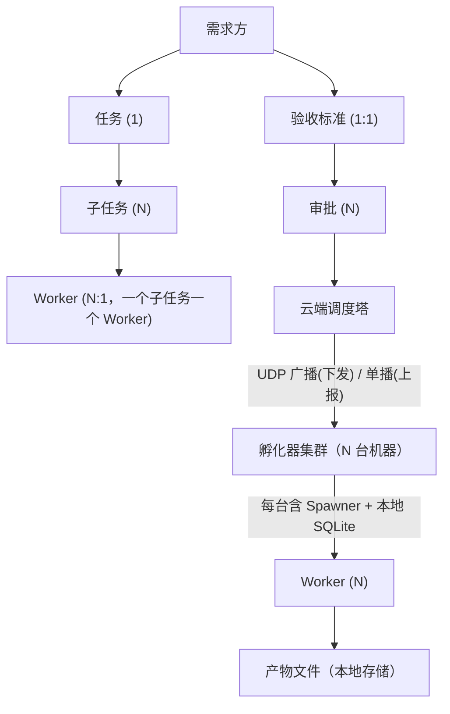
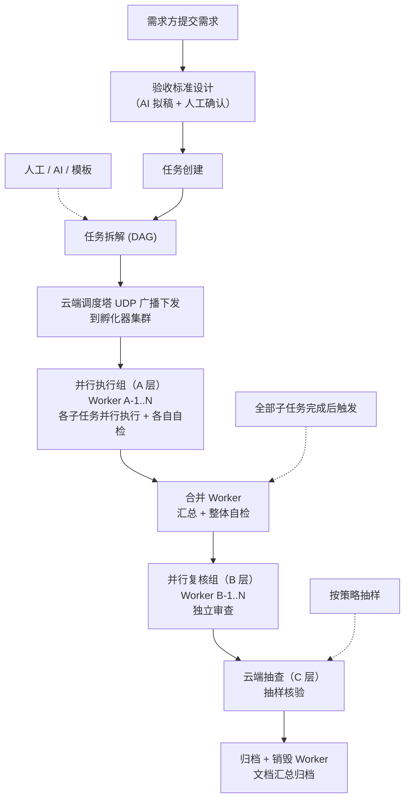
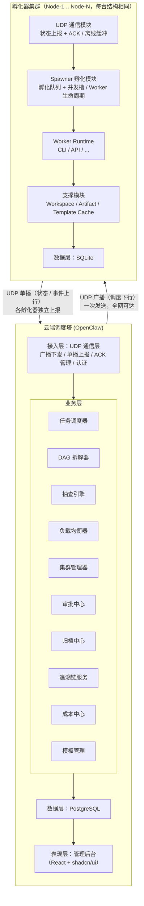
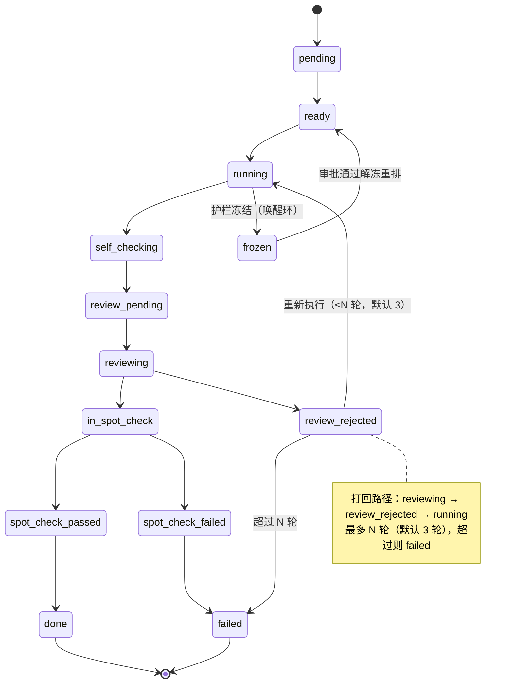

# MACS 多 Agent 协作执行系统 · 技术设计方案 V3.0

> **MACS** — Multi-Agent Cooperative System
> 分布式蜂巢 · UDP 广播调度 · 三层质量保障 · 文档驱动归档 · **全链路统一 Agent 协议**

---

## 一、文档信息 【全员】

| 项目 | 内容 |
| --- | --- |
| 文档名称 | MACS 多 Agent 协作执行系统 · 技术设计方案 |
| 文档版本 | V3.5 |
| 编写日期 | 2026-10-10（V3.0/V3.1 更新于 2026-11-08） |
| 版本说明 | V3.0：新增**全链路统一 Agent 通信协议**（§6.4.13），支持 AutoGen/LangChain/CrewAI/LlamaIndex 等所有 OpenClaw 同类平台；扩展 UDP 消息类型与事件模型实现跨平台全链路互通；新增统一遥测监控指标体系（§6.4.13.4） |
| 文档类型 | 系统技术设计（架构级） |
| 项目阶段 | 技术设计 |
| 状态 | 草稿 |
| 基于模板 | SOA Requirement Design Template V2.0（适配系统级设计） |

**agent 阅读指引**：
实施类 agent 只读以下章节即可理解系统契约——
`三、需求分析`（3.3 范围三态 / 3.4 硬约束 / 3.5 名词表 / 3.6 工程环境）、
`五、总体设计`（5.3 与现有系统的关系）、
`六、详细设计`（全部，6.4 伪代码为单一事实源）、
`七、模块交付清单`、
`八、数据库设计`、
`十、兼容性与配置开关`（10.1 不变量 / 10.3 配置开关）、
`十一、异常与边界处理`、
`十二、测试与验收`、
`附录 A / B`。

**agent 行为规则**：
1. 超出 3.3 范围与第七章交付清单的任何改动 = 违约，必须先停下回报；
2. 实际实现与 6.4 伪代码、附录 B 接口契约不符时，停下回报等待裁决，**禁止按猜测修改设计**；
3. 契约章节与管理章节冲突时以契约章节为准并回报修订；任何口径疑问以 6.4 伪代码为唯一事实源。

---

## 二、执行摘要 【决策】

| | 一句话 |
| --- | --- |
| **问题** | 现有 Agent 系统为单实例串行执行，任务吞吐低，质量依赖人工评审，无法应对规模化自动化需求 |
| **根因** | 缺乏任务拆解与并行调度能力、Worker 常驻资源浪费、无系统化质量保障机制 |
| **方案** | 云端调度塔 + 分布式孵化器集群，UDP 广播调度 + DAG 并行 + 三层质量保障，实现高可靠的多 Agent 协作 |
| **收益** | 多孵化器水平扩展；UDP 广播调度效率高（一次下发全集群感知）；三层质量保障降低人工评审成本 |
| **成本** | 约 12 人月（4.5 人 × 约 12 周）；分 5 个里程碑交付 |
| **主要风险** | UDP 不可靠性（丢包/乱序）—— 可回退：ACK 确认 + 重传机制 + 关键消息走 TCP 兜底 |
| **结论** | ✅ 建议立项，按 M1→M5 里程碑渐进交付 |

### 2.1 可行性快照

| 维度 | 结论 | 关键依据 |
| --- | --- | --- |
| 业务可行性 | ✅ | 推模型 + 蜂巢模式在 SLAW 中已验证可行，MACS 是其升级版 |
| 技术可行性 | ✅ | Node.js + PostgreSQL + SQLite，技术栈成熟；无不可逾越的技术难点 |
| 资源可行性 | ⚠️ | 需要 4.5 人团队；Agent 适配器依赖外部 CLI/API 工具可用性 |

---

## 三、需求分析 【决策 + 契约】

### 3.1 需求背景

**现状**：
- 单 Agent 串行执行任务，大任务耗时长
- Agent 常驻进程，资源利用率低（空闲时也占内存）
- 产出质量依赖人工评审，规模化后人力跟不上
- 企业内网部署困难（NAT/防火墙导致云端无法直接连本地）

**缺口**：
- 缺任务拆解与并行调度能力
- 缺系统化的质量保障体系
- 缺 NAT 友好的通信方案
- 缺知识沉淀与交接文档机制

### 3.2 需求目标与成功标准

核心目标：构建一套"云端调度塔 + 分布式孵化器集群"的多 Agent 协作系统，支持 UDP 广播调度、任务拆解并行执行、三层质量保障和文档驱动归档。

| 指标 | 目标 |
| --- | --- |
| 集群规模 | 支持 100+ 孵化器节点组成执行集群 |
| 并行效率 | 4 并发 Worker/孵化器 × N 孵化器，水平扩展 |
| 调度延迟 | UDP 广播调度消息到达所有孵化器 ≤ 10ms（内网） |
| 质量漏检率 | 三层质量保障后，严重缺陷漏检率 ≤ 1% |
| 离线容错 | 断网 14 天内数据零丢失；恢复后自动同步 |
| Worker 存活率 | Worker 超时/异常自动销毁率 100%，无僵尸进程 |
| 部署复杂度 | 孵化器零配置启动（只需配置调度塔广播地址 + 端口） |

### 3.3 实现范围（三态）【契约】

| 范围 | 说明 |
| --- | --- |
| ✅ **本次做** | UDP 广播调度 + ACK 确认机制；云端任务调度 + DAG 并行 + 全局负载均衡；分布式孵化器 + Worker 生命周期管理；三层质量保障（自检/复核/抽查）；追溯链防篡改；文档归档；统一审批门控；离线缓冲；成本记账；CLI + API 适配器 |
| ❌ **本次不做** | TCP 兜底通道（P1，默认 UDP+ACK 足够）；AI 自动任务拆解（先用人工/模板拆解）；模板市场（先用本地模板）；多租户（单租户起步）；浏览器适配器（P2）；MCP 适配器（P2）；跨公网部署（纯内网） |
| 🔜 **后续迭代** | Planner Worker AI 拆解；Agent 模板市场；多租户隔离；TCP 兜底通道（跨公网）；Browser/MCP 适配器；移动端管理后台；跨网段/跨公网支持 |

### 3.4 设计原则与硬约束 【契约】

**设计原则**：
- 云端不碰业务数据 — 云端只存元数据和报告，产物文件留在本地
- 无状态 Worker，有状态任务 — Worker 用完即毁，任务状态持久化在数据库
- 失败是常态 — 每个子任务独立失败重试，不影响其他并行子任务
- 默认隔离，可选共享 — 工作区默认独立，共享作为高级选项
- 可观测优先 — 每一步都有追溯记录，状态变更都有日志
- 渐进式复杂度 — 单任务模式最简单，并行模式按需开启

**硬约束（agent 行为红线）**：
- **禁止**云端存储任何业务产物文件（代码、文档、配置等），只存元数据和结构化报告
- **禁止**Worker 常驻 — 任务完成/失败后必须销毁，TTL 超时强制销毁
- **必须**保证每个子任务的失败不影响其他并行子任务（故障隔离）
- **必须**支持离线模式 — 调度塔不可达时，孵化器本地任务继续执行，数据暂存待同步
- **必须**幂等 — 同一消息重放、同一事件重发，不产生重复效果
- **必须** UDP 广播 + ACK 确认机制 — 关键调度消息必须收到 ACK，未确认则重传
- **禁止**孵化器之间直接通信 — 所有调度和同步都通过调度塔中转
- 密钥 / API Key 等敏感信息**禁止**出现在日志、文档与提交信息中

### 3.5 名词缩写与术语表

| 名词 | 大白话 |
| --- | --- |
| MACS | Multi-Agent Cooperative System，本系统的名字 |
| OpenClaw | 云端调度塔，MACS 的云端大脑，负责任务调度和质量管控 |
| 孵化器 (Incubator) | 部署在单机上的 Worker 孵化节点，负责本机 Worker 的生命周期管理 |
| 孵化器集群 | 多台机器上的孵化器组成的执行集群，统一由调度塔管理 |
| Worker | 按需孵化的 Agent 执行单元，用完即毁 |
| Spawner | 孵化器中的孵化模块，负责 Worker 进程的创建和销毁 |
| UDP 广播 | 调度塔通过 UDP 广播地址向所有孵化器下发调度消息，一次发送全网可达 |
| UDP 单播 | 孵化器通过 UDP 单播向调度塔上报状态和事件 |
| 子任务 (Subtask) | 父任务拆解后的最小执行单元，可并行 |
| DAG | Directed Acyclic Graph，有向无环图，描述子任务间的依赖关系 |
| 蜂巢模式 | Worker 按需孵化、用完即毁的生命周期管理模式 |
| Merger | 合并 Worker，所有子任务完成后负责汇总结果 |
| 三层质量保障 | 自检（Worker 自查）→ 复核（另一 Worker 独立查）→ 抽查（云端抽样查） |
| 追溯链 | 每个产物的指纹链，用于防篡改和审计 |
| 交接文档 | Worker 完成后产出的 markdown 文档，包含设计方案、流程图、待办等 |
| 并发槽 | 每个孵化器控制本机同时运行的 Worker 数量，防止资源耗尽 |
| 负载均衡 | 调度塔根据各孵化器的资源状况，将任务分配到最合适的孵化器 |
| ACK 确认 | 孵化器收到广播消息后回复确认，保证调度消息可靠送达 |

### 3.6 工程与自验环境 【契约】

| 项 | 内容 |
| --- | --- |
| 涉及仓库 | 新建 `macs-tower`（云端调度塔）、`macs-incubator`（孵化器节点）、`macs-tower-web`（管理后台）、`macs-dsh-monitor`（DSH 监控终端插件） |
| 技术栈与关键版本 | **Go 1.22+（服务端三仓：tower / incubator / cmdterm，V3.6 定版）**；标准库 `net` UDP 通信层 + `net/http` 管理 API；PostgreSQL 15+（云端，可选）；SQLite 3（缺省降级）；macs-tower-web 保持 React+TS，macs-dsh-monitor 保持 Ink/TS（harness 插件生态） |
| 本地启动 / 调试方式 | 服务端：`go run ./cmd/<tower|incubator|cmdterm>`（V3.6）；前端/终端：`npm run dev`；孵化器需配置调度塔广播地址 |
| 自验命令基线 | 服务端：`go vet ./...` + `go test ./...` + `go build ./...`（V3.6）；前端/终端：`npm run lint` + `npm run test` + `npm run build`（任务书 Verify 的默认依据） |
| 依赖服务与 mock 方式 | PostgreSQL（可用 Docker 起本地实例）；Agent CLI（如 claude-cli 需本机安装）；UDP 端口可用 |

---

## 四、业务与流程设计 【决策 + 评审】

### 4.1 系统关系模型



关键规则：
- 一个任务可拆成 N 个子任务，子任务间有 DAG 依赖关系
- 一个子任务对应一个 Worker（执行/复核各一个）
- 一个孵化器（每台机器一个）可同时运行多个 Worker（受本机 `max_workers` 上限限制）
- 多个孵化器挂载到同一调度塔，调度塔通过 UDP 广播一次性向所有孵化器下发调度消息
- 产物文件只存在本地，云端只存元数据和指纹

### 4.2 主流程



失败分支引用：
- 子任务执行失败 → E01（子任务独立失败与重试）
- Worker 超时/崩溃 → E02（Worker 异常销毁与重试）
- 调度塔不可达 → E03（离线缓冲与恢复）
- 复核不通过 → E04（复核打回与修复循环）
- 抽查不通过 → E05（抽查升级路径）
- 指纹校验不通过 → E06（追溯链断裂处置）

### 4.3 特殊业务场景

| 场景 | 规则 |
| --- | --- |
| 单任务（无需并行） | 不拆子任务，直接一个 Worker 执行，跳过合并阶段 |
| 部分子任务失败 | 父任务进入 `partial_failure` 状态，成功的子任务不回滚，失败的可重试；是否继续合并由策略决定 |
| 共享工作区 | 同一大代码仓的多模块开发可启用共享工作区，需文件锁保护 |
| 高优先级任务 | 可抢占低优先级 Worker 的槽位（可配置，默认关闭） |
| 新孵化器信任建立期 | 新注册孵化器承接的前 10 个任务全部抽查，通过后进入正常抽样比例 |

---

## 五、总体设计 【评审 + 契约(5.3)】

### 5.1 方案选型与设计思路

**1. UDP 广播 vs HTTPS 心跳**
- 结论：UDP 广播（调度下行） + UDP 单播（状态上行）
- 理由：内网环境下广播效率极高，一次发送所有孵化器同时收到；调度延迟从心跳周期级（秒级）降到毫秒级；无连接开销，支持大规模节点
- 代价：UDP 不可靠（丢包/乱序）；需要 ACK + 重传机制保证可靠性；纯内网场景，跨公网不适用
- 补充：关键消息走 ACK 确认 + 超时重传；极端情况预留 TCP 兜底通道（后续迭代）

**2. 分布式多孵化器 vs 单 DSH 实例**
- 结论：分布式多孵化器集群
- 理由：水平扩展，加机器就能加算力；负载均衡，任务自动分配到最合适的机器；故障隔离，一台机器挂了不影响其他
- 代价：调度复杂度上升（全局资源视图 + 负载均衡策略）；需要统一的集群管理

**3. 蜂巢模式 vs 常驻 Worker**
- 结论：蜂巢模式（按需孵化 + 用完即毁）
- 理由：资源利用率高（空闲不占资源）；隔离性好（每次干净环境）；安全（用完销毁无残留）
- 代价：启动有开销；上下文需要持久化和恢复

**4. 三层质量保障 vs 单次复核**
- 结论：三层（自检 + 复核 + 抽查）
- 理由：自检快但有偏差、复核独立但成本高、抽查权威但覆盖低，三层互补
- 代价：流程长，环节多；由自动化抵消人力成本

**5. SQLite 默认 vs 直接 PostgreSQL**
- 结论：孵化器本地默认 SQLite，高并发时可切 PG
- 理由：零部署、开箱即用；单孵化器并发不高时足够
- 代价：切换需要迁移；由 schema 兼容设计降低切换成本

### 5.2 架构与模块划分



> 表现层（管理后台）的界面级设计详见独立文档：《UI 交互与运维监控设计 V1.0》——涵盖运维（Operations）/ 监控（Observability）/ 交互（Interaction）三平面、页面清单、SSE 数据通道与角色权限矩阵。

### 5.3 与现有系统的关系 【契约】

MACS 为全新系统，无存量代码改造。

| 类型 | 对象 | 说明 |
| --- | --- | --- |
| 复用 | SLAW 协议设计思路 | 心跳/反向通道、Checkout 机制的设计思路参考 SLAW；MACS 在其上改造为 UDP 广播 + ACK，代码全部重写 |
| 复用 | 外部 Agent 工具 | claude-cli、OpenAI API 等外部 Agent 执行工具作为适配器接入 |
| 改造 | 无 | MACS 为全新项目，无存量代码改造 |
| 新增 | 全部 | 两个新仓库（macs-tower / macs-incubator）+ 全部新代码 |
| 冻结 | 不适用 | 无存量系统需要冻结 |

---

## 六、详细设计 【契约】

### 6.1 功能模块清单

| 功能模块 | 优先级 | 所属层级 | 实现方式 | 关键逻辑 |
| --- | --- | --- | --- | --- |
| FR-01 孵化器注册与认证 | P0 | 云端 | 注册握手 + 一次性密钥 | 注册 → 密钥仅返回一次（云端只存指纹 + Argon2 哈希，见 6.2.2）→ 加入广播组 |
| FR-02 UDP 广播调度 | P0 | 云端 | UDP 广播 + ACK 收集 | 一次广播全网可达 + 超时重传 |
| FR-03 UDP 单播上报 | P0 | 孵化器 | UDP 单播 + 幂等键 | 状态/事件上报 + 幂等去重 |
| FR-04 任务创建与管理 | P0 | 云端 | CRUD + 状态机 | 状态迁移合法性校验 |
| FR-05 任务拆解与 DAG | P1 | 云端 | 子任务表 + 依赖表 | 依赖环检测 + 拓扑排序 |
| FR-06 DAG 调度器 | P1 | 云端 | 就绪队列 + 并发分配 | 依赖满足检测 + 优先级调度 |
| FR-07 全局负载均衡 | P1 | 云端 | 资源评分 + 孵化器选择 | 按剩余槽位 + 资源水位打分选择 |
| FR-08 集群管理 | P1 | 云端 | 节点注册表 + 健康探测 | 节点上下线 + 容量变更 + 上报超时 |
| FR-09 任务下发与对账 | P0 | 两端 | 广播指令 + 全量对账 | 增量优先 + 对账兜底 |
| FR-10 Worker 孵化与销毁 | P0 | 孵化器 | Spawner + 进程管理 | 并发槽控制 + TTL 超时销毁 |
| FR-11 Worker 适配器 | P0 | 孵化器 | 适配器模式 + 协议驱动 | 统一接口；内置 openai_compatible / anthropic 协议驱动（见 6.4.9） |
| FR-12 工作区管理 | P0 | 孵化器 | 文件系统 + SQLite | 独立/共享两种模式 |
| FR-13 自检报告 | P0 | 孵化器 | 结构化 JSON 报告 | 验收项逐项核验 |
| FR-14 独立复核 | P1 | 孵化器 | 独立 Worker 审查 | 指纹比对 + 盲点互补 |
| FR-15 合并 Worker | P1 | 孵化器 | Merger 专用模板 | 多策略合并 + 冲突检测 |
| FR-16 云端抽查引擎 | P1 | 云端 | 抽样 + 重试 | 多种抽样策略 + 指数退避 |
| FR-17 追溯链 | P0 | 两端 | 指纹链 + 双端存储 | SHA-256 链式指纹 + 对账 |
| FR-18 文档归档 | P1 | 两端 | Markdown 模板 + 云端汇总 | 标准模板 + 检索 |
| FR-19 审批中心 | P1 | 云端 | 统一审批模型 | 多场景 + 超时 + 通知 |
| FR-20 离线缓冲 | P0 | 孵化器 | outbox 队列 | 指数退避 + 幂等键 |
| FR-21 成本记账 | P2 | 两端 | 本地记账 + 云端汇总 | 多级预算（任务/孵化器/模板/全局）+ 塔侧上界收紧 + 自动暂停（见 6.4.11） |
| FR-22 Agent 模板管理 | P1 | 两端 | agent.md + 版本管理 | 云端下发 + 本地缓存 |
| FR-23 管理后台 | P1 | 云端 | React + shadcn/ui | 运维/监控/交互三平面（详见《UI 交互与运维监控设计 V1.0》） |
| FR-24 运行时可靠性护栏 | P1 | 两端 | 断路器 + 静默下岗 + 唤醒环检测 + 有界上下文 + done 验收门 | 防失控消耗，唯一口径见 6.4.10 |
| FR-25 插件化适配器加载 | P1 | 孵化器 | 独立进程插件 + 能力门控 + 热重载 | 第三方适配器/连接器隔离接入，见 6.4.12 |

### 6.2 接口设计

#### 6.2.1 通用约定

- 传输协议：**UDP socket（Node.js `dgram`）**，消息体为 JSON（UTF-8）
- 下行（调度）：调度塔 → 广播地址 `255.255.255.255:<port>` 或子网广播地址
- 上行（上报）：孵化器 → 调度塔单播地址 `<tower_ip>:<port>`
- 认证：消息体携带 `incubator_id` + `auth_token`，服务端校验；可选 HMAC 签名防篡改。`auth_token` 注册时一次性下发，云端只存 SHA-256 指纹 + Argon2 哈希（见 6.2.2 凭据安全约定）
- 消息信封（所有 UDP 消息统一格式）：

```json
{
  "msg_id": "uuid",
  "type": "dispatch | report | ack | heartbeat | register",
  "incubator_id": "uuid",
  "timestamp": "2026-10-10T10:00:00Z",
  "seq": 1024,
  "payload": {},
  "signature": "hmac-sha256:..."
}
```

- 可靠性：**关键消息（dispatch/register）必须 ACK**；未收到 ACK 则按固定退避 `200ms/500ms/1s` 重传，最多 3 次（完整口径见 **6.4.8**）
- 幂等：所有消息按 `msg_id` 去重；上报事件按 `idempotency_key` 去重
- 最大报文：UDP 单包 ≤ 1200 字节（避免 IP 分片）；超长内容拆分或改走对账拉取
- 时间格式：ISO 8601（UTC），如 `2026-10-10T10:00:00Z`

#### 6.2.2 孵化器注册

**消息类型：`register`（孵化器 → 调度塔，单播）**

| | |
| --- | --- |
| 用途 | 孵化器首次注册，加入广播组 |
| 必填字段 | `name`（节点名）；`version`（孵化器版本）；`max_workers`（本机最大并发 Worker 数）；`capabilities`（支持的适配器列表）；`resource_profile`（CPU 核数/内存/磁盘） |
| 响应 | 调度塔回 `register_ack`：`incubator_id`；`auth_token`（仅本次响应一次性返回，之后不再下发）；`broadcast_group`（广播组标识） |
| 可靠性 | 未收到 `register_ack` 则每 5s 重发，最多 12 次；仍失败则输出诊断日志 |
| 幂等 | 同一 `machine_fingerprint` 重复注册返回已有 `incubator_id`（更新配置，不新建） |

注册消息体：

```json
{
  "msg_id": "uuid",
  "type": "register",
  "timestamp": "2026-10-10T10:00:00Z",
  "payload": {
    "name": "worker-node-01",
    "version": "1.0.0",
    "machine_fingerprint": "sha256:...",
    "max_workers": 4,
    "resource_profile": {
      "cpu_cores": 16,
      "memory_mb": 32768,
      "disk_free_mb": 204800,
      "gpu": "none"
    },
    "capabilities": ["claude-cli", "openai-api"]
  }
}
```

**凭据安全约定**：

- `auth_token` 仅在 `register_ack` 中一次性返回；云端入库只存 SHA-256 指纹（索引查找）+ Argon2 哈希（校验），不存明文；泄露时吊销立即失效（13.3 应急）
- 孵化器本地的模型凭据（OpenAI / Anthropic API Key 等）加密存储于本地凭据表，**不写入 agent.md 模板、不进入 dispatch payload、不注入 Worker 上下文**；由适配器驱动层（6.4.9）在发起请求时注入
- Worker 日志与交接文档输出前按凭据形态脱敏；发现密钥形态字符串即截断并记录护栏事件

#### 6.2.3 资源与状态上报

**消息类型：`heartbeat`（孵化器 → 调度塔，周期单播）**

| | |
| --- | --- |
| 用途 | 上报本机资源水位与 Worker 数量上限，供全局负载均衡决策 |
| 频率 | 默认 30s 一次（可配置）；有状态变更时立即触发一次 `report` |
| 关键字段 | `max_workers`（本机并发上限，随机器配置变化可动态调整）；`active_workers`（当前运行数）；`available_slots`（剩余槽位）；`load`（CPU/内存/磁盘水位）；`pending_subtasks`（本地待执行数） |

上报消息体：

```json
{
  "msg_id": "uuid",
  "type": "heartbeat",
  "incubator_id": "uuid",
  "auth_token": "xxx",
  "timestamp": "2026-10-10T10:00:00Z",
  "seq": 1024,
  "payload": {
    "version": "1.0.0",
    "capacity": {
      "max_workers": 4,
      "active_workers": 3,
      "available_slots": 1
    },
    "load": {
      "cpu_usage": 0.45,
      "memory_usage": 0.62,
      "disk_free_mb": 102400
    },
    "stats": {
      "pending_subtasks": 5,
      "outbox_count": 12,
      "uptime_sec": 86400
    },
    "status_updates": [
      {
        "subtask_id": "uuid",
        "status": "completed",
        "fingerprint": "sha256:abc123...",
        "finished_at": "2026-10-10T09:58:00Z"
      }
    ]
  }
}
```

> **说明**：调度塔维护每个孵化器的 `max_workers` 与 `available_slots`，作为负载均衡打分依据（见 6.4.7）。

#### 6.2.4 UDP 广播调度下发

**消息类型：`dispatch`（调度塔 → 广播地址，广播）**

| | |
| --- | --- |
| 用途 | 一次广播，所有孵化器同时收到；**带目标标识的定向派发** |
| 广播 vs 定向 | 广播可携带**全局通知**（配置更新、模板更新）和**定向任务**（含 `target_incubator_id`，非目标节点直接忽略） |
| 可靠性 | 目标孵化器必须回 `ack`；调度塔未收到 ACK 则按 `200ms/500ms/1s` 退避重传，最多 3 次（总窗口 1.7s、超时阈值 2s）；仍失败转 `spawn_reassign`（重新选择孵化器）。**完整 ACK 口径见 6.4.8** |
| 幂等 | 孵化器按 `msg_id` 去重，重复消息直接回 ACK 不重复执行 |

广播消息体：

```json
{
  "msg_id": "uuid",
  "type": "dispatch",
  "timestamp": "2026-10-10T10:00:00Z",
  "payload": {
    "dispatch_mode": "targeted",
    "target_incubator_id": "uuid",
    "task_id": "uuid",
    "task_title": "xxx",
    "subtasks": [
      {
        "id": "uuid",
        "title": "子任务1",
        "template_id": "xxx",
        "worker_role": "executor",
        "depends_on": [],
        "acceptance_criteria": []
      }
    ]
  }
}
```

全广播通知（无 target，所有节点处理）：

```json
{
  "msg_id": "uuid",
  "type": "dispatch",
  "timestamp": "2026-10-10T10:00:00Z",
  "payload": {
    "dispatch_mode": "broadcast",
    "notice_type": "template_updated",
    "template_id": "xxx",
    "new_version": "2.1.0"
  }
}
```

ACK 回应（孵化器 → 调度塔，单播）：

```json
{
  "msg_id": "new-uuid",
  "type": "ack",
  "incubator_id": "uuid",
  "auth_token": "xxx",
  "timestamp": "2026-10-10T10:00:00.050Z",
  "payload": {
    "ack_for": "原 dispatch 的 msg_id",
    "status": "accepted"
  }
}
```

#### 6.2.5 批量事件上报

**消息类型：`report`（孵化器 → 调度塔，单播）**

| | |
| --- | --- |
| 用途 | 批量上报事件（报告、文档、成本等） |
| 幂等 | 每个事件有 `idempotency_key`，服务端去重 |
| 批量限制 | 单包最多 10 个事件（保持 ≤1200 字节）；超出则拆包或改走对账拉取 |
| 可靠性 | 调度塔回 `report_ack`（含已接收的 idempotency_key 列表） |

上报消息体：

```json
{
  "msg_id": "uuid",
  "type": "report",
  "incubator_id": "uuid",
  "auth_token": "xxx",
  "timestamp": "2026-10-10T10:00:00Z",
  "payload": {
    "events": [
      {
        "idempotency_key": "uuid",
        "event_type": "subtask_result",
        "payload": {
          "subtask_id": "uuid",
          "status": "completed",
          "fingerprint": "sha256:..."
        },
        "occurred_at": "2026-10-10T09:58:00Z"
      }
    ]
  }
}
```

响应（`report_ack`）：

```json
{
  "msg_id": "new-uuid",
  "type": "ack",
  "timestamp": "2026-10-10T10:00:00.050Z",
  "payload": {
    "ack_for": "原 report 的 msg_id",
    "processed": 10,
    "failed": 0,
    "accepted_keys": ["uuid1", "uuid2"]
  }
}
```

#### 6.2.6 上行事件类型清单

| 事件类型 | 优先级 | payload 关键字段 |
| --- | --- | --- |
| `subtask_status` | 高 | subtask_id, status, updated_at |
| `subtask_result` | 高 | subtask_id, status, fingerprint, cost_cents |
| `driver_mismatch` | 高 | subtask_id, required_driver, driver_version_range, local_drivers（见 6.4.9） |
| `self_check_report` | 高 | subtask_id, report_id, status, score, items |
| `review_report` | 高 | subtask_id, report_id, status, score, items |
| `merge_result` | 高 | task_id, status, conflict_count, fingerprint |
| `cost_record` | 中 | task_id, subtask_id, amount_cents, model |
| `handoff_doc` | 中 | task_id, subtask_id, doc_type, title, content_ref |
| `trace_record` | 低 | task_id, subtask_id, fingerprint, from_kind, to_kind |
| `driver_mismatch` | 高 | subtask_id, required_driver, required_version, local_drivers（不满足协议能力，见 6.4.9） |

#### 6.2.7 大内容传输（对账拉取）

**方式：孵化器 → 调度塔 单播请求（请求-响应）**

UDP 单包不适合传大内容（如完整交接文档、大报告）。约定：
- 超过 1200 字节的事件只上报**引用**（`content_ref`）+ 摘要 + 指纹
- 调度塔需要完整内容时，单播发送 `fetch_request`，孵化器回 `fetch_response`（分片：`chunk_index` / `chunk_total`）
- 分片传输带 ACK；接收方按 `msg_id + chunk_index` 重组

**消息类型：`fetch_request`（调度塔 → 孵化器，单播）**

```json
{
  "msg_id": "uuid",
  "type": "fetch_request",
  "timestamp": "2026-10-10T10:00:00Z",
  "payload": {
    "resource_type": "handoff_doc | task_detail | template | artifact_manifest",
    "resource_id": "uuid"
  }
}
```

#### 6.2.8 模板下发（下行）

**方式：广播通知 + 按需拉取**

- 模板更新时，调度塔广播 `notice_type: template_updated`（含 `template_id` + `new_version`）
- 各孵化器收到后，按需单播 `fetch_request`（`resource_type: template`）拉取完整内容
- 拉取后本地缓存，供 Worker 孵化时加载

### 6.3 数据模型设计

详见独立文档：《数据库存储设计 V2.0》。本节为核心要点摘要。

**全局口径**：
- 所有 ID 使用 UUID v4
- 时间统一 UTC，字段后缀 `_at`
- 金额单位：分（整数），字段后缀 `_cents`
- 指纹算法：SHA-256，格式 `sha256:<hex>`
- 多租户：本期不实现，schema 中预留 `tenant_id` 字段但始终为 NULL

**核心表清单（云端）**：

| 表 | 关键约束 | 说明 |
| --- | --- | --- |
| `incubators` | uk(incubator_key_hash) | 注册到调度塔的孵化器（每台机器一个） |
| `incubator_resources` | idx(incubator_id, reported_at) | 孵化器资源快照（CPU/内存/磁盘/GPU） |
| `tasks` | idx(incubator_id, status) | 任务主表（父任务 / 单任务） |
| `subtasks` | idx(task_id), idx(status) | 子任务表 |
| `subtask_dependencies` | uk(subtask_id, depends_on_id) | DAG 依赖关系 |
| `parallel_groups` | idx(task_id) | 并行执行组 |
| `approvals` | idx(task_id, status) | 审批记录 |
| `spot_checks` | idx(task_id, status) | 抽查记录 |
| `origin_traces` | idx(task_id, fingerprint) | 追溯链 |
| `archive_documents` | idx(task_id, is_latest) | 归档文档 |
| `agent_templates` | uk(name, version) | Agent 模板 |
| `cost_records` | idx(incubator_id, recorded_at) | 成本记录 |
| `dispatch_log` | idx(incubator_id, dispatched_at) | UDP 调度下发日志（含 ACK 状态、重传次数） |

**核心表清单（本地）**：

| 表 | 关键约束 | 说明 |
| --- | --- | --- |
| `incubator_config` | id=1 单例 | 本机孵化器配置（含 `max_workers` 上限） |
| `incubator_metrics` | idx(reported_at) | 本机资源指标历史 |
| `tasks` | pk(id) | 任务本地副本 |
| `subtasks` | idx(task_id), idx(status) | 子任务本地副本 |
| `workers` | idx(status), idx(subtask_id) | Worker 生命周期 |
| `artifacts` | idx(fingerprint) | 产物文件元数据 |
| `self_check_reports` | idx(worker_id) | 自检报告 |
| `review_reports` | idx(worker_id) | 审查报告 |
| `merge_results` | idx(task_id) | 合并结果 |
| `handoff_documents` | idx(synced_to_cloud) | 交接文档（待同步） |
| `spawn_queue` | idx(priority) | 待孵化队列 |
| `sync_outbox` | idx(status, priority) | 离线缓冲队列 |
| `agent_templates` | uk(name, version) | 模板本地缓存 |
| `dispatch_inbox` | uk(msg_id) | 已接收的 UDP 调度消息（幂等去重） |

### 6.4 核心算法与规则（单一事实源）

#### 6.4.1 DAG 调度算法

```
# scheduleReadySubtasks(task_id):
#   输入：父任务 ID
#   输出：新变为 ready 的子任务列表

all_subtasks = getSubtasksByTaskId(task_id)
ready_list = []

for subtask in all_subtasks where status == 'pending':
    deps = getDependencies(subtask.id)
    all_completed = all(
        getSubtask(dep.depends_on_id).status == 'completed'
        for dep in deps
    )
    if all_completed and len(deps) > 0:
        subtask.status = 'ready'
        subtask.ready_at = now()
        updateSubtask(subtask)
        ready_list.append(subtask)
        # 加入 spawn_queue（按优先级）
        addToSpawnQueue(subtask.id, task_id, priority=subtask.priority)

return ready_list
```

#### 6.4.2 Worker 孵化与并发槽控制

```
# trySpawnFromQueue(incubator_id):
#   尝试从就绪队列孵化 Worker，受本机并发槽限制
#   返回：本次孵化的 Worker 数量

incubator = getIncubator(incubator_id)
available_slots = incubator.max_workers - incubator.active_workers

if available_slots <= 0:
    return 0

# 按优先级取 N 个就绪子任务
pending = getSpawnQueueTopN(incubator_id, available_slots)
spawned_count = 0

for item in pending:
    subtask = getSubtask(item.subtask_id)
    template = getTemplate(subtask.template_id)

    # 创建工作区
    workspace_id = createWorkspace(subtask.task_id, subtask.id)

    # 启动 Worker（通过适配器）
    worker_id = spawnWorker({
        subtask_id: subtask.id,
        task_id: subtask.task_id,
        template_id: template.id,
        workspace_id: workspace_id,
        role: subtask.worker_role
    })

    subtask.status = 'running'
    subtask.started_at = now()
    subtask.worker_id = worker_id
    updateSubtask(subtask)

    incubator.active_workers += 1
    updateIncubator(incubator)

    spawned_count += 1

    # 从队列移除
    removeFromSpawnQueue(item.id)

return spawned_count
```

#### 6.4.3 UDP 上报处理与调度下发去重

```
# handleReport(incubator_id, report_packet):
#   处理孵化器上报（UDP 单播上行），返回 ACK

incubator = getIncubator(incubator_id)

# 1. 幂等去重：同一 msg_id 只处理一次
if existsInDispatchInbox(report_packet.msg_id):
    return buildAck(report_packet.msg_id, status='duplicate')

# 2. 更新孵化器存活与资源状态
incubator.last_seen_at = now()
incubator.status = 'online'
incubator.capacity = report_packet.payload.capacity   # max_workers/active_workers/available_slots
incubator.resource_profile = report_packet.payload.resource  # CPU/内存/磁盘/GPU
recordIncubatorResource(incubator.id, incubator.resource_profile)
updateIncubator(incubator)

# 3. 处理子任务状态上报
for update in report_packet.payload.subtask_updates:
    subtask = getSubtask(update.subtask_id)
    if subtask.status != update.status:
        validateTransition(subtask.status, update.status)  # 状态机合法性校验，非法走 E14
        subtask.status = update.status
        updateSubtask(subtask)

        # 子任务终态 → 释放并发槽 + 触发下游
        if isTerminalStatus(update.status):
            incubator.active_workers = max(0, incubator.active_workers - 1)
            updateIncubator(incubator)
            scheduleReadySubtasks(subtask.task_id)
            if allSubtasksCompleted(subtask.task_id):
                triggerMerge(subtask.task_id)

# 4. 记录接收幂等键
markDispatchInbox(report_packet.msg_id)

return buildAck(report_packet.msg_id, status='ok')
```

```
# dispatchToIncubators(subtask, candidates):
#   UDP 调度下发（targeted 单播 / broadcast 广播），带 ACK 与重传
#   见 6.4.7 选择策略产出 candidates

for incubator in candidates:
    packet = buildDispatch({
        msg_id: uuid(),
        type: 'dispatch',
        target_incubator_id: incubator.id,   # broadcast 模式为 null
        dispatch_mode: determineMode(incubator, candidates),  # targeted/broadcast
        payload: { task_id, subtask_id, template_id, deadline, approval_gate }
    })

    sent_at = now()
    sendUdp(packet)                          # 最大 1200 字节
    logDispatch(incubator.id, packet.msg_id, sent_at, status='sent')

    # 等待 ACK（异步）：超时未收到则重传
    # 重传策略：200ms / 500ms / 1s，最多 3 次；仍失败则标记该孵化器不可达
    scheduleAckTimeout(packet.msg_id, retries=3)

    if not waitAck(packet.msg_id, timeout_ms=2000):
        markIncubatorUnreachable(incubator.id)   # 走 E15
        continue

    return incubator.id   # 首个确认的孵化器承接该子任务
```

> 上面 `dispatchToIncubators` / `handleReport` 仅示意主流程；**ACK 的校验、超时退避、广播仲裁、幂等回滚完整口径见 6.4.8**（本节为唯一事实源）。

UDP 下行指令类型全集（取代原"反向通道指令"）：
- `dispatch` — 调度下发（新任务/子任务分配）
- `dispatch_commit` — 广播承接锁定通知（通知其余候选停止应答、不孵化）
- `task_cancelled` — 任务取消
- `task_updated` — 任务定义更新
- `approval_result` — 审批结果
- `template_updated` — Agent 模板更新
- `spot_check_request` — 抽查请求
- `merge_instruction` — 合并指令
- `budget_changed` — 预算变更（含塔侧上界语义：携带 `limit_version` 与各级上限，仅收紧不放宽，见 6.4.11）
- `config_updated` — 配置更新
- `sync_request` — 请求同步指定数据
- `worker_rollback` — 回滚多余 Worker（幂等销毁）

#### 6.4.4 指纹链计算

```
# computeFingerprint(content, parent_fingerprint = null):
#   计算产物指纹
#   - 无父产物时：fp = sha256(content)
#   - 有父产物时：fp = sha256(parent_fingerprint + content)

if parent_fingerprint is null:
    return "sha256:" + sha256_hex(content)
else:
    return "sha256:" + sha256_hex(parent_fingerprint + content)
```

#### 6.4.5 离线缓冲重试策略

```
# getNextRetryDelay(retry_count):
#   指数退避：1min → 2min → 4min → 8min → 16min → 32min → 60min（封顶）
#   最大重试 100 次 ≈ 约 14 天

base_delay_minutes = 1
delay = base_delay_minutes * (2 ** retry_count)
max_delay_minutes = 60  # 封顶 1 小时

return min(delay, max_delay_minutes) * 60  # 返回秒数
```

#### 6.4.6 三层质量保障状态流转



完整路径（全部通过）：`running → self_checking → review_pending → reviewing → in_spot_check → spot_check_passed → done`。
打回路径（复核不通过）：`reviewing → review_rejected → running`（重新执行），最多 N 轮（默认 3 轮），超过则 `failed`。
护栏冻结路径：`running → frozen`（6.4.10 唤醒环检测触发），`guardrail` 审批通过后 `frozen → ready` 解冻重排。

#### 6.4.7 全局负载均衡与孵化器选择

```
# selectIncubator(subtask):
#   为就绪子任务挑选承接的孵化器（全局负载均衡）
#   返回：候选孵化器列表（按评分降序），供 6.4.3 dispatchToIncubators 使用

candidates = []

for inc in listIncubators() where inc.status == 'online':
    # 硬过滤：槽位、能力、亲和性
    if inc.capacity.available_slots <= 0:
        continue
    if not meetsResourceRequirement(inc.resource_profile, subtask.required_resources):
        continue
    if subtask.affinity_tag and subtask.affinity_tag not in inc.tags:
        continue

    # 综合评分（越高越优先）
    #  - 空闲槽位越多越优先（spillover 到资源池）
    #  - 负载率越低越优先（避免热点）
    #  - 已缓存所需模板的加分（减少下发流量）
    #  - 同任务亲和加分（同一父任务的并行子任务尽量分散，避免单机资源争抢）
    idle_score      = inc.capacity.available_slots / max(1, inc.capacity.max_workers)
    load_score      = 1 - clamp(inc.resource_profile.load_avg / inc.resource_profile.cpu_cores, 0, 1)
    template_bonus  = 0.1 if hasTemplateCached(inc.id, subtask.template_id) else 0
    spread_penalty  = -0.15 * countSiblingSubtasksOn(inc.id, subtask.task_id)

    score = 0.45*idle_score + 0.35*load_score + template_bonus + spread_penalty
    candidates.append((inc, score))

# 按评分降序，取前 K 个（默认 K=3）作为候选，逐个尝试下发
sortDescending(candidates, by='score')
return [c.inc for c in candidates[:3]]

# dispatch_mode 判定：
#  - 高优/需精确控制 → targeted（点名单播给评分最高的孵化器）
#  - 普通批量子任务 → broadcast（广播给所有候选，先 ACK 者承接，天然容错）
```

```
# rebalanceTick():
#   周期性全局再平衡（每 30s），缓解孵化器之间负载倾斜

for inc in listIncubators() where inc.status == 'online':
    if inc.resource_profile.load_avg > inc.rebalance_high_watermark:   # 默认 0.85
        # 该孵化器过载：将其 spawn_queue 中"尚未下发"的子任务重新入全局池
        reclaimUndispatched(inc.id)
        markIncubatorOverloaded(inc.id)

# 重新为全局池中未承接的子任务挑选孵化器（走 selectIncubator）
redispatchGlobalPool()
```

#### 6.4.8 UDP 广播 ACK 机制 【契约 · 唯一维护点】

> 本节是 UDP ACK 的**单一事实源**：超时/重传/仲裁/幂等的所有口径在此定义，6.2.1、6.2.4、6.4.3、6.5 及第十一章 E13/E16 均引用本节，禁止散落复述。

**设计目标**：UDP 无连接、可能丢包 / 乱序 / 重复。本机制以"确认 → 重传 → 幂等 → 仲裁"四件套，在不牺牲广播效率的前提下，实现"关键调度消息必达，且绝不重复执行"。

**适用范围（哪些消息需要 ACK）**：

| 消息 | 方向 / 模式 | 是否需 ACK | 语义 |
| --- | --- | --- | --- |
| `dispatch`（targeted） | 下行 单播 | 必须 | 指定孵化器签收并承接 |
| `dispatch`（broadcast，任务分配） | 下行 广播 | 必须 | 先 ACK 者承接（first-ACK-wins） |
| `template_updated` / `config_updated` / `budget_changed`（全局通知） | 下行 广播 | 必须（汇总式） | 所有在线节点确认已收 |
| `task_cancelled` / `task_updated` / `approval_result` / `merge_instruction` / `spot_check_request` | 下行 单播 | 必须 | 定向签收 |
| `register` / `report`（上行） | 上行 单播 | 服务端回 `register_ack` / `report_ack` | 上行到达确认 |
| `heartbeat` | 上行 单播 | 不强制 | 周期性上报天然冗余（连续 N 周期无消息即 E12） |

**统一 ACK 报文**（孵化器 → 调度塔，单播）：

```json
{
  "msg_id": "uuid",
  "type": "ack",
  "incubator_id": "uuid",
  "auth_token": "xxx",
  "seq": 1025,
  "timestamp": "2026-10-10T10:00:00.050Z",
  "payload": {
    "ack_for": "原报文 msg_id",
    "ack_mode": "targeted | broadcast | notice | report | register",
    "status": "accepted | duplicate | rejected",
    "accepted_subtask_id": "uuid",
    "available_slots": 3,
    "reason": "可选：rejected / duplicate 的原因"
  }
}
```

| 字段 | 说明 |
| --- | --- |
| `ack_for` | 被确认的原报文 `msg_id`（关联键，调度塔据此匹配待确认记录） |
| `ack_mode` | 回执类别，决定调度塔走定向 / 广播 / 通知 / 上行的哪条仲裁分支 |
| `status` | `accepted` 已收并承接；`duplicate` 重复消息（已执行过，幂等回执）；`rejected` 拒绝（槽位不足 / 能力不符 / 校验失败） |
| `accepted_subtask_id` | 广播承接时声明本次承接的子任务，用于比对与回滚 |
| `available_slots` | 承接时刻的实时空闲槽位，供仲裁参考 |
| `auth_token` | 服务端校验身份；targeted 模式还须校验 `incubator_id == target_incubator_id` |

**超时与重传模型（唯一口径）**：

- 首次下发后进入确认等待；**首次等待 200ms**，未收到 ACK → 重传第 1 次并**再等 500ms**，未收到 → 重传第 2 次并**再等 1s**，未收到 → 重传第 3 次（末次，不再等待）。
- 即：**最多重传 3 次**，退避序列 `200ms → 500ms → 1s`，**总确认窗口 1.7s、超时阈值取 2s**（含调度与时钟容差）。
- 3 次重传后仍无 ACK → 触发 **E13**，该孵化器标记疑似不可达并转 **E15**。
- 每次（重）传与每次 ACK 均落 `dispatch_log`（`attempt_count` / `last_sent_at` / `status`），供追溯与监控。
- 该退避序列固定（不做指数放大），因为内网 RTT 极低、丢包多为瞬时突发；固定小退避能更快收敛，避免长尾等待。

**ACK 收集与广播仲裁**：

- **定向（targeted）**：只接受 `incubator_id == target_incubator_id` 的 ACK；收到即置 `acked`，同批次其余回执忽略。
- **广播任务分配（broadcast dispatch）**：候选集（6.4.7 取前 K=3）全部收到同一广播包。
  - 调度塔开启**收集窗口（默认 200ms）**：窗口内**以首个合法 ACK 为准**锁定承接者，立即置 `dispatch_log.status='acked'`；
  - 锁定后向**其余候选广播 `dispatch_commit`**（携带 `subtask_id` + 承接者 `incubator_id`），令其停止应答、**不孵化**；
  - 窗口外 / 后到的 ACK 一律置 `duplicate` 并忽略；
  - **同刻竞态**：若多个 ACK 的接收时间戳相同，以 `incubator_id` 字典序最小者承接（确定性仲裁，杜绝双承接）；
  - **重复孵化兜底（E16）**：若因网络延迟导致某节点已孵化多余 Worker，调度塔依据 `dispatch_log` 的承接者权威记录下发 `worker_rollback`，被回滚方**幂等销毁**（未启用共享工作区时直接销毁进程）。
- **全局通知（notice）**：无承接语义、非任务分配。
  - 广播给所有在线节点，调度塔维护"未确认节点集合"，在**汇总窗口（默认 3s）**内收集 ACK；
  - 未确认节点进入重传集合，按 `200ms/500ms/1s` 重传；
  - 3 次后仍未确认：**不直接判不可达**（通知非执行关键路径），记录**投递缺口**并加入"下次心跳 / 对账补发清单"（配置类可经 `sync_request` 或调度对账兜底）；
  - 同一节点累计 N 次（默认 5）通知投递缺口 → 触发 E12 探测该节点。

**上行 ACK（对称可靠性）**：

- `register` / `report` 为上行单播，调度塔处理后回 `register_ack` / `report_ack`。
- **ACK 自身也走 UDP，可能丢**：孵化器未在约定窗口内收到 `report_ack` → 按 6.4.5 退避重发原 `report`；`register_ack` 见 6.2.2（每 5s 重发，最多 12 次）。
- 调度塔以 `dispatch_inbox`（本地 `uk(msg_id)`）与事件 `idempotency_key` 幂等去重；对重复报文**只重发 ACK、不重复产生副作用**。
- 由此形成"下行重传 + 上行重发"的对称闭环：任一侧 ACK 丢失，都由发送方重试收敛，接收方幂等吸收。

**安全与防伪**：

- 每条 ACK 校验 `auth_token`；失败丢弃并记安全审计日志。
- targeted 模式校验 ACK 的 `incubator_id` 必须等于目标；broadcast 模式校验其 ∈ 本次候选集，否则忽略（防第三方冒领）。
- 校验 `seq` 单调性以识别重放；重放 ACK 置 `duplicate` 丢弃。

**数据落库**：

- 云端 `dispatch_log`（每次下发 / 重传 / 确认一行）关键字段：
  `msg_id`(pk) / `incubator_id` / `subtask_id` / `dispatch_mode`(targeted|broadcast|notice) / `attempt_count` / `first_sent_at` / `last_sent_at` / `acked_at` / `ack_latency_ms` / `status`(sent|retransmitted|acked|failed|duplicate)。
- 本地 `dispatch_inbox`（`uk(msg_id)`）记录已处理的 UDP 调度消息，保证"重复下发不重复执行"。

**伪代码**：

```
# sendWithAck(packet, mode):
#   统一下发入口：首次发送 + 固定退避重传 + 等待 ACK
BACKOFF = [200, 500, 1000]   # ms；最多重传 3 次，总窗口 1.7s

def sendWithAck(packet, mode):
    attempt = 0
    while attempt <= len(BACKOFF):
        sendUdp(packet)
        logDispatch(packet.msg_id, packet.target_incubator_id,
                    attempt=attempt,
                    status=('sent' if attempt == 0 else 'retransmitted'))
        if attempt == len(BACKOFF):
            break                       # 末次已发，不再等待
        if waitAck(packet.msg_id, timeout_ms=BACKOFF[attempt]):
            return True                 # 已在 onAck 中置 acked
        attempt += 1
    logDispatch(packet.msg_id, status='failed')
    return False                        # targeted → E13 → E15；broadcast → 候选整体回池
```

```
# onAck(ack):
#   收到 ACK：校验 → 定向/广播仲裁 → 落库
def onAck(ack):
    if not verifyToken(ack.auth_token):
        auditSecurity(ack); return                      # 丢弃
    rec = getDispatchLog(ack.payload.ack_for)
    if rec is None or isLocked(rec):
        logAck(ack, status='duplicate'); return         # 未匹配或已锁定 → 忽略（E16）

    if rec.dispatch_mode == 'targeted':
        if ack.incubator_id != rec.incubator_id:
            logAck(ack, status='duplicate'); return      # 非目标，忽略
        lockAndMarkAcked(rec, ack)                       # 置 acked

    elif rec.dispatch_mode == 'broadcast':
        if ack.incubator_id not in rec.candidates:
            logAck(ack, status='duplicate'); return
        if not isLocked(rec):                            # 首个合法 ACK 锁定承接者
            lockAndMarkAcked(rec, ack)
            broadcastCommit(rec.subtask_id, ack.incubator_id)   # 通知其余候选停止应答
        else:
            logAck(ack, status='duplicate')              # 后到者忽略
            if hasSpawned(ack.incubator_id, rec.subtask_id):
                sendWorkerRollback(ack.incubator_id, rec.subtask_id)  # 幂等回滚
```

```
# ackRetransmitTick():
#   定时扫描（每 10s）兜底重传超期未确认记录（见 6.5）
def ackRetransmitTick():
    for rec in scanDispatchLog(status in ('sent', 'retransmitted')):
        if rec.attempt_count > MAX_RETRY and now() - rec.first_sent_at > TOTAL_WINDOW_MS:
            finalizeDispatchFailure(rec)     # E13 → E15
            continue
        if isRetryDue(rec):                  # 到达下一退避点
            resend(rec)
```

**监控指标（对接管理后台）**：

| 指标 | 定义 | 用途 |
| --- | --- | --- |
| ACK 成功率 | `acked / (acked + failed)` | 集群调度健康度 |
| 重传率 | `retransmitted / sent` | 网络抖动预警 |
| 平均 ACK 延迟 | `avg(acked_at - last_sent_at)` | 内网时延基线（目标 ≤ 10ms） |
| 广播承接时延 | 首 ACK 到达耗时 | 广播调度效率 |
| 未确认节点数 | notice 投递缺口的节点数 | 通知可达性 |

> 对应《UI 交互与运维监控设计 V1.0》6.3 调度监控（ACK 面板）与 6.6 告警中心；相关开关见 10.3 `udp.ack_retransmit.enabled`、`udp.broadcast_mode.enabled`、`udp.tcp_fallback.enabled`。

#### 6.4.9 Worker 协议适配（OpenAI / Anthropic）【契约 · 唯一维护点】

Worker 适配器层内置两类 API 协议驱动，与 CLI 型适配器（claude-cli 等）并存。协议版本不做全局信封协商，而是按驱动族做能力协商：

| 驱动 | 覆盖协议 | 关键约定 |
| --- | --- | --- |
| `openai_compatible` | OpenAI Chat Completions 及兼容网关（支持自定义 `base_url` 接第三方） | `base_url + api_key + model` 三要素；SSE 流式增量回传；function/tool calling；usage 回填 `cost_records` |
| `anthropic` | Anthropic Messages API | `anthropic-version` 头协商（默认 `2023-06-01`）；system + messages 结构；tool use 块；usage（含缓存 token）回填 `cost_records` |

能力协商规则（替代通用协议版本字段）：

- 孵化器注册（6.2.2）与心跳上报的 `capabilities` 携带 驱动@版本 列表，如 `["openai_compatible@1", "anthropic@2023-06-01"]`
- Agent 模板声明 `protocol_driver` + `driver_version_pin`（见数据库设计 2.9）；云端下发 dispatch 时 payload 附带 `required_driver` / `driver_version_range`
- 孵化器收到本机不满足的调度时回执 `driver_mismatch` 上行事件，云端按 6.4.7 改派满足能力的节点；该情形不记 ACK 失败（不适用 E13）
- CLI 型适配器不走此协商，沿用原适配器接口与 TTL 语义

#### 6.4.10 运行时可靠性护栏（防失控消耗）【契约 · 唯一维护点】

五项护栏默认开启（`reliability.*` 开关见 10.3），护栏动作全部落 `guardrail_events` 并接 6.6 告警中心：

| 护栏 | 触发条件 | 动作 |
| --- | --- | --- |
| 上游断路器 | 同一 孵化器×驱动×model 连续 5 次 5xx/超时 | 熔断 60s 后半开探测；熔断期内该节点不承接新调度（等价临时下线） |
| 空闲下岗 | Worker 连续 10 分钟无 token 消耗且无产物更新 | 标记 stalled，二次确认后销毁（走 E02 语义），子任务回队列重试 |
| 唤醒环检测 | 同一子任务 30 分钟内重试唤醒 ≥ 3 次且无新产物 | 冻结子任务（`frozen`，见 6.4.6）+ 自动创建 `guardrail` 审批转人工 |
| 有界上下文 | Worker 启动前按模板配置预检 token 预算 | 超预算拒绝继续注入增量上下文：产出阶段性摘要后收尾，不无限续跑 |
| done 验收门 | 自检报告提交时 | strict：验收项全部通过才可提交复核；advisory：允许带缺陷提交但记 `quality_flag`（`done_acceptance_mode` 配置） |

#### 6.4.11 多级预算与塔侧上界【契约 · 唯一维护点】

预算按作用域分层，同一任务路径取最先触达者；本节为预算语义唯一口径：

| 层级 | 载体 | 触达效果 |
| --- | --- | --- |
| 任务级 | `tasks.budget_cents` | 超限暂停该任务全部未派发子任务 + `budget_exceed` 审批（E09） |
| 孵化器级 | `incubators.monthly_budget_cents` | 超限该节点停止承接新调度，在跑 Worker 收尾 |
| 模板级 | `agent_templates.monthly_budget_cents` | 超限该模板暂停孵化（7.2 模板管理展示） |
| 全局/企业上界 | `budget_limits`（云端） | 云端统一封顶，向下收紧 |

塔侧上界收紧语义：云端经 `budget_changed` 下行指令携带 `limit_version` 与各级上限；孵化器**仅当 `limit_version` 更大时应用**；云端只收紧、不放宽本地自设预算（本地下限 + 云头上限双重生效，取先到者）。80% 软告警（`warn_at_pct`），100% 硬停在派发边界生效：在跑 Worker 允许收尾，不再孵化新 Worker。

#### 6.4.12 插件化适配器加载【契约】

第三方适配器/连接器以插件形式接入孵化器，与内核进程隔离：

- 每个插件独立子进程运行，与孵化器主进程以 JSON-RPC（stdio）通信；插件崩溃不影响主进程与其他插件，崩溃计入 `guardrail_events`
- 插件 manifest 声明能力（adapter / webhook / 定时任务 / 工具注册），越权调用被能力门控拒绝
- 插件安装后默认 `paused`，需显式启用；插件托管资源（其声明的模板/定时任务）默认停用
- 本地路径安装支持热重载：构建产物变更后 ≤ 1s 重启插件进程，主进程不重启
- 内置适配器（claude-cli / `openai_compatible` / `anthropic` 等）不走插件通道

#### 6.4.13 统一 Agent 平台协议【新增 V3.0 · 全链路互通】

为支持所有 OpenClaw 同类 Agent 平台实现跨平台互操作，MACS 引入**全链路统一通信协议**，覆盖从任务下发、执行、上报到质量保障的完整生命周期。该协议设计遵循以下原则：

**设计目标**：
- **全链路覆盖**：支持任务调度、子任务分发、Worker 执行、结果上报、遥测监控等所有环节的统一协议格式
- **平台无关性**：不依赖特定 Agent 框架（AutoGen/LangChain/CrewAI/LlamaIndex/其他），通过适配器层实现统一接入
- **能力抽象**：将各平台的异构能力映射为标准化的任务执行、状态上报、质量反馈等原子操作
- **双向兼容**：既有平台可作为 Adapter 接入 MACS，MACS 也可调度这些平台上的 Agent

**协议分层架构**：

```
┌─────────────────────────────────────────────────────┐
│                    MACS 统一协议层                   │
│  - UDP 消息信封（§6.4.13.2）                         │
│  - REST API Schema（管理后台）                      │
│  - SSE Stream Protocol（实时推送）                  │
└─────────────────────┬───────────────────────────────┘
                      │
        ┌─────────────┼─────────────┐
        ▼             ▼             ▼
┌──────────────┐ ┌──────────────┐ ┌──────────────┐
│  AutoGen    │ │ LangChain   │ │ CrewAI      │
│ Adapter     │ │ Adapter     │ │ Adapter     │
│ (JSON-RPC)  │ │ (gRPC)      │ │ (REST)      │
└──────────────┘ └──────────────┘ └──────────────┘
        ▲             ▲             ▲
        │             │             │
┌─────────────────────────────────────────────────────┐
│                    Agent 平台层                      │
│  - AutoGen / LangChain Agents / CrewAI / LlamaIndex等 │
└─────────────────────────────────────────────────────┘
```

##### 6.4.13.1 协议驱动注册与能力映射（数据库设计参见§2.10a）

| 组件 | 说明 |
|------|------|
| **统一 Agent 平台注册表** (`unified_agent_platforms`) | 记录所有兼容平台的元数据：`platform_name`(如 auto-gen)、`vendor`(microsoft/huggingface)、`version`(1.0)、`protocol_spec`(规范链接) |
| **协议驱动注册表** (`protocol_drivers`) | 定义标准化的协议实现：`openai-compat-protocol`、`anthropic-msg-protocol`，包含 `message_schema`(JSON Schema 格式) |
| **平台 - 适配器映射表** (`platform_adapter_mappings`) | 定义各平台与标准化协议的适配关系，如 `auto-gen-to-openai-compat`（status: ready） |

##### 6.4.13.2 UDP 消息信封扩展（全链路统一格式）

在现有 UDP 报文基础上，新增以下字段以支持跨平台协议：

```json
{
  "msg_id": "uuid-v4",
  "type": "dispatch | report | telemetry | event | ack",
  "version": "3.0",                              // V3.0+ 支持统一协议
  "protocol_driver": "openai-compat-protocol@1.0", // 使用的协议驱动（如 openai-compatible）
  "platform_adapter": "auto-gen-to-openai-compat", // 平台适配器标识
  "timestamp": "2026-11-08T07:00:00.050Z",
  "seq": 1025,
  "incubator_id": "uuid-v4",
  "auth_token": "xxx",
  "payload": {
    // 原有 payload + 以下扩展字段
    "task_execution_id": "uuid-v4",              // 统一任务执行 ID（跨平台唯一）
    "agent_platform": "auto-gen",                 // 使用的 Agent 平台
    "agent_framework_version": "0.2.1",           // Agent 框架版本
    "adapter_config": {},                        // 适配器配置（JSON Schema）
    "telemetry_metrics": {                       // 遥测指标（§6.4.13.4）
      "start_time_ms": 100,
      "end_time_ms": 5000,
      "token_usage": {"prompt": 1000, "completion": 500},
      "cost_cents": 50
    },
    // ... 其他扩展字段（见下文）
  }
}
```

**扩展消息类型**：

| type | 用途 | 方向 | 协议驱动要求 |
|------|------|------|-------------|
| `dispatch` | 任务/子任务调度下发 | 下行 | 所有平台适配器需实现 `task_dispatch()` 接口 |
| `execution_result` | Worker 执行结果上报（新增） | 上行 | 所有平台适配器需实现 `report_execution_result()` |
| `telemetry_stream` | 实时遥测指标推送（新增） | 上行 | SSE 流式推送，支持 token_usage / duration / cost 等 |
| `platform_event` | 平台原生事件上报（新增） | 上行 | 如 AutoGen 的 message_published、LangChain 的 chain_invoked |
| `capability_query` | 查询孵化器支持的 Agent 平台能力 | 下行 | 孵化器需返回已注册的平台列表及版本 |
| `adapter_config_update` | 适配器配置热更新（新增） | 广播/单播 | 支持运行时动态下发新适配器 |

##### 6.4.13.3 全链路消息流转示例

**场景：从云端创建任务到最终结果上报的全链路协议交互**

```
1️⃣ 云端创建任务（REST API）
   POST /api/v1/tasks {
     "title": "分析销售数据",
     "agent_platform": "langchain-agents",      // 指定使用的平台
     "adapter_config": {"framework_version": "0.1.0"}
   }

2️⃣ 云端下发调度（UDP dispatch）
   {
     "type": "dispatch",
     "protocol_driver": "openai-compat-protocol@1.0",
     "payload": {
       "subtask_id": "uuid",
       "agent_platform": "langchain-agents",
       "template_config": {...}
     }
   }

3️⃣ 孵化器转发至 LangChain Agent（内部 gRPC）
   LangChain Adapter:
   - 解析 dispatch payload
   - 调用 langchain.execute_task() with config
   - Worker 启动执行

4️⃣ Agent 执行中实时遥测推送（UDP + SSE）
   孵化器 → UDP report (telemetry_stream):
   {
     "type": "telemetry_stream",
     "platform_adapter": "langchain-to-openai-compat",
     "payload": {
       "task_execution_id": "uuid",
       "current_step": "retrieval-augmented-generation",
       "progress_percent": 35,
       "token_usage": {"prompt": 1024, "completion": 256},
       "timestamp_ms": 3000
     }
   }

   同时 → SSE Stream:
   {
     "event": "telemetry.update",
     "data": {"progress_percent": 35}
   }

5️⃣ Agent 执行完成，结果上报（UDP report）
   孵化器 → UDP report (execution_result):
   {
     "type": "report",
     "protocol_driver": "openai-compat-protocol@1.0",
     "payload": {
       "msg_id": [...],
       "subtask_id": "uuid",
       "event_type": "worker_completed",          // 或 agent_message_published
       "result": {                                 // LangChain 原生命令对象（序列化）
         "output": "分析结论...",
         "intermediate_steps": [...]
       },
       "telemetry_metrics": {...},               // §6.4.13.4
       "fingerprint": "sha256:..."
     }
   }

6️⃣ 云端接收并更新状态（幂等）
   - 根据 msg_id / idempotency_key 去重
   - 更新任务/子任务状态为 completed
   - 存储遥测数据用于成本核算
```

##### 6.4.13.4 统一遥测监控指标体系（新增 V3.0）

MACS 扩展现有的成本记录表，增加跨平台统一的遥测指标：

| 指标 | 维度 | 说明 | 用途 |
|------|------|------|------|
| **token_usage** | task/subtask/worker | prompt / completion tokens（含缓存 token） | 成本核算、预算控制 |
| **execution_duration_ms** | task/subtask/agent_call | 从 dispatch 到 result 的总耗时 | 性能分析、SLA 监控 |
| **agent_steps_count** | subtask | Agent 执行过程中的步骤数（如 LangChain chain 节点） | 质量评估 |
| **adapter_latency_ms** | dispatch→execution / execution→report | 适配器转发延迟 | 瓶颈识别 |
| **cost_cents** | task/subtask/worker | 实际消耗的货币成本 | 预算控制、对账 |
| **platform_version** | task | 使用的 Agent 平台版本（auto-gen@0.2.1） | 兼容性管理 |

数据库扩展：成本核算复用 `cost_records` 既有 `token_usage`(JSONB) 与 `duration_sec`(INT) 字段（DB 设计 §2.10）；新增云端 `telemetry_events`（DB 设计 §2.10b）与本地 `telemetry_events_local`（DB 设计 §3.17）存储细粒度遥测数据。

```sql
-- telemetry_events: 细粒度遥测事件（高写入日志）
CREATE TABLE telemetry_events (
    id              BIGSERIAL PRIMARY KEY,
    task_id         UUID REFERENCES tasks(id),
    subtask_id      UUID REFERENCES subtasks(id),
    worker_id       VARCHAR(255),
    platform_adapter VARCHAR(128),                 -- 使用的平台适配器（如 langchain-to-openai-compat）
    agent_platform  VARCHAR(64),                   -- Agent 平台名称
    event_type      VARCHAR(32) NOT NULL,          -- task_start / step_progress / token_usage / completed / failed
    payload         JSONB NOT NULL DEFAULT '{}',   -- 事件详情（如 progress_percent、current_step）
    timestamp       TIMESTAMPTZ NOT NULL DEFAULT NOW()
);

CREATE INDEX idx_telemetry_events_task ON telemetry_events(task_id, timestamp DESC);
CREATE INDEX idx_telemetry_events_subtask ON telemetry_events(subtask_id, timestamp DESC);
CREATE INDEX idx_telemetry_events_type ON telemetry_events(event_type);
```

##### 6.4.13.5 平台适配器开发规范（契约）

所有接入 MACS 的 Agent 平台需实现以下标准接口：

| 方法 | 签名 | 说明 |
|------|------|------|
| `init(config)` | `(adapter_config: JSON) → void` | 初始化适配器，加载配置 |
| `dispatch_task(task_payload)` | `({ subtask_id, task_def }) → TaskExecutionId` | 接收调度并启动任务执行 |
| `report_execution_result(execution_id, result)` | `(uuid, { output, metadata }) → void` | 上报执行结果（含遥测） |
| `stream_telemetry(metrics_stream)` | `(Stream<TelemetryEvent>) → void` | 推送实时遥测指标 |
| `get_capabilities()` | `() → PlatformCapabilities` | 返回平台能力清单 |

**PlatformCapabilities 接口定义**：

```json
{
  "platform": "langchain-agents",
  "version": "0.1.0",
  "supported_features": ["executor", "reviewer", "planner"],
  "protocol_drivers": ["openai-compat-protocol@1.0"],
  "max_concurrent_tasks": 8,
  "default_timeout_sec": 3600,
  "quality_capabilities": {
    "self_check_supported": true,
    "review_supported": true,
    "spot_check_supported": true
  }
}
```

##### 6.4.13.6 现有协议驱动扩展（V2.0 → V3.0）

在 §6.4.9 Worker 协议适配基础上，增加以下说明：

- **OpenAI Compatible**：支持所有基于 OpenAI Chat Completions API 的平台（AutoGen、LangChain、CrewAI 等），通过 `openai-compat-protocol` 驱动统一接入
- **Anthropic**：支持基于 Claude API 的平台，通过 `anthropic-msg-protocol` 驱动
- **CLI Native**：支持 CLI 型 Agent 适配器（如 claude-cli、llama-cli），保持原有接口不变

能力协商规则扩展：
- 孵化器注册时携带支持的协议驱动列表：`["openai_compatible@1", "anthropic@2023-06-01"]`
- 任务调度时指定 `required_protocol_driver`，孵化器自动匹配适配该驱动的 Agent 平台
- 若本机无满足协议要求的 Agent 平台，孵化器回执 `driver_mismatch`（不记 ACK 失败）

---

#### 6.5 定时任务

| 类型 | Cron | 用途 | 策略 |
| --- | --- | --- | --- |
| 孵化器超时检测 | 每分钟 | 检查 UDP 上报超时的孵化器，标记为 offline | 超过 3 个上报周期未收到消息 = 离线 |
| 调度 ACK 重传监控 | 每 10 秒 | 扫描未收到 ACK 的调度包并重传（见 6.4.8 `ackRetransmitTick`） | 200ms/500ms/1s，最多 3 次；仍失败标记孵化器不可达 |
| 全局负载再平衡 | 每 30 秒 | 检测过载孵化器，回收未下发子任务重调度 | 负载均值 > 0.85 触发（见 6.4.7 rebalanceTick） |
| Worker 超时清理 | 每分钟 | 清理超过 TTL 的 Worker，强制销毁 | 销毁 + 释放槽位 + 子任务标记 failed + 重试 |
| 抽查重试调度 | 每分钟 | 检查需要重试的抽查任务 | 指数退避（见 6.4.5） |
| 预算月度重置 | 每月 1 号 00:00 UTC | 重置月度预算 | 重置 spent_monthly_cents = 0 |
| 归档清理 | 每天 02:00 | 清理过期的临时数据 | 已销毁 Worker 的工作区保留 7 天后清理 |

---

### 6.4.14 命令终端全生命周期（V3.5，模块 #32 补全）

**注册与心跳（A1）**：cmdterm 启动后向塔发 `cmd_register`（携带 terminal_id / hostname / 白名单摘要），塔回 ACK 即上线；此后每 60s 发 `cmd_heartbeat`，连续 3 次（180s）未收判定离线。注册同样需 HMAC 预共享密钥签名，未配置密钥拒绝上线。

**密钥管理（A2）**：每终端独立密钥（禁止全局一把）；密钥由塔侧在 `POST /command-terminals` 登记时生成并一次性展示，本地仅存 `.env`；轮换走 `POST /command-terminals/:id/rotate-secret`，塔侧保留新旧密钥 10 分钟双验窗口后废弃旧钥。

**审计对账（A3）**：cmdterm 本地 `cmdterm-audit.jsonl` 与塔侧 `command_audit` 表双写；塔侧提供 `GET /api/v1/command-terminals/:id/audit` 按 terminal_id + 日期查询；对账规则：以 `cmd_result.msg_id` 与本地审计行一一比对，缺失即告警（追溯链机制复用）。

### 6.4.15 统一错误响应（V3.5，B4）

所有 `/api/v1` 端点错误统一返回 `{ "code": 6xxxx, "message": "人类可读", "details": {} }`。错误码段：`66000` 参数校验 / `66100` 鉴权 / `66200` 资源不存在 / `66300` 状态冲突 / `66400` 配额与预算 / `66500` 内部错误。HTTP 映射：400→660xx、401/403→661xx、404→662xx、409→663xx、429→664xx、500→665xx。

### 6.4.16 令牌与权限模型（V3.5，B5/B6/C11）

Admin Token 三级 scope：`read`（监控只读）/ `ops`（任务创建、审批）/ `danger`（cmd_exec 下发、密钥轮换、模板删除）。Token 由 `POST /api/v1/admin-tokens` 签发（仅 danger 持有者可签发），支持吊销与轮换；孵化器注册令牌吊销/轮换：`POST /api/v1/incubators/:id/rotate-token`。所有 danger 操作强制写审批流（approval scene=`danger_op`）。

### 6.4.17 工程配套设计（V3.5，C7~C10）

**日志（C7）**：三端统一 JSON Lines `{ts, level, module, msg, trace_id?}`，级别 error/warn/info/debug；tower/incubator 按日轮转保留 14 天（Q6 口径），cmdterm 审计独立保留 90 天。

**备份与回迁（C8）**：SQLite 模式每日 03:00 快照 `macs-tower.db.YYYYMMDD`（保留 14 份）；回迁工具 `macs-tower/scripts/rehome-to-pg.ts`：停写→快照→导出→导入 PG→校验行数→切 `DATABASE_URL`。

**通知（C9）**：告警出站配置表 `notify_channels`（webhook / 企业微信机器人 / SMTP），告警按级别路由；M3 前先落地 webhook 单通道。

**部署形态（C10）**：tower/incubator 以 npm 包分发 + pm2/systemd 守护；升级流程：停写→备份→替换→migrate→启动→doctor 自检；UDP 协议向后兼容（未识别 version 字段忽略），滚动升级可混部。

## 七、模块交付清单 【契约 · agent 工作单】

> MACS 为全新项目，无存量改造。以下为各模块的交付范围，agent 按模块逐一实施。

| # | 模块 | 仓库 / 路径 | 改动类型 | 说明 |
| --- | --- | --- | --- | --- |
| 1 | 孵化器注册与认证 | `macs-tower/src/modules/auth` | 新增 | 孵化器 Key 生成 + HMAC 验证 + 注册 |
| 2 | UDP 接入层 | `macs-tower/src/modules/udp-gateway` | 新增 | UDP socket 收发 + 消息编解码 + 分包/组包 + 去重 |
| 3 | UDP 广播调度器 | `macs-tower/src/modules/dispatcher` | 新增 | 广播/单播下发 + ACK 等待 + 重传 + 下发日志 |
| 4 | 集群管理与负载均衡 | `macs-tower/src/modules/cluster` | 新增 | 孵化器注册表 + 资源画像 + 选择评分（见 6.4.7）+ 再平衡 |
| 5 | 任务管理 | `macs-tower/src/modules/tasks` | 新增 | 任务 CRUD + 状态机 |
| 6 | 子任务与 DAG | `macs-tower/src/modules/subtasks` | 新增 | 子任务 CRUD + 依赖管理 + 环检测 |
| 7 | DAG 调度器 | `macs-tower/src/modules/scheduler` | 新增 | 就绪队列 + 依赖满足检测 + 全局分配 |
| 8 | 抽查引擎 | `macs-tower/src/modules/spot-check` | 新增 | 抽样策略 + 重试管理 + 核验执行 |
| 9 | 审批中心 | `macs-tower/src/modules/approvals` | 新增 | 统一审批模型 + 多场景 + 超时 |
| 10 | 追溯链服务 | `macs-tower/src/modules/trace` | 新增 | 指纹校验 + 对账 + 告警 |
| 11 | 归档中心 | `macs-tower/src/modules/archive` | 新增 | 文档存储 + 检索 + 汇总 |
| 12 | 成本中心 | `macs-tower/src/modules/billing` | 新增 | 预算管理 + 成本汇总 + 对账 |
| 13 | 模板管理 | `macs-tower/src/modules/templates` | 新增 | 模板 CRUD + 版本管理 + 下发 |
| 14 | 数据库 Schema | `macs-tower/migrations/` | 新增 | 云端数据库 DDL（SQL 迁移脚本，V3.6 起 Go 落地） |
| 15 | UDP 通信模块 | `macs-incubator/src/modules/udp` | 新增 | UDP socket + 广播监听 + 单播上报 + ACK 应答 |
| 16 | 资源探针 | `macs-incubator/src/modules/probe` | 新增 | CPU/内存/磁盘/GPU 采集 + 上报周期计算 |
| 17 | Reporter 模块 | `macs-incubator/src/modules/reporter` | 新增 | 状态上报循环 + 调度接收 + 离线缓冲 |
| 18 | Spawner 孵化器 | `macs-incubator/src/modules/spawner` | 新增 | 孵化队列 + 并发槽（本机 max_workers）+ Worker 生命周期 |
| 19 | Worker 适配器 | `macs-incubator/src/adapters/` | 新增 | 统一接口 + CLI 适配器 + API 适配器 |
| 20 | 工作区管理 | `macs-incubator/src/modules/workspace` | 新增 | 工作区创建/清理 + 文件锁（共享模式） |
| 21 | 产物管理 | `macs-incubator/src/modules/artifact` | 新增 | 产物元数据 + 指纹计算 |
| 22 | 本地数据库 | `macs-incubator/src/db/` | 新增 | SQLite schema + 迁移 + 查询层 |
| 23 | 自检引擎 | `macs-incubator/src/modules/self-check` | 新增 | 验收项逐项核验 + 报告生成 |
| 24 | 复核引擎 | `macs-incubator/src/modules/review` | 新增 | 独立 Worker 复核 + 指纹比对 |
| 25 | 合并 Worker | `macs-incubator/src/modules/merger` | 新增 | 多策略合并 + 冲突检测 + 汇总报告 |
| 26 | 交接文档生成 | `macs-incubator/src/modules/handoff` | 新增 | Markdown 模板 + 自动生成 |
| 27 | 管理后台 | `macs-tower-web/` | 新增 | React + shadcn/ui 管理界面：运维/监控/交互三平面（详见《UI 交互与运维监控设计 V1.0》） |
| **28** | **统一 Agent 平台协议层** | `macs-tower/src/modules/unified-protocol` | **新增 V3.0** | 协议驱动注册表 + 能力映射 + 消息编解码扩展 |
| **29** | **跨平台适配器加载器** | `macs-incubator/src/adapters/loader` | **新增 V3.0** | 插件化适配器加载 + AutoGen/LangChain/CrewAI 等原生协议转发 |
| **30** | **遥测监控服务** | `macs-tower/src/modules/telemetry` | **新增 V3.0** | 细粒度指标采集 + SSE 流推送 + 成本核算增强 |
| **31** | **DSH 监控终端插件** | `macs-dsh-monitor/` | **新增 V3.1** | deepseek harness 插件形态的 Ink TUI 监控终端，内容对齐 macs-tower-web 三平面；数据源复用 `/api/v1` REST + `/telemetry/stream` SSE，**只读不写** |
| **32** | **命令终端（受控服务器 Agent）** | `macs-cmdterm/` | **新增 V3.4** | 安装在受控服务器的轻量命令终端：仅接受调度塔 Agent 签发的 `cmd_exec`（HMAC-SHA256 签名 + 时间窗防重放 + 命令白名单），执行后经 `cmd_result` 回执；替代 SSH 等第三方客户端；全量审计落库 |

---

## 八、数据库设计 【契约】

### 8.1 Schema 管理

- 云端：SQL 迁移脚本（`macs-tower/migrations/`，Go 内嵌执行，V3.6）
- 本地：SQLite 纯 SQL 迁移，按版本号顺序执行，在 `macs-incubator/src/db/migrations/`
- 迁移必须幂等、可重复执行
- 所有表必须有 `created_at` / `updated_at` 时间戳

### 8.2 表清单

详见独立文档：《数据库存储设计 V2.0》

**云端核心表（16 张）**：incubators / incubator_resources / tasks / subtasks / subtask_dependencies / parallel_groups / approvals / spot_checks / origin_traces / archive_documents / agent_templates / **unified_agent_platforms** / protocol_drivers / platform_adapter_mappings / cost_records / dispatch_log / telemetry_events

**本地核心表（17 张）**：incubator_config / incubator_metrics / tasks / subtasks / workers / artifacts / self_check_reports / review_reports / merge_results / handoff_documents / spawn_queue / sync_outbox / agent_templates / dispatch_inbox / **telemetry_events_local** / guardrail_events

### 8.3 索引设计原则

- 所有外键字段必须建索引
- 状态查询高频字段建组合索引（如 `idx_subtasks_task_status` = `(task_id, status)`）
- 唯一约束用 UNIQUE 索引
- 避免过度索引 — 写多读少的表控制索引数量

---

## 九、非功能性设计 【评审】

| 维度 | 设计 |
| --- | --- |
| 性能 | UDP 上行处理 P99 ≤ 200ms；单机孵化器支持 4~16 并发 Worker（按机器资源自动上报上限）；单播调度延迟 ≤ 10ms（内网）；广播调度延迟 ≤ 10ms（内网） |
| 并发 | 子任务级并发（进程隔离，无共享内存）；共享工作区用文件锁保护；数据库操作靠事务 + 乐观锁 |
| 幂等 | UDP 上报按 `msg_id + incubator_id` 去重；上行事件按 `idempotency_key` 去重；调度消息按 `msg_id` 去重（本地 `dispatch_inbox`） |
| 事务 | 单库操作靠本地事务；跨云端-本地一致性靠对账 + 重试 + 幂等保证最终一致 |
| 安全 | 孵化器 Key + HMAC 签名防篡改（UDP 包内 signature 字段）；密钥哈希存储（argon2）；最小权限原则；敏感信息禁止落日志；UDP 仅限内网/VPN 使用 |
| 可观测 | 结构化日志（JSON）；孵化器在线状态监控；ACK 成功率/重传率监控；任务成功率统计；质量通过率报表；指纹对账异常告警 |
| 可靠性 | UDP 采用 ACK + 重传（200ms/500ms/1s，最多 3 次）；离线缓冲 14 天；Worker 超时自动销毁；子任务独立重试；数据双写（DB + 文件）；提供 TCP 兜底通道（P1，用于丢包严重的网络） |

### 容量估算

- 单调度塔支持 100+ 分布式孵化器挂载（UDP 广播域内）
- 单机孵化器支持 4~16 并发 Worker（取决于机器资源，注册时自动上报 `max_workers`）
- 全网 Worker 并发上限 ≈ Σ(各孵化器 max_workers)，可水平扩展
- 日均任务量：万级（调度塔 PG 完全够用）
- 数据保留：任务数据保留 1 年，归档文档永久保留

---

## 十、兼容性、灰度与回滚 【契约(10.1/10.3) + 管理(10.2)】

### 10.1 兼容性不变量 【契约】

- **协议向后兼容**：UDP 消息中未识别的 `type` 直接忽略（不报错），保证新旧版本混部；消息信封固定字段不可删
- **数据库向前兼容**：新增列必须有默认值或允许 NULL，保证旧版代码可运行
- **配置格式兼容**：配置新增字段有默认值，旧配置文件可直接用
- **API 版本化**：管理后台 REST 接口路径含版本号（`/api/v1/`）；UDP 消息信封含 `version` 字段，大版本升级时同时兼容旧版消息
- **孵化器可用性语义**：已注册孵化器在调度塔不可达时继续执行存量子任务并离线缓冲上报（fail-open，走 E03）；从未注册的孵化器不承接任何任务（fail-closed）

### 10.2 灰度方案

| 步骤 | 范围 | 观察 | 判定 |
| --- | --- | --- | --- |
| 1 | 单孵化器内测 | UDP 连通性 + 任务成功率 + Worker 存活率 | 连续 3 天 0 严重故障 → 放量 |
| 2 | 小团队试点（3-5 孵化器） | 广播调度命中率 + ACK 成功率 + 任务并行效率 + 质量漏检率 + 离线恢复 | 连续 7 天 SLA 达标 → 全量 |
| 3 | 全量推广 | 系统稳定性 + 集群资源利用率 + 负载均衡分布 | 持续监控 |

### 10.3 配置开关 【契约】

| 开关 key | 默认 | 开语义 | 关语义 | 拦截边界 |
| --- | --- | --- | --- | --- |
| `feature.parallel.enabled` | false | 启用并行执行（DAG 拆解 + 多 Worker） | 单任务串行执行（简单模式） | 只影响任务拆解和调度，不影响已在途任务 |
| `feature.spot_check.enabled` | false | 启用云端抽查（第三层质量） | 只走自检 + 复核两层 | 只拦截抽查触发，不影响执行和复核 |
| `feature.review.enabled` | true | 启用独立复核（第二层质量） | 只走自检 + 抽查 | 控制复核 Worker 是否孵化 |
| `worker.shared_workspace.enabled` | false | 允许启用共享工作区 | 全部使用独立工作区 | 只影响新任务，已在途任务不变 |
| `udp.broadcast_mode.enabled` | true | 调度默认广播下发（先 ACK 者承接） | 调度使用点名单播 | 只影响新调度，已在途不变 |
| `udp.ack_retransmit.enabled` | true | 未收 ACK 自动重传（200ms/500ms/1s） | 下发即认为成功（不重传） | 关闭后丢包会导致子任务漏下发，仅排障时临时关闭 |
| `cluster.rebalance.enabled` | true | 启用全局负载再平衡（每 30s） | 静态分配，不再平衡 | 只影响新调度，不迁移已在跑子任务 |
| `udp.tcp_fallback.enabled` | false | UDP 丢包严重时自动切换 TCP 兜底通道（P1） | 纯 UDP | 通道级切换，不影响业务语义 |
| `worker.preemptive.enabled` | false | 高优先级任务可抢占低优先级槽位 | 严格按先来后到 | 抢占时优雅终止低优任务（标记 interrupted，可重试） |
| `reliability.guardrails.enabled` | true | 五项护栏生效（6.4.10） | 全部护栏停用（应急，仅告警不干预） | 只影响新判定与护栏动作，不回滚已执行动作 |
| `done_acceptance_mode` | strict | 自检严格门：验收项全过才提交复核 | advisory：允许带缺陷提交并记 `quality_flag` | 只作用于自检提交边界 |
| `budget.limit_enforce` | true | 多级预算 + 塔侧上界强制（6.4.11） | 只记账告警，不拦截派发 | 不影响在跑 Worker 收尾 |
| `plugins.enabled` | false | 允许加载第三方插件（6.4.12） | 仅内置适配器 | 插件停用不影响主进程与在跑 Worker |

### 10.4 回滚步骤

| 步骤 | 操作 | 验证方式 | 预计耗时 |
| --- | --- | --- | --- |
| 1 | 关闭功能开关（如关闭并行 → 回退串行） | 观察新任务不再进入并行模式 | ≤ 1 分钟 |
| 2 | 回滚代码版本（重新部署上一版） | 接口返回版本号正确 + UDP 上报正常 | ≤ 5 分钟 |
| 3 | 数据库回滚（仅 DDL 变更时需要） | 表结构与旧版一致 | 视变更大小 |

**在途数据处置**：在途任务按当前状态自然继续，不强制回退。如果新版本引入了旧版不认识的状态，旧版代码会将其视为异常状态并触发告警，由人工介入。

---

## 十一、异常与边界处理 【契约 · 唯一维护点】

> 全文失败分支统一引用此表。主流程、接口、伪代码中的失败分支标 E 编号指向这里，禁止散落复述。

| 编号 | 场景 | 触发条件 | 处理策略 |
| --- | --- | --- | --- |
| E01 | 子任务执行失败 | Worker 执行返回非零退出码 / 异常 | 该子任务标记 failed，不影响其他并行子任务；按 `max_retries` 自动重试（指数退避）；重试耗尽则升级父任务为 `partial_failure` |
| E02 | Worker 超时/崩溃 | Worker 运行超过 TTL / 进程意外退出 / 无响应 | Spawner 强制销毁进程 + 释放并发槽；子任务标记 failed + 触发重试；连续 3 次崩溃的模板标记为不稳定 |
| E03 | 调度塔不可达（离线） | 本机 UDP 上报无响应 / 网络中断 | 本地任务继续执行；所有上报事件写入 `sync_outbox`；重试策略按 6.4.5 指数退避；恢复后自动批量同步 |
| E04 | 复核不通过 | 复核 Worker 输出 rejected | 打回执行 Worker 重新执行 + 自检；复核不通过的轮次 +1；达到最大轮次（默认 3 轮）则标记为失败 + 触发人工审批 |
| E05 | 抽查不通过 | 云端抽查发现问题 | 单条不通过 → 扩大抽查范围；系统性问题 → 整任务打回复核；严重问题 → 升级 `human_final` 人工终审 |
| E06 | 指纹校验不通过 | 对账时发现两端指纹不一致 / 抽查时重算指纹不匹配 | 标记追溯链异常 + 触发告警；相关任务冻结，等待人工核查；不自动回滚（防误判） |
| E07 | 重复上报/事件重放 | 相同 idempotency_key 或 msg_id 的消息重复到达 | 服务端按幂等键去重，返回已存在状态；不产生重复效果 |
| E08 | 并发槽超限 | 就绪任务数 > 可用槽位 | 超出的任务留在 spawn_queue 等待；高优任务可抢占（需开启 preemptive 开关） |
| E09 | 预算耗尽 | 任务累计成本 > 预算上限 | 暂停新任务孵化（已在跑的继续）；触发 `budget_exceed` 审批；充值/调整预算后恢复 |
| E10 | DAG 依赖环检测 | 子任务依赖图中存在环 | 任务创建时检测，发现环则拒绝创建 + 提示错误位置；禁止带环的任务进入调度 |
| E11 | 工作区磁盘满 | Worker 工作区所在磁盘空间不足 | 停止孵化新 Worker；已有 Worker 正常完成（可能因空间不足失败，走 E01）；触发磁盘告警 |
| E12 | 孵化器上报超时 | 孵化器超过 3 个上报周期未上报（UDP 无消息） | 标记孵化器为 `offline`；其承接的在跑子任务按"失联"处理（状态保持，等待恢复后对账）；不自动重分配（防重复执行），仅对其未下发的子任务走 E15 回收重调度 |
| E13 | UDP 丢包 / 无 ACK | 广播或单播调度包发出后超时未收到 ACK | 按 200ms/500ms/1s 重传，最多 3 次（唯一口径见 6.4.8）；仍无 ACK → 该孵化器标记疑似不可达并转入 E15；子任务改选下一候选孵化器 |
| E14 | 非法状态迁移 | 上报的子任务状态与当前状态不满足状态机 | 拒绝该次迁移 + 记录审计日志 + 保持原状态；连续 3 次同一子任务非法迁移 → 标记该孵化器异常并告警 |
| E15 | 孵化器不可达 | 多次重传仍无 ACK / 上报周期内无消息 | 标记孵化器 `unreachable`；将其未下发的子任务回收进全局池重调度（见 6.4.7）；已在跑子任务状态保持，等待恢复后对账 |
| E16 | 广播风暴 / 重复承接 | 多个孵化器对同一广播包都返回 ACK | 以首个到达的 ACK 为准（`dispatch_log` 记录首确认）；后到者回执忽略；若已重复孵化则回滚多余 Worker（幂等销毁）。仲裁与回滚细则见 6.4.8 |

---

## 十二、测试与验收 【契约 · agent 完成定义】

### 12.1 测试方案

| 测试类型 | 范围 | 重点 |
| --- | --- | --- |
| 单元测试 | 各模块核心逻辑 | DAG 环检测、依赖满足算法、指纹链计算、指数退避计算、状态机迁移合法性、孵化器评分排序、ACK 重传时序 |
| 集成测试 | 端到端链路 | UDP 注册 → 广播调度 → Worker 孵化 → 执行 → 单播上报 → 状态更新 → 归档全链路 |
| 并发测试 | 并行执行 | 多子任务并发 + 共享工作区文件锁 + 本机并发槽控制 + 多孵化器同时承接正确性 |
| 幂等测试 | 所有写操作 | 上报重放 ×100 零副作用；事件重放零重复；调度消息重传零重复孵化 |
| 网络测试 | UDP 可靠性 | 模拟丢包 5%/20%/50% 下 ACK+重传的可达性；广播风暴下的幂等承接（E16） |
| 异常测试 | E01~E16 | 逐条验证异常处理策略符合第十一章定义 |
| 离线测试 | 离线缓冲 | 断网 14 天模拟 + 恢复后自动同步 + 数据零丢失验证 |
| 回归测试 | 兼容性不变量 | 对照 10.1 不变量逐条验证 |
| 性能测试 | UDP 接入 + 调度 | 上行处理 P99 ≤ 200ms；100 孵化器并发压测；广播下发耗时统计 |

### 12.2 验收标准（= agent 完成定义）

| 验收项 | 验收标准 | 验收方式 |
| --- | --- | --- |
| UDP 连通 | 孵化器注册后 UDP 上报成功，状态实时更新，ACK 可回 | 功能测试 + 连续 100 次上报零失败 |
| 广播调度 | 一次广播使多个孵化器同时收到调度消息，先 ACK 者承接 | 多孵化器场景测试 + 下发日志核对 |
| 任务下发与执行 | 云端创建任务 → 广播下发 → 孵化器接收 → Worker 孵化 → 执行 → 单播上报 → 云端确认 | 端到端场景测试 |
| 负载均衡 | 3 台孵化器（不同 max_workers）下，子任务按空闲槽位合理分布 | 调度评分核对 + 分布统计 |
| 并行执行 | 4 个子任务跨孵化器并行执行，总耗时 ≤ 单个的 1.2 倍（理想情况） | 并发测试 + 时间统计 |
| 三层质量 | 自检/复核/抽查各层状态正确流转，不通过时升级路径正确 | 场景测试 + 各层分别验证 |
| 离线容错 | 断网 1 小时后恢复，数据完整同步，无丢失无重复 | 真实断网测试 |
| Worker 超时销毁 | Worker 超过 TTL 被强制销毁，无僵尸进程 | 超时测试 + 进程检查 |
| 指纹追溯链 | 篡改任何一个产物，对账时能发现不一致 | 篡改测试 + 对账验证 |
| 幂等性 | 上报/事件/调度重放或重传 100 次，结果一致，无重复孵化 | 重放测试 + 数据库断言 |
| 文档归档 | Worker 完成后自动生成交接文档，云端可检索 | 功能测试 + 文档内容校验 |
| 预算控制 | 超预算后停止新任务孵化，已在途继续 | 边界测试 |

---

## 十三、上线计划 【管理】

### 13.1 上线步骤

| 步骤 | 操作 | 检查点 |
| --- | --- | --- |
| 1 | 部署云端调度塔（数据库 + UDP 网关 + 服务 + 管理后台） | 服务可访问 + 数据库连接正常 + UDP 端口监听 |
| 2 | 配置孵化器 Key | 管理后台可见 |
| 3 | 部署首个孵化器（内测环境，同一 UDP 广播域） | UDP 上报连通 + 状态 online + 资源上限可见 |
| 4 | 单任务冒烟测试 | 任务从创建到完成全链路跑通 |
| 5 | 并行功能灰度开启 | 多子任务并行执行正常 |
| 6 | 挂载多台孵化器 + 广播调度验证 | 广播下发 + ACK + 负载均衡分布正常 |
| 7 | 小团队试点接入（3-5 孵化器） | 稳定运行 7 天 |
| 8 | 全量推广 | 持续监控 |

### 13.2 上线监控

- 盯控时长：灰度期 7 × 24 小时
- 核心指标：UDP 上报成功率、ACK 成功率/重传率、孵化器在线率、任务成功率、Worker 存活率、平均执行时长、成本趋势
- 告警阈值：UDP 上报成功率 < 95%、ACK 失败率 > 2%、孵化器在线率 < 95%、任务失败率 > 5%、Worker 崩溃率 > 1%

### 13.3 应急预案

| 场景 | 处置 |
| --- | --- |
| 调度塔宕机 | 各孵化器按 fail-open 继续执行存量任务（10.1），事件写入 outbox；恢复后自动同步 |
| UDP 广播域故障 | 切换 TCP 兜底通道（开启 `udp.tcp_fallback.enabled`）；或临时改用点名单播逐台下发 |
| 数据库故障 | 切换主从；写入失败时服务降级为只读 |
| 大面积 Worker 异常 | 关闭并行开关，降级串行；禁用有问题的 Agent 模板 |
| 安全事件（孵化器 Key 泄露） | 立即吊销密钥 + 孵化器强制下线 + 审计追溯 |

---

## 十四、任务拆解、排期与前提 【管理】

### 14.1 里程碑排期

| # | 里程碑 | 内容 | 预估 | 依赖 |
| --- | --- | --- | --- | --- |
| M1 | 核心通信链路 | 孵化器注册 + UDP 收发 + 广播调度 + ACK + 集群管理 | 2.5 周 | — |
| M2 | 单 Worker 执行 | Spawner + 适配器 + Workspace + 自检 | 2 周 | M1 |
| M3 | 质量与归档 | 复核 + 抽查 + 追溯链 + 审批 + 归档 | 2 周 | M2 |
| M4 | 并行执行 | DAG 拆解 + 跨孵化器并行调度 + 负载均衡 + 合并 + 失败重试 | 3 周 | M3 |
| M5 | 完善优化 | 成本 + AI 拆解 + TCP 兜底通道 + 模板市场 + 监控 | 2 周 | M4 |
| M6 | 统一 Agent 平台协议（V3.0） | 协议驱动注册与能力映射 + OpenAI/Anthropic 核心协议驱动 + AutoGen/LangChain/CrewAI 适配器插件 + 遥测监控服务（含 SSE 推送）+ 管理后台 V3.0 界面（模块 #28/#29/#30） | 6 周 | M2（Worker 适配器基础） |
| M7 | DSH 监控终端（V3.1） | Ink TUI 插件（模块 #31）：REST/SSE 客户端 + 三平面视图 + harness 插件注册 | 1 周 | M1（REST/SSE 端点可用） |
| M0 | 评审冻结（异步任务线） | 附录 C.1 评审签字与基线冻结；作为**异步任务线**运行，不阻塞 M1~M8 并行推进 | 持续 | — |
| M8 | 命令终端（V3.4） | 受控服务器 Agent（模块 #32）：签名校验 + 白名单执行 + 审计回执 | 1 周 | M1（UDP 信道可用） |

**总计：M1~M5 约 11.5 周（3 个月不到）；M6 约 6 周，可与 M3~M5 部分并行**

### 14.2 团队配置

| 角色 | 人数 | 职责 |
| --- | --- | --- |
| 后端工程师 | 2 | 调度塔 + 本地执行层 + 通信协议 |
| 前端工程师 | 1 | 管理后台 |
| DevOps/测试 | 1 | 部署 + 测试 + 监控 |
| 产品/设计 | 0.5 | 需求确认 + 交互设计 |

### 14.3 前提与外部依赖

| 前提 | 说明 | 责任方 |
| --- | --- | --- |
| Agent 执行工具可用 | claude-cli 或 OpenAI API 等执行环境 | 开发环境自行准备 |
| 云端服务器 | 调度塔部署环境（含 UDP 广播能力） | 运维 |
| UDP 广播域 | 调度塔与所有孵化器处于同一内网/VPN 广播域 | 运维 |
| HTTPS 证书 | 管理后台 + 大内容传输（fetch_request）访问 | 运维 |

---

## 十五、风险与应对 【管理】

| 编号 | 风险 | 影响 | 概率 | 应对 |
| --- | --- | --- | --- | --- |
| R01 | Worker 执行不可控（超时/死循环/资源泄漏） | 高 | 中 | TTL 超时强制销毁 + 资源限制（cgroup/ulimit）+ 监控告警；连续崩溃的模板自动标记不稳定 |
| R02 | 并发出问题（竞态/死锁/数据不一致） | 高 | 中 | 默认独立工作区（进程级隔离，无共享内存）；共享工作区用文件锁保护；充分的并发测试 |
| R03 | Agent 适配器兼容性差 | 中 | 高 | 先做一个最成熟的适配器（Claude CLI P0），验证通了再扩展其他；适配器接口定义清晰，新增适配器不影响核心 |
| R04 | 云端数据库瓶颈 | 中 | 低 | 初期孵化器少（百台以内）PG 完全够用；量大了加分库 + 读写分离 |
| R05 | 离线数据丢失 | 高 | 低 | SQLite + 文件系统双写；定期备份；outbox 事件持久化到磁盘 |
| R06 | 安全问题（API Key 泄露） | 高 | 低 | HMAC 签名 + 密钥哈希存储（argon2）+ 密钥轮换机制 + 权限最小化 |
| R07 | 成本失控（API 费用超预算） | 中 | 中 | 预算上限 + 自动暂停 + 实时告警 + 审批升级 |
| R08 | UDP 不可靠（丢包/乱序/重复） | 中 | 中 | ACK + 重传（3 次）+ msg_id 幂等去重 + 首 ACK 承接；丢包严重时启用 TCP 兜底通道（P1）；网络测试覆盖 5%/20%/50% 丢包场景 |
| R09 | 三层质量保障流程太长 | 中 | 低 | 可通过开关控制启用哪些层；低风险任务可只用自检一层 |
| R10 | 任务拆解质量不稳定（AI 拆解） | 中 | 中 | M1~M3 先用人工/模板拆解，AI 拆解放 M5 迭代；拆解结果需人工确认 |
| R11 | UDP 仅限内网广播域 | 中 | 中 | 本期明确只支持内网/VPN 部署；跨公网场景列入后续迭代（需引入中继/隧道） |

---

## 附录 A　待确认项落实

| 待确认项 | 本方案默认口径 | 确认状态 |
| --- | --- | --- |
| Q1 | 孵化器注册的幂等策略（是否允许同一机器重复注册） | 已确认 — 每次注册生成新孵化器 ID，同机重复注册以最新 Key 为准 |
| Q2 | 孵化器上报默认间隔时长 | 已确认 — 60 秒（有调度消息时缩短） |
| Q3 | Worker 默认 TTL 时长 | 已确认 — 30 分钟 |
| Q4 | 单机最大并行 Worker 数 | 已确认 — 默认 4；孵化器注册时按机器 CPU/内存自动探测上限并上报 |
| Q5 | 复核最大打回轮次 | 已确认 — 3 轮 |
| Q6 | 离线缓冲最大保留天数 | 已确认 — 14 天 |
| Q7 | 抽查默认抽样比例 | 已确认 — 20% |
| Q8 | 预算阈值告警比例 | 已确认 — 80% 告警，100% 暂停 |
| Q9 | UDP 广播域范围与端口 | 已确认 — 单广播域；UDP 调度端口默认 8470（下发/上行共用），HTTPS 管理端口 8471，均可在孵化器配置中覆盖 |
| Q10 | ACK 重传次数与间隔 | 已落实（见 6.4.8）— 最多重传 3 次，退避 200ms/500ms/1s，总确认窗口 1.7s（超时阈值 2s） |

---

## 附录 B　接口与数据契约汇总

### B.1 UDP 消息清单

**上行（孵化器 → 调度塔，UDP 单播）**：

| type | 用途 | 方向 |
| --- | --- | --- |
| `register` | 孵化器注册（上报 `max_workers` + 资源画像） | 单播上行 |
| `heartbeat` | 周期性状态与资源上报 | 单播上行 |
| `report` | 子任务/事件批量上报（≤10 条/包） | 单播上行 |
| `fetch_request` | 请求大内容（模板/任务详情）分片传输 | 单播上行（转 HTTPS） |
| `execution_result` | Worker 执行结果上报（V3.0，含遥测指标与产物指纹） | 单播上行 |
| `telemetry_stream` | 实时遥测指标推送（V3.0，token_usage / progress / cost） | 单播上行 |
| `platform_event` | 平台原生事件上报（V3.0，如 AutoGen message_published、LangChain chain_invoked） | 单播上行 |
| `cmd_result` | 指令执行回执（exit_code / stdout / stderr 截断 64KB / duration_ms，V3.4 模块 #32） | 单播上行 |
| `cmd_register` | 命令终端注册上线（terminal_id / hostname / 白名单摘要，HMAC 签名，V3.5 §6.4.14） | 单播上行 |
| `cmd_heartbeat` | 命令终端心跳（60s 周期，180s 未收判离线，V3.5 §6.4.14） | 单播上行 |

**下行（调度塔 → 孵化器，UDP 广播 / 单播）**：

| type | 用途 | 方向 |
| --- | --- | --- |
| `dispatch` | 调度下发（新任务/子任务分配） | 广播 或 单播 |
| `dispatch_commit` | 广播承接锁定通知（其余候选停止应答、不孵化） | 广播 |
| `task_cancelled` / `task_updated` | 任务取消 / 更新 | 广播 或 单播 |
| `approval_result` | 审批结果 | 单播 |
| `template_updated` / `config_updated` | 模板 / 配置更新 | 广播 |
| `spot_check_request` | 抽查请求 | 单播 |
| `merge_instruction` | 合并指令 | 单播 |
| `budget_changed` | 预算变更 | 广播 |
| `worker_rollback` | 回滚多余 Worker（幂等销毁） | 单播 |
| `ack` | 对上行报文的确认（含 targeted/broadcast/notice/report/register 五类语义，见 6.4.8） | 单播回应 |
| `capability_query` | 查询孵化器支持的 Agent 平台能力与协议驱动列表（V3.0） | 单播 |
| `adapter_config_update` | 适配器配置热更新（V3.0，运行时下发新适配器配置） | 广播 或 单播 |
| `cmd_exec` | 服务器操作指令下发（V3.4 模块 #32；payload 含 HMAC-SHA256 签名 + nonce + 时间戳，仅调度塔 Agent 可签发） | 单播下行 |

**管理后台 REST 接口（HTTP，`/api/v1/`，Admin Token）**：

| 方法 | 路径 | 用途 |
| --- | --- | --- |
| GET / POST | `/api/v1/tasks` | 任务列表（V3.3 起 GET 支持查询参数：`status` 逗号多值 / `from` / `to` / `q` 标题模糊 / `page` / `pageSize` 默认 50 上限 200 / `sort` 默认 `updated_at DESC`）/ 创建任务 |
| GET | `/api/v1/incubators` | 孵化器集群列表与资源视图 |
| GET | `/api/v1/dispatch-log` | 调度下发与 ACK 日志 |
| GET / POST | `/api/v1/agent-platforms` | 统一 Agent 平台列表 / 注册（V3.0） |
| GET / PATCH | `/api/v1/agent-platforms/:id` | 平台详情 / 启停与默认驱动更新（V3.0） |
| GET / POST | `/api/v1/protocol-drivers` | 协议驱动列表 / 注册（V3.0） |
| GET / POST / PATCH | `/api/v1/platform-adapters` | 平台-适配器映射管理（V3.0） |
| GET | `/api/v1/command-terminals` | 受控命令终端列表（V3.4，模块 #32） |
| POST | `/api/v1/command-terminals/:id/exec` | 调度塔 Agent 签发服务器指令（签发生成 + 审计落库，V3.4） |
| POST | `/api/v1/command-terminals` | 登记命令终端并生成独立密钥（一次性展示，V3.5 §6.4.14，scope=danger） |
| POST | `/api/v1/command-terminals/:id/rotate-secret` | 轮换终端密钥（10 分钟新旧双验窗口，V3.5，scope=danger） |
| GET | `/api/v1/command-terminals/:id/audit` | 终端指令审计查询（V3.5 §6.4.14 对账） |
| POST | `/api/v1/admin-tokens` | 签发 Admin Token（read/ops/danger 三级 scope，V3.5 §6.4.16） |
| POST | `/api/v1/incubators/:id/rotate-token` | 孵化器注册令牌吊销/轮换（V3.5 §6.4.16） |
| GET | `/api/v1/telemetry/events` | 遥测事件查询（V3.0，按 task_id / subtask_id / event_type / 时间范围过滤） |
| GET | `/api/v1/telemetry/stream` | SSE 实时遥测推送（V3.0） |
| GET | `/api/v1/tasks/:id` | 任务详情：目标 / 验收标准 / 状态 / 预算消耗（V3.2，UI V1.2 §14.2） |
| GET | `/api/v1/tasks/:id/dag` | 子任务 DAG：subtasks + dependencies + parallel_groups（V3.2，§14.3） |
| GET | `/api/v1/tasks/:id/workers` | 子 Worker 状态投影（V3.2，§14.5 口径，由遥测/上报事件读取侧合成，不建独立云端 Worker 表） |
| GET | `/api/v1/tasks/:id/events` | Agent 间汇报 feed：report 事件 + platform_event，时间倒序分页（V3.2，§14.6） |

> V3.0 起 `POST /api/v1/tasks` 请求体支持扩展字段：`agent_platform`（指定 Agent 平台）、`adapter_config`（适配器配置）、`required_protocol_driver`（协议驱动协商，见 6.4.13.6）；不传则按默认平台与驱动调度。

### B.2 上行事件类型清单

见 6.2.5 节。

### B.3 UDP 下行指令清单

见 6.4.3 节。

### B.4 状态枚举全集

**任务状态（task.status）**：
`backlog / todo / splitting / in_progress / merging / in_review / in_spot_check / done / failed / cancelled / blocked / partial_failure`

**子任务状态（subtask.status）**：
`pending / ready / running / self_checking / review_pending / reviewing / frozen / completed / failed / skipped / cancelled`

**Worker 状态（worker.status）**：
`spawning / idle / running / paused / completed / failed / destroyed`

**孵化器状态（incubator.status）**：
`registering / online / overloaded / unreachable / offline / revoked`

**审批状态（approval.status）**：
`pending / approved / rejected / expired`

**抽查状态（spot_check.status）**：
`pending / running / passed / failed / retried / skipped`

**调度下发状态（dispatch_log.status）**：
`sent / acked / retransmitted / failed / duplicate`

---

## 附录 C　评审记录与变更记录

### C.1 评审记录

| 评审门 | 日期 | 结论 | 修改要求 | 参与人 |
| --- | --- | --- | --- | --- |
| 架构评审 | 2026-10-10 | 草稿 | — | — |
| 详细设计评审 | — | — | — | — |
| 冻结基线确认 | — | — | — | — |

### C.2 变更记录

| 版本 | 日期 | 变更人 | 变更说明 |
| --- | --- | --- | --- |
| V1.0 | 2026-10-10 | — | 初版（基于 SOA Template V2.0 适配）：云端调度塔 + 单 DSH 实例 + HTTPS 心跳 |
| V2.0 | 2026-10-10 | — | 架构升级为分布式多孵化器集群 + 全 socket UDP 广播调度（ACK + 重传）；新增集群管理与全局负载均衡、资源探针与上限上报、孵化器/调度日志表；异常扩展至 E16 |
| V2.0.1 | 2026-10-11 | — | 新增《UI 交互与运维监控设计 V1.0》交叉引用（5.2 表现层 / FR-23 / 模块交付清单 #27）；界面级设计移至独立文档 |
| V2.0.2 | 2026-10-11 | — | 新增 6.4.8 UDP 广播 ACK 机制（唯一事实源）：统一 ACK 报文与五类语义、超时/重传模型（200ms/500ms/1s，最多 3 次）、广播 first-ACK-wins 仲裁与幂等回滚、上行对称 ACK、安全防伪、`dispatch_log` 落库与监控指标；补全下行指令 `dispatch_commit`/`worker_rollback`；修正 6.2.1/6.2.4 超时口径并交叉引用（6.4.3/6.5/E13/E16/附录 B.1） |
| V2.0.3 | 2026-10-11 | — | 移植 SLAW 高价值设计：新增 6.4.9 Worker 协议适配（内置 OpenAI / Anthropic 协议驱动，能力协商替代通用协议版本协商）、6.4.10 运行时可靠性护栏（断路器/空闲下岗/唤醒环/有界上下文/done 验收门，新增 FR-24）、6.4.11 多级预算与塔侧上界（FR-21 扩展，`budget_changed` 携带 limit_version 仅收紧）、6.4.12 插件化适配器加载（FR-25）；凭据安全模型（auth_token 一次性下发 + 指纹/Argon2 存储、模型凭据不注入 Worker 上下文）；10.1 新增孵化器 fail-open / fail-closed 不变量；子任务状态新增 `frozen`，审批新增 `guardrail` 场景；10.3 新增 4 个开关 |
| V3.0 | 2026-11-08 | — | 新增 6.4.13 统一 Agent 平台协议（全链路互通）：协议驱动注册与能力映射三表（`unified_agent_platforms` / `protocol_drivers` / `platform_adapter_mappings`，DB 设计 §2.10a）；UDP 消息信封 v3.0 扩展与 5 个新消息类型（`execution_result` / `telemetry_stream` / `platform_event` / `capability_query` / `adapter_config_update`）；6.4.13.3 全链路消息流转；6.4.13.4 统一遥测监控指标体系（新增云端 `telemetry_events`（DB §2.10b）+ 本地 `telemetry_events_local`（DB §3.17），`cost_records` 复用既有 `token_usage` / `duration_sec` 字段）；6.4.13.5 平台适配器开发契约；6.4.13.6 V2.0→V3.0 协议驱动扩展；模块交付清单新增 #28/#29/#30；云端表 13→16、本地表 14→17；附录 B 同步更新；§14.1 新增里程碑 M6 |
| V3.1 | 2026-11-08 | — | 新增 DSH 监控终端插件（模块 #31，`macs-dsh-monitor`）：deepseek harness 插件形态的 Ink TUI 监控终端，内容对齐管理后台三平面（UI 设计 V1.1 附录 A），数据源复用 `/api/v1` REST + SSE 只读通道；§3.6 涉及仓库与 §14.1 里程碑（M7）同步更新 |
| V3.2 | 2026-11-08 | — | 监控内容规格落地（UI 设计 V1.2 第十四章）：附录 B.1 新增 4 个任务执行透视只读端点（`/tasks/:id` / `/tasks/:id/dag` / `/tasks/:id/workers` / `/tasks/:id/events`）；明确子 Worker 状态云端投影口径（由上行 report 事件 + `telemetry_events` 读取侧合成，不建独立云端 Worker 表，符合 DB 设计 1.1 分层原则） |
| V3.3 | 2026-11-08 | — | 实时进度与历史记录（UI 设计 V1.4 第十六章）：`GET /api/v1/tasks` 扩展查询参数（status / from / to / q / page / pageSize 默认 50 上限 200 / sort 默认 updated_at DESC），支撑历史任务记录页与 DSH 终端「历史记录」视图；实时任务进度条为纯读取侧组件（加权合成公式见 UI §16.1），不新增服务端通道与表结构 |
| V3.4 | 2026-11-08 | — | 三项决策落地：① 云端数据库降级——PostgreSQL 不可用时自动降级 SQLite 本地文件（`DATABASE_URL` 缺省触发，DB 设计 §1.2 同步）；② 评审冻结改为异步任务线（里程碑 M0），不阻塞其他里程碑并行推进；③ 新增命令终端（模块 #32，`macs-cmdterm`）：受控服务器轻量 Agent，仅接受调度塔 HMAC-SHA256 签名指令（时间窗防重放 + 命令白名单 + 审计落库），替代 SSH 等第三方客户端；附录 B.1 新增 `cmd_exec` / `cmd_result` 消息与 2 个管理端点，§14.1 新增 M0 / M8 |
| V3.5 | 2026-11-08 | — | A/B/C 缺陷补全：§6.4.14 命令终端全生命周期（`cmd_register` / `cmd_heartbeat` 消息、每终端独立密钥与轮换、审计双写对账）；§6.4.15 统一错误响应（660xx~665xx 码段与 HTTP 映射）；§6.4.16 令牌与权限模型（Admin Token read/ops/danger 三级 scope，danger 操作强制审批）；§6.4.17 工程配套（JSONL 日志规范、SQLite 快照与回迁工具、告警通知通道、npm 包部署与滚动升级）；附录 B.1 新增 2 消息 + 6 端点 |
| V3.5.1 | 2026-11-08 | — | 同步修复：V3.5 三实体补入 DB 设计（§2.10c `command_audit` / `admin_tokens` / `notify_channels`，云端 16→19 表）与 Prisma schema；UDP 契约类型补 `cmd_register` / `cmd_heartbeat` 上行与信封版本 `3.5`；UI 附录 A 补 Admin Token 管理（`/ops/admin-tokens` P1）与通知渠道配置（`/ops/notify-channels` P2）页面 |
| V3.6 | 2026-11-08 | — | 服务端技术栈定版 Go 1.22+：tower / incubator / cmdterm 三仓由 Node+TS 改为 Go（标准库 net UDP + net/http + database/sql，SQLite 驱动 modernc.org/sqlite）；UDP 契约类型单一事实源迁至 `macs-tower/internal/udp/envelope.go`；DB 迁移由 Prisma 改为 `macs-tower/migrations/` SQL 脚本；macs-tower-web（React）与 macs-dsh-monitor（Ink/TS，harness 插件生态）保持不变；§3.6 / 模块 #14 同步 |

> 铁律：正文改净、此处记账。禁止把最终口径只写在这里。

---

## 附：设计完成检查清单（交付实施前逐项核对）

- [x] 3.3 范围三态完整，❌ 项均有理由
- [x] 3.4 硬约束可执行（禁止/必须句式）
- [x] 核心逻辑只有 6.4 一份口径；接口/测试均引用
- [x] 每个状态变更有幂等语义；每类写操作有幂等键
- [x] 所有失败分支有 E 编号且只在第十一章有策略
- [x] 不变量为恒等式/可测断言；10.1 与 12.1 对应
- [x] 每个开关有默认值 + 开/关语义 + 拦截边界
- [x] 七章模块交付清单精确到目录；改动类型明确
- [x] 八章有数据库 schema 设计 + 迁移机制
- [x] 12.2 验收标准逐条可执行判定
- [x] 关键假设已验证或已登记为待确认项
- [x] 3.6 工程环境说明完整，可自验
