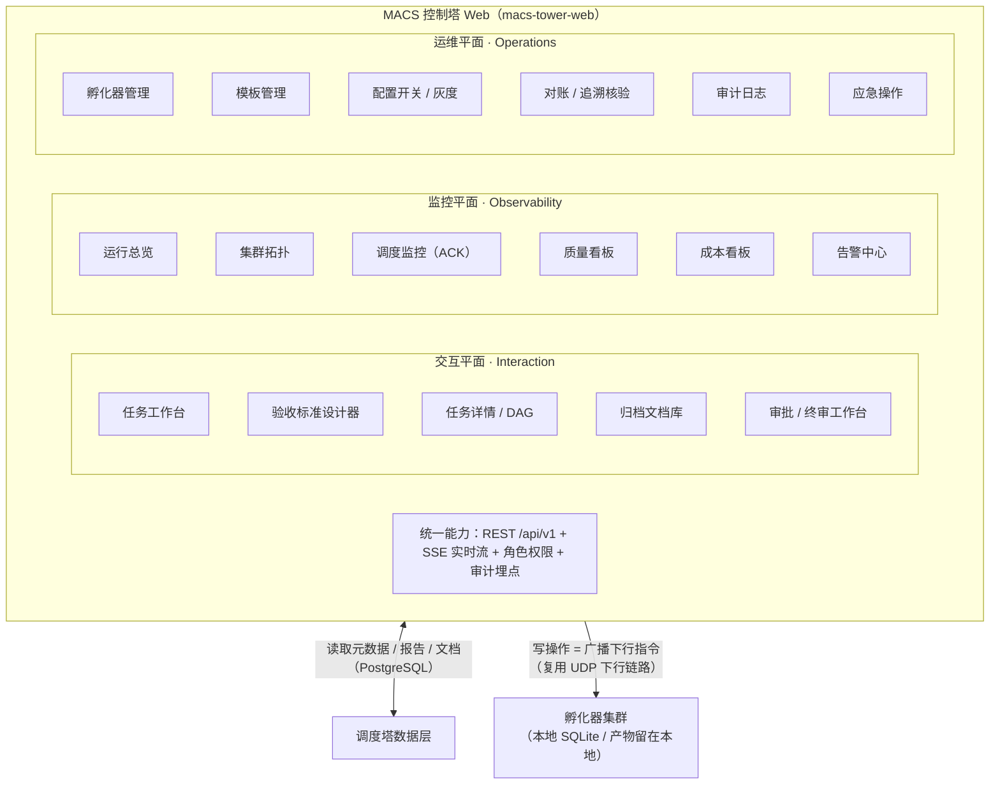
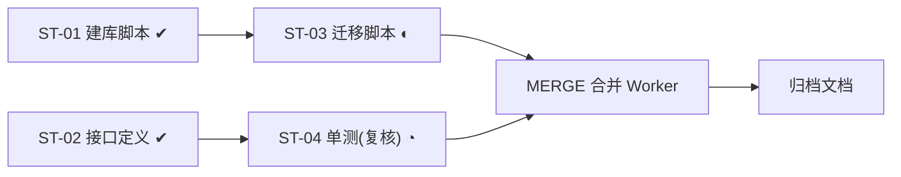
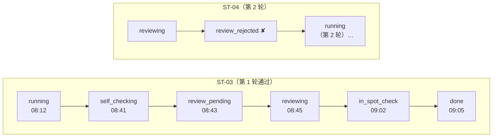
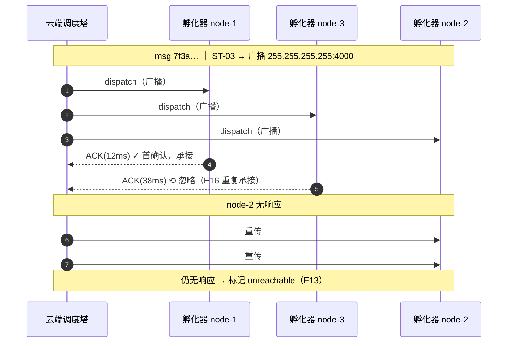

# MACS · 多 Agent 协作执行系统 · UI 交互与运维监控设计 V1.4

> **MACS** — Multi-Agent Cooperative System
> 运维 · 监控 · 交互 三平面 · 参考 SLAW 控制塔与治理模型 · 契约驱动前端

---

## 一、文档信息 【全员]

| 项目 | 内容 |
| --- | --- |
| 文档名称 | MACS UI 交互与运维监控设计 |
| 文档版本 | V1.4 |
| 编写日期 | 2026-10-11 |
| 版本说明 | 首版：定义运维（Operations）/ 监控（Observability）/ 交互（Interaction）三平面 UI，参考 SLAW Botfather Tower、Mission Control 与 Operator 治理模型 |
| 文档类型 | 前端与交互设计（界面级） |
| 上游文档 | 《MACS 技术设计方案 V2.0》、《MACS 数据库存储设计 V2.0》 |
| 对应模块 | FR-23 管理后台；模块交付清单 #27 `macs-tower-web` |
| 状态 | 草稿 |

**前置说明**：
本文件**不重复**主设计文档的口径。所有状态枚举、UDP 消息、异常编号、数据表字段均以《MACS 技术设计方案 V2.0》为唯一事实源，本文只描述"如何在界面上呈现与操作"。
冲突时以主设计文档为准并回报修订。

**三条硬约束（UI 必须遵守）**：
1. **云端不碰业务数据** — 平台只展示元数据、结构化报告与归档文档；代码/产物文件一律在**本机孵化器**侧查看，UI 只提供跳转与文件元数据，**禁止**把业务产物上传到云端预览。
2. **敏感信息不落界面** — `auth_token`、HMAC 密钥、API Key 在列表中一律掩码（如 `mac_****9f2a`），仅支持"一次性查看/轮换"，**禁止**在页面、导出、日志中明文呈现。
3. **可观测优先** — 每一次状态变更在 UI 上都能下钻到对应的 UDP 消息 / 事件 / 审计记录，不允许出现"黑盒状态"。

---

## 二、设计目标与三平面模型

### 2.1 目标

MACS 的控制塔不仅是"调度后端"，也是人机协作的**唯一操作面**。UI 需要同时服务三类诉求：

| 诉求 | 典型使用者 | 核心问题 |
| --- | --- | --- |
| **交互使用** | 任务提交者、复核/终审人 | 我要交任务、定义验收标准、盯住我的任务、拿到产物与归档文档、处理需要我拍板的审批 |
| **监控** | 值班运维、团队负责人 | 集群当前健康吗？调度有没有丢包重传？质量漏检了吗？花了多少钱？有没有告警？ |
| **运维** | 运维管理员（Operator） | 我要上下线孵化器、改配置开关、做灰度/回滚、管模板、核验追溯链、查审计 |

### 2.2 三平面模型

参考 SLAW 的"本地自治 + 中心治理"分层：SLAW 把 **Admin Dashboard / Fleet State**（治理视角）与 **Operator 审批门控**（交互视角）放在 Tower，把 **Local DB / Task Board**（本地操作）放在 Instance，并另有 **Mission Control** 承担轻量自托管监控。MACS 将其整合为**同一控制塔**下的三个平面：



**设计要点**：
- 三个平面是**同一信息架构下的分组**，不是三个独立系统；共享导航壳、权限、实时流。
- 所有**写操作**（改开关、下发模板、审批、吊销孵化器）在服务端最终都转化为**已有 UDP 下行指令**（见主设计 6.4.3 / 附录 B.3），UI 不引入新的通信机制。
- **实时性**统一走 `SSE`（服务端推送），复用监控平面的同一条事件总线；UI 不直连 UDP。

---

## 三、参考 SLAW 的取舍

| SLAW UI 组件 | 定位 | MACS 采纳方式 | 说明 |
| --- | --- | --- | --- |
| **Botfather Tower · Admin Dashboard** | 中心控制台 | ✅ 采纳为**运维平面**骨架 | 集群/策略/预算的中心治理入口 |
| **Botfather Tower · Postgres Fleet State** | 机群状态视图 | ✅ 采纳为**监控平面 · 集群拓扑** | 展示孵化器存活、资源画像、负载 |
| **Botfather Tower · Standard Skills Registry** | 技能/模板注册表 | ✅ 改造为**运维平面 · Agent 模板管理** | SLAW 是"技能"；MACS 是 `agent.md` 模板 + 版本下发 |
| **Instance · Task Board** | 本地任务看板 | ✅ 上移为**交互平面 · 任务工作台**（云端汇总视图） | 云端看聚合态，产物仍在本地 |
| **Instance · Reporter (sidecar)** | 上报旁路 | ✅ 概念保留，UI 化为**上报健康指示**（在线/离线/缓冲积压） | 对应 `sync_outbox` 积压量 |
| **Mission Control** | 轻量自托管监控（31 面板 + 98 API，Alpha） | ✅ 采纳为**监控平面**组织方式（面板化 + API 驱动），但收敛面板数、按域分组 | 不照搬规模，取其"面板 + API"驱动范式 |
| **Operator 审批门控** | 人审批（hire/strategy） | ✅ 采纳并扩展为**统一审批中心**（含抽查升级的 `human_final` 终审） | 对应 `approvals` 表，见主设计 FR-19 |
| **Operator 审计日志** | 操作审计 | ✅ 采纳为**运维平面 · 审计日志**（读操作也可审计） | 对应安全事件应答（13.3） |
| **Operator 预算设置/强制** | 预算治理 | ✅ 采纳为**监控平面 · 成本看板** + 运维写入 | 对应 `cost_records` / `budget_changed` 指令 |
| ~~Org Chart（组织树）~~ | 层级委派 | ❌ 不采纳 | MACS 用**蜂巢模式**（无组织树），见主设计 5.1 |
| ~~Squad / 雇佣审批~~ | 团队单元 | ❌ 不采纳 | MACS 无 Squad 概念，审批收敛为"验收/预算/抽查"三场景 |

> 一句话：**取 SLAW 的治理视图（Fleet State / Admin Dashboard / 审批 / 审计 / 预算），去掉其组织树与 Squad 模型，补上 SLAW 缺失的"验收标准设计 + 三层质量可视 + UDP 调度可观测"。**

---

## 四、信息架构与角色

### 4.1 角色与权限矩阵

| 能力 | 只读观察者 Viewer | 任务提交者 Requester | 复核/终审人 Approver | 运维管理员 Operator |
| --- | :-: | :-: | :-: | :-: |
| 查看总览 / 拓扑 / 质量 / 成本 | ✅ | ✅ | ✅ | ✅ |
| 创建任务 + 定义验收标准 | ❌ | ✅ | ❌ | ✅ |
| 查看自己任务详情 / 归档文档 | ✅ | ✅ | ✅ | ✅ |
| 执行复核 / 抽查终审 | ❌ | ❌ | ✅ | ✅ |
| 审批（预算/超时/升级） | ❌ | ❌ | ✅ | ✅ |
| 孵化器上下线 / 吊销 | ❌ | ❌ | ❌ | ✅ |
| 模板下发 / 配置开关 / 灰度回滚 | ❌ | ❌ | ❌ | ✅ |
| 对账 / 追溯核验 / 审计日志 | ❌ | ❌ | 只读 | ✅ |
| 查看密钥明文 / 轮换密钥 | ❌ | ❌ | ❌ | ✅（一次性） |

> 权限在服务端强制（Admin Token + 角色声明）；前端只做入口隐藏与灰显，不作为安全边界。

### 4.2 导航结构

导航采用左侧边栏加顶部落地页的结构。侧边栏按三个平面分组，顶部固定「运行总览」（`/overview`）作为默认落地页，聚合三平面的关键指标；「交互」组包含任务工作台（`/tasks`）、任务详情（`/tasks/:id`）、归档文档库（`/archive`）与我的审批（`/approvals`）；「监控」组包含集群拓扑（`/monitor/topology`）、调度监控（`/monitor/dispatch`）、质量看板（`/monitor/quality`）、成本看板（`/monitor/cost`）与告警中心（`/alerts`）；「运维」组包含孵化器管理（`/ops/incubators`）、Agent 模板管理（`/ops/templates`）、配置开关与灰度（`/ops/config`）、对账与追溯核验（`/ops/reconcile`）与审计日志（`/ops/audit`）。侧边栏按角色权限过滤入口，无权访问的分组与页面直接隐藏，只读角色进入监控与运维页时以灰显只读态呈现。

### 4.3 页面—数据源—实时性矩阵

| 页面 | 主数据源（表） | 实时通道 | 写操作 → 下行指令 |
| --- | --- | --- | --- |
| 运行总览 | 各表聚合 | SSE `metrics` | — |
| 任务工作台 | `tasks` `subtasks` | SSE `task.*` | `dispatch`（创建后由调度器下发） |
| 任务详情 | `subtasks` `subtask_dependencies` `workers`(本地) `origin_traces` | SSE `subtask.*` `worker.*` | `task_cancelled` / `task_updated` |
| 归档文档库 | `archive_documents` `handoff_documents` | — | — |
| 我的审批 | `approvals` `spot_checks` | SSE `approval.*` | `approval_result` |
| 集群拓扑 | `incubators` `incubator_resources` | SSE `incubator.*` | `config_updated` |
| 调度监控 | `dispatch_log` | SSE `dispatch.*` | 重试按钮 → 重新 `dispatch` |
| 质量看板 | `subtasks` `self_check_reports` `review_reports` `merge_results` `spot_checks` | SSE `subtask.*` | — |
| 成本看板 | `cost_records` | SSE `cost.*` | `budget_changed` |
| 告警中心 | 告警派生视图 | SSE `alert.*` | — |
| 孵化器管理 | `incubators` `incubator_resources` | SSE `incubator.*` | `config_updated` / 吊销 |
| 模板管理 | `agent_templates` | — | `template_updated`（广播） |
| 配置开关 | 配置表 | — | `config_updated`（广播） |
| 对账与追溯 | `origin_traces` `dispatch_log` `sync_outbox` | SSE `reconcile.*` | — |
| 审计日志 | `audit_log` | — | — |

---

## 五、交互平面（Interaction）

> 面向"提交—跟踪—审批—取件"的人机协作主链路。参考 SLAW Task Board，但补上 SLAW 缺失的**验收标准设计**与**三层质量可视化**。

### 5.1 任务工作台 `/tasks`

**布局**：

页面分左右两栏。左栏是状态分组导航，按 `task.status` 全集列出各状态及其实时计数，点击任一分组即筛选右栏；页头常驻「新建任务」按钮、筛选器与搜索框。右栏是可虚拟滚动的任务卡片列表，每张卡片在单行内聚合任务编号与标题、耗时与子任务完成比、孵化器与 Worker 分布、累计成本、依赖满足率进度条与当前质量阶段，并内联提示打回重试数与待审批数，卡片右侧悬浮取消、重跑失败子任务、催办审批三个快捷动作。

**要点**：
- 卡片内联展示**进度（依赖满足率）+ 质量阶段 + 成本 + 跨孵化器分布**，一眼可判"卡在哪"。
- 状态分组直接映射 `task.status` 全集（`backlog / todo / splitting / in_progress / merging / in_review / in_spot_check / done / failed / cancelled / blocked / partial_failure`），`partial_failure` 用琥珀色高亮。
- 卡片右侧快捷动作：**取消**（`task_cancelled`）、**重跑失败子任务**、**催办审批**。

### 5.2 新建任务 + 验收标准设计器

这是 MACS 相对 SLAW 的**核心差异化界面**（SLAW 完全没有"可机检验收条件"）。

**布局**：

三步向导在同一页面内以横向三栏推进，通过「下一步」串联，已完成的步骤折叠为摘要。步骤一「任务定义」填写标题、目标描述、优先级、关联模板与工作区模式（独立或共享）；步骤二「验收标准（可机检）」维护验收项列表，每项由编号、描述、检查类型、机检表达式、是否硬性与抽样权重构成，列表下方提供「添加验收项」；步骤三「拆解与预算」选择自动拆解（按模板）或手动指定子任务，并在 React Flow 画布上编辑 DAG 依赖与并行组，同时设定预算上限与复核、抽查开关。

**验收项编辑器**（结构化，供自检/复核/抽查三层共同消费）：

| 字段 | 说明 | 示例 |
| --- | --- | --- |
| `id` | 验收项编号 | `AC-01` |
| `desc` | 人读描述 | 单元测试全绿 |
| `check_type` | 检查类型 | `command` / `file_exists` / `json_path` / `fingerprint` / `manual` |
| `expr` | 机检表达式 | `exit_code == 0` |
| `required` | 是否硬性 | 是 / 否 |
| `weight` | 抽查抽样权重 | 1 |

> `check_type = manual` 的项会**自动生成一条 `approvals` 记录**（场景=`acceptance`），并在"我的审批"里出现——这就是 SLAW "审批门控"在 MACS 的落地形态：**审批发生在"定义标准"和"抽查升级"两处，而非雇佣/策略**。

### 5.3 任务详情 `/tasks/:id`

**四段式布局**（Tabs）：

**① DAG 视图** — 依赖拓扑 + 实时状态着色：


- 节点颜色 = `subtask.status`；锁定节点（依赖未满足 `pending`）灰显。
- 点击节点打开右侧抽屉：Worker 归属 / 孵化器 / 重试次数 / 自检报告 / 复核报告 / 指纹。

**② 子任务看板** — 按孵化器泳道分组，展示蜂巢并行度：

每条泳道对应一个孵化器，泳道头部显示孵化器名、`active/max_workers` 槽位占比条与本机运行中的子任务数；泳道内逐行列出该孵化器承载的子任务，每行含子任务编号与名称、`subtask.status`、已运行时长，以及是否已进入自检等阶段标记。

**③ 质量时间线** — 三层质量保障的状态流转可视化（对应主设计 6.4.6 状态机）：



**④ 产物与归档** — 结构性说明 + 本地跳转：

| 分栏 | 内容 | 来源 |
| --- | --- | --- |
| 产物清单（元数据） | 文件名、大小、sha256 指纹、所属 Worker | `artifacts`（云端仅元数据） |
| 归档文档 | markdown 交接文档（设计/实现/时序/数据架构/进度/待办） | `archive_documents` |
| 自检/复核/合并报告 | 结构化 JSON 折叠视图 | `self_check_reports` / `review_reports` / `merge_results` |
| **本机打开** | "在孵化器 node-1 本地打开"按钮 | 生成深链，**产物文件本身不经云端** |

> 这一栏是硬约束 #1 的界面化体现：**云端看元数据 + 文档，产物实体永远留在本地**。

### 5.4 归档文档库 `/archive`

- 按任务/孵化器/时间/模板检索（对应主设计 FR-18）。
- 文档为 Workers 交接产物（**附加物**，非主交付物）：含设计实现方案、内容说明、流程/时序图、数据架构、进度、待办。
- 提供 markdown 预览 + 导出；支持"云端汇总版"与"各 Worker 原始版"对比。

### 5.5 审批 / 终审工作台 `/approvals`

统一审批模型（`approvals` 表，FR-19），按**场景**分组：

| 场景 `scene` | 触发来源 | 典型动作 |
| --- | --- | --- |
| `acceptance` | 验收标准含 `manual` 项 | 通过 / 打回并附意见 |
| `review_escalation` | 复核打回超最大轮次（E04） | 判失败 / 允许追加轮次 |
| `spot_escalation` | 抽查发现严重问题（E05） | 升级 `human_final` 人工终审 |
| `budget_exceed` | 预算耗尽（E09） | 追加预算 / 终止任务 |
| `guardrail` | 护栏冻结（唤醒环检测，主设计 6.4.10） | 解冻重排 / 判失败 |
| `timeout` | 审批超时（默认 SLA） | 默认拒绝 + 通知 |

**布局**：页面为单列审批列表。页头显示待办总数与「全部 / 超时优先」排序切换；列表每行是一条审批卡片，左侧以徽标标注场景（预算 / 终审 / 验收 / 复核 / 护栏），随后是任务编号、审批事由摘要与剩余时限，行尾按场景给出对应动作按钮（批准 / 驳回、查看 / 裁定、通过 / 打回、判失败 / 追加 / 解冻重排）。

- 超时项置顶并倒计时；超时后按场景策略自动流转（拒绝/升级），与主设计一致。
- 裁定结果通过 `approval_result`（单播）下发对应孵化器。

---

## 六、监控平面（Observability）

> 参考 Mission Control 的"面板 + API"范式，但按 MACS 的域收敛为 **5 个页面**，指标口径统一取自主设计 13.2 上线监控。

### 6.1 运行总览 `/overview`

顶部 6 张 KPI 卡（对应 13.2 核心指标）+ 底部趋势图：

| 指标卡 | 口径 | 告警阈值（13.2） |
| --- | --- | --- |
| UDP 上报成功率 | 收到 report/heartbeat ÷ 预期周期数 | < 95% ⚠ |
| ACK 成功率 / 重传率 | `dispatch_log` acked ÷ sent | ACK 失败 > 2% ⚠ |
| 孵化器在线率 | online ÷ 注册总数 | < 95% ⚠ |
| 任务成功率 | done ÷ (done+failed) | 失败率 > 5% ⚠ |
| Worker 存活率 | 正常退出 ÷ 孵化总数 | 崩溃率 > 1% ⚠ |
| 平均执行时长 / 成本趋势 | `cost_records` 聚合 | — |

页面顶部并排六张 KPI 卡，分别呈现 UDP 上报成功率、ACK 成功率、孵化器在线率、任务成功率、Worker 存活率与今日成本，卡内以数值加状态色与图标（正常绿勾、告警琥珀）标注达标与否；卡片下方是可切换的底部图表区，左侧为吞吐、延迟、队列深度折线，中间为告警计数环形图，右侧为 Top 5 慢子任务列表。

### 6.2 集群拓扑 `/monitor/topology`

参考 SLAW **Postgres Fleet State**：机群一屏视图。

**布局**：页头显示广播域网段、调度塔地址与刷新按钮。主体是节点卡片网格，每个孵化器一张卡片，卡内自上而下给出节点名、`incubator.status` 状态徽标、`active/max_workers` 槽位占用、CPU 等资源水位、上报新鲜度与离线缓冲积压计数，并以小方块阵列示意当前 Worker 占用。选中任一节点后，右侧抽屉展开该节点的 CPU、内存、磁盘与 GPU 资源画像时序（来自 `incubator_resources`）。

- 节点色 = `incubator.status`（`registering / online / overloaded / unreachable / offline / revoked`）。
- 每节点展示 **slots 使用（active/max_workers）**、资源水位、**上报新鲜度**、**离线缓冲积压**（`sync_outbox` 计数）。
- 与 SLAW 的差异：这里不只是"机群状态"，还要展示 **UDP 广播域与调度塔地址**，因为 MACS 靠广播下发。

### 6.3 调度监控（ACK 时序）`/monitor/dispatch`

这是 MACS 独有的、SLAW 没有的页面（SLAW 是 HTTPS 推模型，无广播/ACK 概念）。

页面另含筛选器 `[广播] [单播] [仅失败 ▾] [时间范围 ▾]`。核心时序：



页面底部汇总：`sent 1,204 ｜ acked 1,197 (99.4%) ｜ retrans 21 ｜ failed 7`；失败明细表字段：`msg_id / subtask / 候选孵化器 / 重传次数 / 最终状态`。

- 直接映射 `dispatch_log.status`（`sent / acked / retransmitted / failed / duplicate`）。
- 时序图让 **E13（无 ACK）/ E16（广播风暴重复承接）** 可被人肉定位——这是排障最高频的两个场景。
- 支持对失败项**重试**（重新触发 `dispatch`）。

### 6.4 质量看板 `/monitor/quality`

可视化三层质量保障（自检 → 复核 → 抽查）：

**布局**：页面为纵向分区卡片，依次呈现三层质量漏斗（① 自检通过、② 复核通过并含打回数、③ 抽查通过并含升级终审数，各层标注分子、分母与比率）、漏检估算（严重缺陷漏检率与目标对比）、复核查获构成（指纹不一致、盲点互补、其他的条形占比）、抽查策略命中分布（random、高价值、高风险模板、手动），以及不稳定模板 TOP 列表；上述数字均可点击下钻。

- 漏斗同屏可见"每一层截获了多少问题"，直观体现三层互补价值。
- 打回轮次分布、抽查状态（`spot_check.status`）下钻到具体子任务。
- **不稳定模板**徽标与运维平面联动（可一键禁用）。

### 6.5 成本看板 `/monitor/cost`

| 区块 | 内容 | 来源 |
| --- | --- | --- |
| 预算用量 | 月度预算 / 已用 / 剩余（进度条 + 燃尽图），支持 任务 / 孵化器 / 模板 / 全局 分层查看（主设计 6.4.11） | `cost_records` / `budget_limits` |
| 成本构成 | 按任务 / 按孵化器 / 按模板 / 按适配器 拆分 | `cost_records` |
| 超预算列表 | 触发 `budget_exceed` 的任务（E09） | `approvals` |
| 单位经济 | 每完成子任务成本、每千 token 成本 | 派生 |

- 运维可在此**调整预算**，写操作走 `budget_changed`（广播）；塔侧上界以 `limit_version` 下发，仅收紧不放宽（主设计 6.4.11），页头在应用新上界后提示「已收紧至 vX」。
- 各层级附 burn rate 与预计耗尽日期（进度条侧标注）。

### 6.6 告警中心 `/alerts`

统一收口所有异常（映射主设计第十一章 E 编号）：

| 告警 | 触发 | 关联 E 编号 | 处置入口 |
| --- | --- | --- | --- |
| 孵化器失联 | 上报超时 | E12 | 跳转拓扑 |
| ACK 失败 | 重传耗尽 | E13 | 跳转调度监控 |
| 指纹不一致 | 对账不匹配 | E06 | 跳转对账核验（冻结任务） |
| 磁盘告警 | 工作区不足 | E11 | 跳转孵化器管理 |
| 预算耗尽 | 超上限 | E09 | 跳转成本看板 |
| 非法状态迁移 | 连续 3 次 | E14 | 跳转审计日志 |
| 大面积 Worker 异常 | 崩溃率 > 1% | E02 | 应急操作（降级串行） |
| 断路器熔断 | 孵化器×驱动×model 连续 5 次失败 | 6.4.10 | 跳转孵化器管理 |
| 护栏冻结 | 唤醒环检测触发（子任务 frozen） | 6.4.10 | 跳转审批工作台（guardrail） |

- 每条告警带**一键处置深链**（如"吊销该孵化器""禁用该模板""扩大抽查"），避免运维在页面间瞎找。

---

## 七、运维平面（Operations）

> 对应 SLAW Botfather Tower 的 Admin Dashboard + Skills Registry + Operator 治理动作，收敛为 5 个运维页面。

### 7.1 孵化器管理 `/ops/incubators`

**布局**：页面主体是一张孵化器列表（TanStack Table），列为节点名、状态徽标（含断路器熔断标记）、槽位占用、资源水位、版本、上报新鲜度、预算水位与操作；操作列按节点状态给出「详情」及「停用 / 限流 / 吊销 / 重新接入」等动作，行支持多选以走页头的「批量操作」，页头另设「生成接入 Key」按钮。

**运维动作**（全部走已有下行指令，见主设计附录 B.3）：

| 动作 | 语义 | 指令 |
| --- | --- | --- |
| 生成接入 Key | 预置注册凭据（一次性展示） | — |
| 停用 / 恢复 | 暂停承接新调度（不杀在跑任务） | `config_updated` |
| 限流 | 临时下调该机 `max_workers` | `config_updated` |
| 吊销 | Key 泄露应急：强制下线 + 审计（13.3） | 服务端吊销 + 审计 |
| 重新接入 | `revoked` → 重新注册 | 重新 `register` |

- **密钥轮换**入口：仅 Operator 可见，明文**一次性展示**，页面关闭即失效（硬约束 #2）。

### 7.2 Agent 模板管理 `/ops/templates`

参考 SLAW **Standard Skills Registry**，改造为 `agent.md` 模板注册表（FR-22）。

| 列 | 说明 |
| --- | --- |
| 模板名 / 版本 | `uk(name, version)` |
| 适用任务类型 | 任务匹配依据（蜂巢按任务选模板） |
| 适配器 | CLI / API / … |
| 协议驱动 | `openai_compatible` / `anthropic` / CLI（主设计 6.4.9），含版本 pin 与节点覆盖数 |
| 月度预算 | 模板级预算与已用（主设计 6.4.11） |
| 状态 | 可用 / 灰度 / 已禁用 / 不稳定 |
| 下发覆盖 | 已缓存节点数 / 总节点数 |
| 操作 | 下发（`template_updated` 广播）/ 回滚版本 / 禁用 |

- 与质量看板的"不稳定模板 TOP"联动，一键禁用问题模板（对应 13.3 应急预案）。

### 7.3 配置开关与灰度 `/ops/config`

直接映射主设计 10.3 配置开关表——**每个开关在 UI 上必须显示：当前值 / 默认值 / 开↔关语义 / 拦截边界**，不允许"黑盒开关"。

| 开关 | 默认 | 打开效果 | 关闭效果 |
| --- | --- | --- | --- |
| `parallel.enabled` | 开 | DAG 并行调度 | 降级串行（应急） |
| `preemptive` | 关 | 高优任务可抢占槽位 | 严格 FIFO（E08） |
| `udp.tcp_fallback.enabled` | 关 | 广播域故障时走 TCP 兜底 | 仅 UDP+ACK |
| `spot_check.strategy` | random | — | 可选 random/高价值/高风险模板/手动 |
| `budget.enforce` | 开 | 超预算暂停孵化（E09） | 只告警不拦截 |
| `reliability.guardrails.enabled` | 开 | 五项护栏生效（主设计 6.4.10） | 全部停用（应急） |
| `done_acceptance_mode` | strict | 自检严格门 | advisory（带缺陷提交记 quality_flag） |
| `budget.limit_enforce` | 开 | 多级预算 + 塔侧上界强制（主设计 6.4.11） | 只记账告警 |
| `plugins.enabled` | 关 | 允许加载第三方插件（主设计 6.4.12） | 仅内置适配器 |

- **灰度面板**：按孵化器/比例分批开启某能力，展示灰度进度与对照指标（复用 10.2 灰度方案）。
- **回滚**：一键执行 10.4 回滚步骤，展示回滚前置检查与结果。

### 7.4 对账与追溯核验 `/ops/reconcile`

**布局**：页头提供「发起全量对账」与「上传核验」按钮。主体上半部是任务级追溯链视图，选定任务后逐段列出子任务及其 sha256 指纹、云端与孵化器的比对结果与结论（一致，或指纹不一致并标注任务已冻结）；下半部是离线缓冲监控条，逐孵化器给出 `sync_outbox` 积压条数与最早时间。

- **指纹链**逐段比对（`origin_traces`），不一致即高亮并**冻结任务**（不自动回滚，防误判 E06）。
- **离线缓冲监控**：各孵化器 `sync_outbox` 积压量与最老时间——这是"断网 14 天不丢数据"的可视化保障（E03）。

### 7.5 审计日志 `/ops/audit`

- 记录**写操作 + 敏感读操作**：谁、何时、改了什么、旧值→新值、结果。
- 支持按操作人/对象类型/时间检索，导出（导出内容自动脱敏）。
- 安全事件追溯入口（对应 13.3 "孵化器 Key 泄露"处置链）。

---

## 八、组件与设计规范

### 8.1 技术栈

| 维度 | 选型 | 理由 |
| --- | --- | --- |
| 框架 | React 18 + TypeScript | 与主设计 FR-23 / 模块 #27 一致 |
| 组件库 | **shadcn/ui**（Radix + Tailwind） | 主设计既定；可复制的源码级组件，便于定制 |
| 路由 | React Router | 页面级权限与懒加载 |
| 数据层 | TanStack Query（REST 缓存）+ 原生 SSE 订阅 | REST 拉 + SSE 推，避免全量轮询 |
| 图表 | ECharts / Recharts | 趋势、漏斗、燃尽、时序 |
| DAG 视图 | React Flow | 依赖拓扑 + 拖拽编辑（新建向导步骤 3） |
| 表格 | TanStack Table | 大数据量虚拟滚动（dispatch_log） |

### 8.2 设计令牌与状态色

**状态色语义**（三平面统一，避免同一状态不同页不同色）：

| 语义 | 颜色 | 用于 |
| --- | --- | --- |
| 正常/成功 | 翡翠绿 `emerald` | online / done / passed / acked |
| 进行中 | 天蓝 `sky` | running / reviewing / in_progress |
| 等待/中性 | 石板灰 `slate` | pending / backlog / registering |
| 警告 | 琥珀 `amber` | overloaded / retransmitted / partial_failure / 超时 |
| 危险/失败 | 玫红 `rose` | failed / rejected / unreachable / 指纹不一致 |

- 深色/浅色双主题；监控大屏默认深色（值班场景）。
- 状态徽标（Badge）组件统一封装，**枚举零硬编码**，从后端枚举字典读取。

### 8.3 交互规范要点

1. **写操作二次确认**：吊销孵化器、禁用模板、批量取消任务等破坏性动作需输入对象名确认。
2. **写操作即回执**：提交后展示下行指令的 `msg_id` 与 ACK 状态（"已下发 → 3/4 节点已确认"），让"广播语义"可见。
3. **一切可下钻**：任意统计数字可点击进入明细；任意状态可追溯到 UDP 消息 / 事件 / 审计。
4. **空态与降级**：调度塔不可达时，页面明确展示"数据可能滞后 + 最后更新时间"，不静默展示旧值。

---

## 九、前端架构与数据通道

### 9.1 数据通道

数据通道分为浏览器与调度塔之间的拉、推两条链路，以及调度塔内部的上行事件流转。

- **拉**：REST 与主设计附录 B.1 的"管理后台 REST 接口"一致，并在本设计中补齐（见 9.2）。
- **推**：新增 `GET /api/v1/stream`（SSE），按 `topic` 订阅（`metrics` / `task.*` / `subtask.*` / `dispatch.*` / `incubator.*` / `alert.*` / `cost.*`），单一连接多路复用。
- **不直连 UDP**：浏览器永不接触 UDP；广播语义仅在服务端体现，UI 只呈现结果。

### 9.2 需新增的 REST 接口（相对主设计 B.1 的扩展）

| 方法 | 路径 | 用途 | 归属平面 |
| --- | --- | --- | --- |
| POST | `/api/v1/tasks` | 创建任务（含验收项 + DAG） | 交互 |
| GET | `/api/v1/tasks/:id` | 任务详情（子任务/依赖/质量） | 交互 |
| POST | `/api/v1/tasks/:id/cancel` | 取消（→ `task_cancelled`） | 交互 |
| GET | `/api/v1/archive` | 归档文档检索 | 交互 |
| GET / POST | `/api/v1/approvals` · `/api/v1/approvals/:id/decide` | 审批列表 / 裁定（→ `approval_result`） | 交互 |
| GET | `/api/v1/stream` | SSE 实时流 | 监控 |
| GET | `/api/v1/metrics/overview` | 总览 KPI | 监控 |
| GET | `/api/v1/incubators` · `/api/v1/incubators/:id/resources` | 集群/资源画像 | 监控+运维 |
| GET | `/api/v1/dispatch-log` | 调度与 ACK 日志 | 监控 |
| GET | `/api/v1/quality/funnel` | 三层质量漏斗 | 监控 |
| GET | `/api/v1/cost` · POST `/api/v1/budget` | 成本 / 调预算（→ `budget_changed`） | 监控+运维 |
| GET | `/api/v1/alerts` | 告警 | 监控 |
| GET / POST | `/api/v1/templates` · `/api/v1/templates/:id/rollout` | 模板列表 / 下发（→ `template_updated`） | 运维 |
| GET / PUT | `/api/v1/config` | 配置开关读写（→ `config_updated`） | 运维 |
| POST | `/api/v1/incubators/:id/revoke` | 吊销 | 运维 |
| GET | `/api/v1/reconcile` | 对账与指纹核验 | 运维 |
| GET | `/api/v1/audit` | 审计日志 | 运维 |

### 9.3 前端目录结构

```
macs-tower-web/
├── src/
│   ├── app/                # 路由 + 布局壳 + 权限守卫
│   ├── planes/
│   │   ├── interaction/    # 交互平面页面
│   │   ├── observability/  # 监控平面页面
│   │   └── operations/     # 运维平面页面
│   ├── components/
│   │   ├── ui/             # shadcn/ui 基础组件
│   │   ├── domain/         # 状态徽标/槽位条/指纹链/DAG 领域组件
│   │   └── charts/
│   ├── lib/                # api client / sse client / 枚举字典 / 权限
│   └── styles/             # 设计令牌 / 主题
└── ...
```

### 9.4 前端自带测试与自验

| 验收项 | 标准 | 方式 |
| --- | --- | --- |
| 三平面可达 | 三个平面的所有页面在权限内可达、无死链 | 路由遍历测试 |
| 实时性 | SSE 断线自动重连；指标刷新延迟 ≤ 2s | 断网重连 + 时延测试 |
| 写操作回执 | 每个写操作展示 `msg_id` + ACK 汇总 | 端到端场景 |
| 状态一致性 | UI 状态色/文案与后端枚举字典 100% 对齐 | 枚举快照测试 |
| 脱敏 | 页面/导出/日志中无密钥明文 | 正则扫描测试 |
| 大表性能 | `dispatch_log` 10 万行滚动 ≥ 50fps | 性能测试 |

---

## 十、非功能性设计

| 维度 | 要求 |
| --- | --- |
| **性能** | 首屏 ≤ 1.5s；列表虚拟滚动；REST 分页；SSE 单连接多路复用 |
| **实时性** | 关键指标端到端（UDP 上行 → SSE 推送 → 渲染）≤ 2s |
| **可用性** | 调度塔不可达时前端展示"数据滞后"提示与最后更新时间，不误导 |
| **响应式** | 运维/监控支持 1280～2560 宽；交互平面支持移动端查看（响应式只读） |
| **可访问性** | 语义化标签、键盘可达、状态色辅以图标/文字（色盲友好） |
| **安全** | Admin Token + 角色强制于服务端；CSRF 防护；导出脱敏；操作全审计 |
| **国际化** | 中文优先，文案集中管理，预留 i18n 结构 |

> 说明：主设计 3.3 范围标注"移动端管理后台"属**后续迭代**；本期 UI 仅保证移动端**只读**可看（响应式），写操作仍限桌面。

---

## 十一、交付清单与里程碑

### 11.1 交付增量

| # | 模块 | 路径 | 说明 |
| --- | --- | --- | --- |
| 27a | 前端框架壳 | `macs-tower-web/src/app` | 路由 + 三平面布局 + 权限守卫 + 设计令牌 |
| 27b | 交互平面 | `macs-tower-web/src/planes/interaction` | 任务工作台 / 验收标准设计器 / 任务详情 DAG / 归档库 / 审批 |
| 27c | 监控平面 | `macs-tower-web/src/planes/observability` | 总览 / 拓扑 / 调度 ACK / 质量 / 成本 / 告警 |
| 27d | 运维平面 | `macs-tower-web/src/planes/operations` | 孵化器 / 模板 / 配置开关 / 对账核验 / 审计 |
| 27e | SSE 流服务 | `macs-tower/src/modules/web-stream` | 事件总线 → SSE 广播（服务端新增） |
| 27f | 管理 REST 扩展 | `macs-tower/src/modules/web-api` | 见 9.2 接口清单 |

### 11.2 里程碑挂载

| 里程碑 | 内容（前端视角） |
| --- | --- |
| M1 核心通信链路 | 前端仅提供"集群拓扑 + 调度 ACK 监控"最小可用视图（验证 UDP 通道） |
| M2 任务与 DAG | 任务工作台 + 新建向导 + 任务详情 DAG |
| M3 三层质量 | 质量看板 + 审批/终审工作台 |
| M4 运维与治理 | 运维平面（孵化器/模板/开关/对账/审计）+ 成本看板 |
| M5 规模化 | 大表性能优化 + 响应式只读 + 告警中心完善 |

### 11.3 前端完成定义（DoD）

- [ ] 三平面所有页面可达，权限矩阵逐条验证通过
- [ ] 每个写操作有 `msg_id` + ACK 回执，且转化为既定下行指令（无新通信机制）
- [ ] 所有状态展示与后端枚举字典一致（快照测试）
- [ ] 密钥/敏感字段零明文（页面 + 导出 + 日志）
- [ ] 云端不呈现业务产物文件，仅元数据 + 报告 + 归档文档 + 本地跳转
- [ ] SSE 断线重连 + 数据滞后提示可用
- [ ] 9.4 前端自验项全绿

---

## 十二、与主设计文档的映射

| 本文 | 主设计文档 |
| --- | --- |
| 交互平面 · 任务工作台 | FR-04 任务创建与管理、6.4.1 DAG 调度 |
| 交互平面 · 验收标准设计器 | 3.4 三层质量保障、FR-13/14/16、附录 B.4 |
| 交互平面 · 任务详情质量时间线 | 6.4.6 三层质量保障状态流转 |
| 交互平面 · 审批工作台 | FR-19 审批中心、E04/E05/E09 |
| 监控平面 · 集群拓扑 | FR-07/08 负载均衡与集群管理、`incubators`/`incubator_resources` |
| 监控平面 · 调度监控 | FR-02/09、6.4.7、`dispatch_log`、E13/E16 |
| 监控平面 · 告警中心 | 第十一章异常 E01~E16 |
| 运维平面 · 孵化器管理 | FR-01 注册与认证、13.3 应急 |
| 运维平面 · 模板管理 | FR-22 模板管理、E02 不稳定模板 |
| 运维平面 · 配置开关/灰度 | 10.2 灰度、10.3 配置开关、10.4 回滚 |
| 运维平面 · 对账与追溯 | FR-17 追溯链、E03/E06、`origin_traces`/`sync_outbox` |
| 前端技术栈 | FR-23 管理后台、模块交付清单 #27 |
| 数据通道 SSE/REST | 附录 B.1 管理后台 REST 接口（本文 9.2 为其扩展） |
| 运维平面 · 统一平台管理（V3.0） | 6.4.13 统一 Agent 平台协议、`unified_agent_platforms` / `protocol_drivers` / `platform_adapter_mappings` |
| 监控平面 · 适配器状态监控（V3.0） | 6.4.13.5 适配器契约、6.4.13.6 能力协商（`driver_mismatch`） |
| 监控平面 · 遥测可视化（V3.0） | 6.4.13.4 遥测指标体系、`telemetry_events`、SSE `/telemetry/stream`、模块 #30 |
| 监控平面 · 任务执行透视（V1.2） | 6.4.1 DAG 调度、6.4.6 三层质量状态流转、附录 B.4 状态枚举、`subtasks` / `subtask_dependencies` / `parallel_groups` / `telemetry_events`、附录 B.1 四个透视端点 |
| 视觉主题 HUD（V1.3） | 全端通用；零位图约束与状态色值对齐附录 B.4、§14.7；DSH 终端（模块 #31）Ink 映射 |

> 一致性铁律：本文所有状态、枚举、E 编号、表名**引用**主设计；若主设计变更，本文同步修订并在下文变更记录记账。

---

## 十三、V3.0 增量设计：统一平台与遥测可视化【新增 V1.1】

对应主设计 V3.0（§6.4.13 统一 Agent 平台协议、§6.4.13.4 遥测指标体系），新增 3 个页面 + 1 处既有页面扩展。

### 13.1 统一 Agent 平台管理（运维平面）

**页面**：`/ops/agent-platforms`（P1）

- 平台列表：`platform_name` / `vendor` / `version` / `default_driver` / `is_active` / `is_system`，支持启停（PATCH `/api/v1/agent-platforms/:id`）
- 平台详情：`capabilities` 能力声明（executor / reviewer / planner）+ 关联适配器映射列表（`adapter_name` / `status` / `compatibility_mode`）
- 注册与驱动管理：POST `/api/v1/agent-platforms`；GET/POST `/api/v1/protocol-drivers`（`driver_name@version`、`protocol_family`、`spec_url`）
- 敏感字段约束：`base_url`、`metadata` 中含内网地址/凭证的内容一律掩码展示（遵循本文三条硬约束第 2 条）

### 13.2 适配器状态监控（监控平面）

**页面**：`/monitor/adapters`（P1）

- 适配器映射状态墙：按平台分组展示 `status`（developing / ready / deprecated）与 `compatibility_mode`
- 孵化器能力视图：展示各孵化器上报的 `protocol_drivers` 列表，及 `driver_mismatch` 回执统计（近 24h，来源：调度日志 + ACK 语义）
- 热更新入口：`adapter_config_update` 下发（广播/单播可选），二次确认 + 操作审计落库

### 13.3 遥测数据可视化（监控平面）

**页面**：`/monitor/telemetry`（P1）

- 实时流：EventSource 订阅 GET `/api/v1/telemetry/stream`，渲染任务执行进度（`progress_percent`、`current_step`）与 token 实时消耗
- 历史查询：GET `/api/v1/telemetry/events`，支持 `task_id` / `subtask_id` / `event_type` / 时间范围过滤
- 指标卡（对齐主设计 6.4.13.4 六指标）：`token_usage` / `execution_duration_ms` / `agent_steps_count` / `adapter_latency_ms` / `cost_cents` / `platform_version` 分布
- 成本联动：`cost_cents` 汇总口径与成本看板（`/monitor/cost`）一致，支持下钻跳转
- 性能预算：`telemetry_events` 为高写入日志表，列表默认分页 50 条、默认时间范围 1h，**禁止**无时间窗全表导出

### 13.4 与既有平面的关系

- SSE 通道复用第九章既有架构：`/telemetry/stream` 为第二个 SSE 端点（第一个为既有事件推送），断线重连与背压策略一致
- 任务详情页（`/tasks/:id`）质量时间线新增「遥测」标签页，内嵌 13.3 的任务级视图

---

## 十四、任务执行透视：监控内容规格【新增 V1.2】

单任务维度的监控内容标准，web 端（`/tasks/:id/blueprint`）与 DSH 监控终端共用同一份内容与数据口径。

### 14.1 内容总览（6 块）

| # | 内容块 | 回答的问题 | 数据源 | 通道 | 刷新 |
|---|--------|-----------|--------|------|------|
| 1 | 目标面板 | 这个任务要达成什么、验收标准过了几项 | `tasks`（title / description / acceptance_items / status）+ `cost_records` | REST `/tasks/:id` | 5s 轮询 |
| 2 | 过程拆解视图 | 任务被拆成哪些子任务、依赖关系如何 | `subtasks` + `subtask_dependencies` + `parallel_groups` | REST `/tasks/:id/dag` | 5s 轮询 |
| 3 | 当前执行看板 | 此刻谁在跑、跑到哪一步、烧了多少 token | 子任务状态 + `telemetry_events`（step_progress / token_usage） | SSE `telemetry.update` + 轮询兜底 | 实时 + 5s |
| 4 | 子 Worker 状况 | 每个 Worker 健康与否、还能活多久 | Worker 状态投影（见 14.5 口径） | REST `/tasks/:id/workers` | 5s 轮询 |
| 5 | Agent 间汇报记录 | 谁向谁汇报了什么、结论如何 | 上行 report 事件流 + `telemetry_events`（platform_event） | REST `/tasks/:id/events` + SSE | 实时 + 5s |
| 6 | 实时蓝图 | 整个工作流现在长什么样 | 14.3 DAG + 14.4 实时状态客户端合成 | 无独立通道 | 随源刷新 |

### 14.2 目标面板

- 任务标题 + 目标描述 + 状态徽标（附录 B.4 十二态着色）
- 验收标准清单：逐项渲染 ✓ 通过 / ✗ 未过 / ○ 未验，计数 `已通过/总数`
- 总进度：`completed 子任务数 / 子任务总数`（含 skipped 单列）
- 预算条：累计 `cost_cents` / 预算上限（主设计 6.4.11），80% 黄、100% 红

### 14.3 过程拆解视图（DAG）

- 节点 = 子任务（短码 id + 名称 + 状态色）；边 = `subtask_dependencies`；分层 = 拓扑层级自上而下；同层内按 `parallel_groups` 分组框出
- 环检测失败、被 `frozen` 的节点必须保留原位并置灰，**禁止**从图上删除任何节点

### 14.4 当前执行看板

- 仅渲染 `running / self_checking / reviewing` 三态子任务卡片
- 卡片字段：`worker_id` 短码、当前步骤（telemetry `current_step`）、`progress_percent` 进度条、`token_usage`（prompt+completion）、已耗时（dispatch→now）
- 无进行中子任务时显示空态与最近完成时间，**禁止**伪造进度

### 14.5 子 Worker 状况

- 每 Worker 一行：`worker_id` 短码、`platform_adapter` / `agent_platform`、状态（附录 B.4 七态）、当前 subtask 短码、TTL 倒计时（30 分钟 − 已运行，Q3 口径）、token 累计、最近心跳时间
- **云端投影口径**：Worker 最新状态 = 该 `worker_id` 最近一次上行事件（report payload / `telemetry_events`），云端**不建**独立 Worker 表（遵循 DB 设计 1.1「Worker 运行时状态本地临时」分层原则）；投影由 telemetry 模块在读取侧合成

### 14.6 Agent 间汇报记录

- 时间倒序 feed，每行：`event_type`（worker_completed / self_check_passed / self_check_failed / review_verdict / platform_event / escalation / handoff）+ 来源（worker/适配器短码）→ 去向（调度塔 / 复核 Worker / Merger）+ 摘要（≤80 字符）+ 产物 `fingerprint` 短码
- 复核打回、护栏冻结、升级审批三类事件必须高亮（对应异常路径可追溯）
- 数据口径：云端由上行 report 事件落库 + `telemetry_events`（platform_event）合成，按 `task_id + timestamp DESC` 检索

### 14.7 实时蓝图

- **web 端**：Mermaid flowchart 渲染 14.3 DAG，节点 class 按 status 实时着色（running 绿 / self_checking 黄 / reviewing 紫 / completed 蓝 / failed 红 / frozen 灰 / pending 浅灰），SSE 驱动增量更新，不整图重绘
- **终端端**：ASCII 拓扑分层渲染，box-drawing 连线，状态符号 `●` 运行 / `✓` 完成 / `✗` 失败 / `❄` 冻结 / `○` 等待 / `◐` 质检中
- 渲染输入 = 14.3 结构 + 14.4 状态，两端客户端各自合成，**不新增**服务端通道

### 14.8 配套 REST 端点（只读，主设计附录 B.1 同步登记）

| 方法 | 路径 | 用途 |
| --- | --- | --- |
| GET | `/api/v1/tasks/:id` | 目标面板（含 acceptance_items、预算消耗） |
| GET | `/api/v1/tasks/:id/dag` | 拆解视图（subtasks + dependencies + parallel_groups） |
| GET | `/api/v1/tasks/:id/workers` | 子 Worker 状况投影 |
| GET | `/api/v1/tasks/:id/events` | Agent 汇报 feed（按时间倒序，分页） |

---

## 十五、视觉主题：蓝绿终端 HUD【新增 V1.3】

全端统一视觉主题：蓝绿（cyan/green）单色族终端风，面向**透明显示设备**（透明 OLED / AR 投屏 / 玻璃屏）的 HUD 观感，**零位图素材**。web 端（macs-tower-web）与 DSH 终端（macs-dsh-monitor）共用同一 token 体系。

### 15.1 色彩 tokens（CSS 自定义属性，shadcn/Tailwind 直接映射）

| token | 值 | 用途 |
| --- | --- | --- |
| `--hud-bg-base` | `rgba(3,11,18,0.72)` | 主面板底（深海军蓝半透明） |
| `--hud-bg-raised` | `rgba(6,24,34,0.55)` | 次级面板/卡片 |
| `--hud-bg-glass` | `rgba(8,32,44,0.38)` | 浮层/弹窗 |
| `--hud-line` | `rgba(0,229,255,0.24)` | 描边/分隔线/表格线 |
| `--hud-cyan` | `#00e5ff` | 主色：数据、链接、completed 态 |
| `--hud-green` | `#00ff9c` | 运行中/成功/active 元素 |
| `--hud-amber` | `#ffb454` | 自检中/告警/预算 80% |
| `--hud-red` | `#ff5470` | 失败/危险/预算 100% |
| `--hud-violet` | `#b18cff` | 复核态/审批 |
| `--hud-text` | `#d6f4ff` | 主文本 |
| `--hud-text-dim` | `rgba(214,244,255,0.55)` | 次要文本/占位 |
| `--hud-glow-cyan` | `0 0 6px rgba(0,229,255,0.45)` | 发光（仅 active/running） |

### 15.2 字体与排版

- 全文等宽：`"JetBrains Mono","Cascadia Code","Sarasa Mono SC",Consolas,ui-monospace,monospace`（本地字体栈，不加载网络字体）
- 数字一律 `font-variant-numeric: tabular-nums`，保证监控数据纵向对齐
- 最小字号 12px；数据标注允许 10px 但仅用于非关键信息；行高 ≥1.5

### 15.3 透明显示设备适配（硬约束）

1. 所有面板一律 `rgba` 半透明底 + 1px `--hud-line` 描边，**禁止**纯黑/纯白实底
2. 浮层可用 `backdrop-filter: blur(8px) saturate(140%)`，必须配 `@supports` 降级（不支持时底色 alpha +6%）
3. 主文本对比度 ≥7:1（相对最深可叠加背景），细线最小 1px
4. 发光效果仅用于 active/running 元素，**禁止**大面积 glow（透明 OLED 烧屏与功耗风险）
5. 提供 `body[data-hud-solid="1"]` 一键切换不透明模式（强光/投屏演示环境兜底）

### 15.4 零位图素材规范（硬约束）

1. 全站禁止 `.png/.jpg/.webp/.gif` 引用；图标仅用 Boxicons 字体或 inline SVG
2. 图表一律 SVG 渲染（ECharts 使用 SVG renderer，禁用 canvas 导出贴图）
3. 实时蓝图为 Mermaid（SVG），主题映射：
   `themeVariables: { background:'transparent', primaryColor:'#06222e', primaryBorderColor:'#00e5ff', primaryTextColor:'#d6f4ff', lineColor:'#00e5ff', fontFamily:'JetBrains Mono,monospace' }`
4. Logo 使用 SVG 字标，不使用图片素材

### 15.5 终端（Ink）映射

| token | Ink 颜色 | 终端用途 |
| --- | --- | --- |
| `--hud-cyan` | `#00e5ff` | 标题/表头/链接 |
| `--hud-green` | `#00ff9c` | active 页签/运行态 |
| `--hud-amber` | `#ffb454` | 告警高亮 |
| `--hud-red` | `#ff5470` | 错误 |
| `--hud-violet` | `#b18cff` | 复核/审批 |
| `--hud-text-dim` | `gray` | 次要文本（Ink 不支持 alpha，用 gray 近似） |

状态符号沿用 §14.7（`● ✓ ✗ ❄ ○ ◐ ◌ ⊘ ◑`），语义不变只映射色值。

### 15.6 与既有约定的一致性

- 状态七色映射（§14.7）语义不变，仅色值收敛到本 token 族
- 告警分级色（告警中心）复用 `--hud-amber` / `--hud-red`，不新增色板

---

## 十六、实时任务进度条与历史任务记录【新增 V1.4】

### 16.1 实时任务进度条组件

全端统一组件（web `/tasks/:id/blueprint` 目标面板 + DSH 终端「任务透视」共用口径）。

**进度合成公式**：`task_progress = round(100 × Σ(wᵢ·pᵢ) / Σwᵢ)`，默认 `wᵢ=1`；单节点进度 `pᵢ`：`completed=1`、`running=progress_percent/100`、`self_checking/reviewing=0.9`、其余=0（skipped 计入分母不计分子）。

**数据通道**：SSE `telemetry.update` 增量驱动 + 5s REST 轮询兜底（与 §14.1 通道口径一致）。

**渲染规范**：
- web：总条 + 段式（每子任务一段，宽度按 `wᵢ` 占比，色值取 §15.1 状态 token）；数字 `tabular-nums`
- 终端：ASCII 条 `█`（已完）+ `░`（未完），如 `[██████████░░░░░░] 62%`，宽度 16 格
- 状态着色：running 绿（active 可 glow）/ completed 青 / failed 红 / paused 琥珀

**诚实性约束**：无 telemetry 细粒度数据时只按完成数比例渲染并标注「按完成数」，**禁止**插值伪造进度（沿用 §14.4 约束）。

### 16.2 历史任务记录

**页面/视图**：web `/tasks/history`（交互平面，P1）+ DSH 终端「历史记录」视图（按键 9）。

**数据契约**：GET `/api/v1/tasks` 扩展查询参数（V3.3）——`status`（逗号分隔多值）、`from` / `to`（ISO 时间）、`q`（标题模糊）、`page` / `pageSize`（默认 50，上限 200）、`sort`（默认 `updated_at DESC`）。

**列口径**：id 短码 / 标题 / 状态徽标 / 进度条（§16.1 合成值）/ 耗时（dispatch→finished）/ `cost_cents` / 完成时间；归档任务带 `archived` 标记（主设计模块 #12 归档口径）。

**交互**：web 端筛选器（状态下拉 + 时间范围 + 关键词）+ 分页；终端默认近 50 条按更新时间倒序，选中行可跳「任务透视」。已完成/失败任务保留至少 14 天（与 Q6 离线缓冲天数口径对齐），归档任务查询走 `/api/v1/archives`（既有模块）。

---

## 附录 A　页面清单汇总

| 平面 | 页面 | 路径 | 优先级 |
| --- | --- | --- | --- |
| 监控 | 运行总览 | `/overview` | P0 |
| 交互 | 任务工作台 | `/tasks` | P0 |
| 交互 | 任务详情（DAG） | `/tasks/:id` | P0 |
| 监控 | 集群拓扑 | `/monitor/topology` | P0 |
| 监控 | 调度监控（ACK） | `/monitor/dispatch` | P0 |
| 交互 | 我的审批 | `/approvals` | P1 |
| 交互 | 归档文档库 | `/archive` | P1 |
| 监控 | 质量看板 | `/monitor/quality` | P1 |
| 运维 | 孵化器管理 | `/ops/incubators` | P1 |
| 运维 | 配置开关与灰度 | `/ops/config` | P1 |
| 运维 | Agent 模板管理 | `/ops/templates` | P1 |
| 监控 | 成本看板 | `/monitor/cost` | P2 |
| 监控 | 告警中心 | `/alerts` | P2 |
| 运维 | 对账与追溯核验 | `/ops/reconcile` | P2 |
| 运维 | 审计日志 | `/ops/audit` | P2 |
| 运维 | 统一 Agent 平台管理（V3.0） | `/ops/agent-platforms` | P1 |
| 监控 | 适配器状态监控（V3.0） | `/monitor/adapters` | P1 |
| 监控 | 遥测数据可视化（V3.0） | `/monitor/telemetry` | P1 |
| 监控 | 任务执行透视（V1.2，六块内容规格） | `/tasks/:id/blueprint` | P1 |
| 交互 | 历史任务记录（V1.4） | `/tasks/history` | P1 |
| 运维 | Admin Token 管理（V3.5 §6.4.16） | `/ops/admin-tokens` | P1 |
| 运维 | 通知渠道配置（V3.5 §6.4.17 C9） | `/ops/notify-channels` | P2 |

## 附录 B　变更记录

| 版本 | 日期 | 变更人 | 变更说明 |
| --- | --- | --- | --- |
| V1.0 | 2026-10-11 | — | 首版：参考 SLAW 定义运维/监控/交互三平面 UI，含 15 个页面、SSE 数据通道、REST 扩展接口、角色权限矩阵与前端 DoD |
| V1.0.1 | 2026-10-11 | — | 页面线框图改用文本描述布局与功能；流程图/时序图统一改用 Mermaid，不再使用纯文本框图 |
| V1.0.2 | 2026-10-11 | — | 同步主设计 V2.0.3（SLAW 高价值移植）：审批新增 `guardrail` 场景（护栏冻结解冻）；成本看板支持任务/孵化器/模板/全局分层预算与 burn rate，提示塔侧上界收紧；告警中心新增断路器熔断与护栏冻结；孵化器列表增加熔断与预算徽标；模板管理增加协议驱动（OpenAI/Anthropic）与月度预算列；配置开关新增护栏/验收门/预算强制/插件 4 项 |
| V1.1 | 2026-11-08 | — | 同步主设计 V3.0：新增统一 Agent 平台管理（`/ops/agent-platforms`）、适配器状态监控（`/monitor/adapters`）、遥测数据可视化（`/monitor/telemetry`，含 SSE 实时流与六指标卡）三个页面；任务详情页新增「遥测」标签页；附录 A 页面清单与十二章映射同步更新 |
| V1.2 | 2026-11-08 | — | 新增第十四章任务执行透视监控内容规格：目标面板 / 过程拆解 DAG / 当前执行看板 / 子 Worker 状况 / Agent 间汇报记录 / 实时蓝图六块内容，含数据口径（Worker 状态云端投影、汇报 feed 合成规则）与 web（Mermaid）/ 终端（ASCII）双端蓝图渲染规范；配套 4 个只读 REST 端点（`/tasks/:id` `/tasks/:id/dag` `/tasks/:id/workers` `/tasks/:id/events`），页面 `/tasks/:id/blueprint` 入附录 A |
| V1.3 | 2026-11-08 | — | 新增第十五章视觉主题：蓝绿终端 HUD（cyan `#00e5ff` / green `#00ff9c` 单色族 token 体系），面向透明显示设备（rgba 半透明面板、backdrop-filter 降级、glow 仅限 active 元素、`data-hud-solid` 不透明兜底），零位图素材规范（Boxicons 字体 + inline SVG + Mermaid SVG 主题映射），含 web CSS tokens 与 DSH 终端 Ink 色映射；状态色语义沿用 §14.7 不变 |
| V1.4 | 2026-11-08 | — | 新增第十六章：实时任务进度条组件（加权合成公式、SSE 增量 + 轮询兜底、段式/ASCII 双端渲染、「按完成数」诚实性约束）与历史任务记录（`/tasks/history` 页面 + 终端视图，`GET /api/v1/tasks` 扩展 status/from/to/q/分页/排序查询参数，归档任务走 `/api/v1/archives`）；附录 A 同步 |

## 参考来源

1. SLAW 深度解析报告（本项目内部）：`research/slaw/SLAW深度解析报告.md`
2. SLAW Botfather 架构（含 Admin Dashboard / Fleet State / Skills Registry）: https://docs.slaw.run/botfather/overview/architecture
3. SLAW 报告协议（Reporter sidecar / 离线 spool）: https://docs.slaw.run/botfather/integrate/reporting-protocol
4. SLAW 成本与预算（Operator 预算治理）: https://docs.slaw.run/slaw/concepts/costs-and-budgets
5. Mission Control 官网（轻量自托管监控，面板 + API 范式）: https://mc.builderz.dev/
6. MACS 技术设计方案 V2.0（本项目内部）：`projects/macs/design/MACS技术设计文档.md`
7. MACS 数据库存储设计 V2.0（本项目内部）：`projects/macs/design/数据库存储设计.md`
