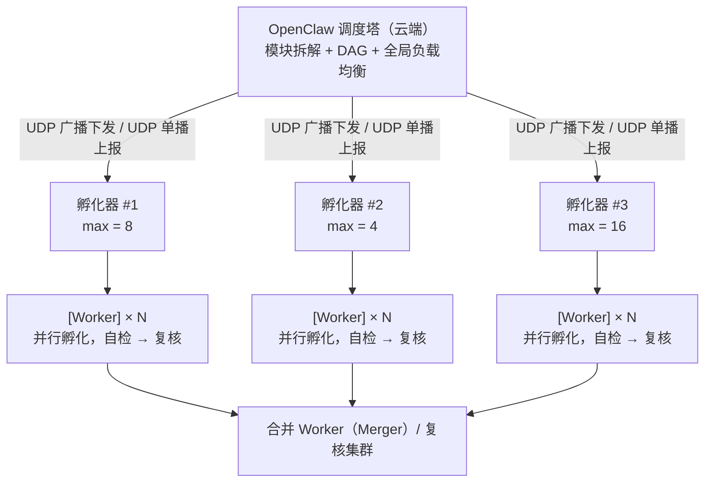
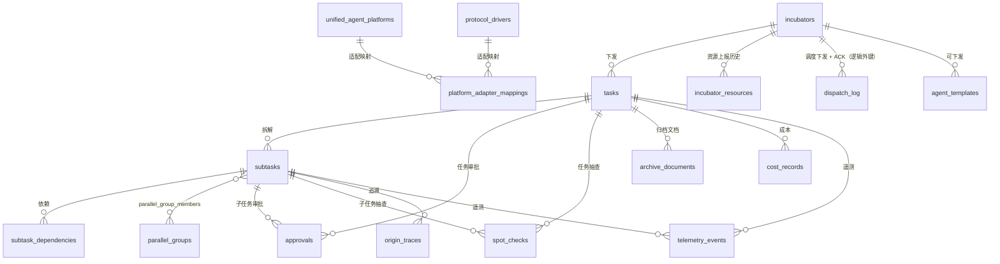
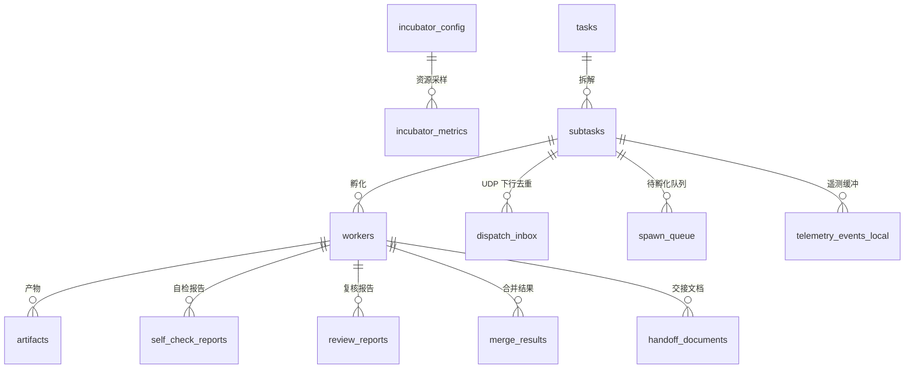

# MACS · 多 Agent 协作执行系统 · 数据库存储设计

> **MACS** — Multi-Agent Cooperative System
> 蜂巢并行 · 推模型调度 · 三层质量保障

## 一、存储架构总览

### 1.1 分层存储原则

采用 **"云端存元数据 + 本地存业务数据"** 的分层策略，与推模型通信架构保持一致：

| 数据类型 | 存储位置 | 原因 |
|---------|---------|------|
| 任务定义 + 验收标准 | 云端 + 本地 | 云端是权威源，本地缓存执行 |
| 子任务拆解 + DAG 依赖 | 云端权威 + 本地同步 | 拆解策略由调度塔决定 |
| Agent 模板配置 | 本地为主 + 云端可下发 | 模板体积小，本地孵化需要低延迟读取 |
| Worker 运行时状态 | 本地（临时） | Worker 用完即毁，状态不持久化 |
| 执行产物（代码/文件） | 本地工作区 | 数据量大，云端不持有业务数据 |
| 自检报告 / 审查报告 | 本地生成 → 云端同步 | 结构化 JSON，体积小，同步成本低 |
| 归档文档（markdown） | 本地生成 → 云端归档 | 最终交付物之一，云端永久保存 |
| 审批记录 | 云端权威 + 本地缓存 | 审批由云端发起和裁定 |
| 追溯链 + 产物指纹 | 云端 + 本地双写 | 防篡改需要双方校验 |
| 孵化器状态 + 资源上报 | 云端（实时） | 云端管理孵化器集群状态与资源画像 |
| 调度下发记录 + ACK | 云端（实时） | 云端记录每次 UDP 广播的下发与确认情况 |
| 成本 / 预算 | 云端汇总 + 本地记账 | 云端是账单权威，本地实时扣减 |

> **云端双 Provider 降级（V3.4 决策）**：云端库默认 PostgreSQL；`DATABASE_URL` 缺省或 PG 不可达时自动降级为本地 SQLite 文件（`macs-tower.db`），Schema 保持一致；降级期间 PG 专有并发特性（行锁、函数）以应用层互斥替代，恢复 PG 后经导出工具回迁，业务零感知。

### 1.2 技术选型建议

| 层级 | 推荐数据库 | 原因 |
|------|-----------|------|
| **云端（OpenClaw 调度塔）** | PostgreSQL | 关系型 + JSON 支持，适合任务/审批/追溯/孵化器集群的复杂查询 |
| **本地（孵化器 Incubator）** | SQLite（默认）/ PostgreSQL（可选） | SQLite 零部署；多 Worker 高并发建议切 PG |
| **产物文件** | 本地文件系统 + 对象存储（可选归档） | 大文件走文件系统，元数据存数据库 |

### 1.3 并行执行模型总览

MACS 采用 **"云端调度塔 + 分布式孵化器集群"** 架构：多台机器各自运行一个孵化器进程，通过 UDP 注册/上报/心跳挂载到调度塔；调度塔按负载均衡选择（或广播）把子任务下发到合适的孵化器，孵化器内部再按 `max_workers` 上限并行孵化 Worker。



**并行层级**：
1. **孵化器级并行**：多个孵化器同时承载不同的子任务，云端按资源与负载动态分配
2. **子任务级并行**：单个孵化器内一个父任务拆成多个独立子任务，同时启动多个执行 Worker
3. **复核级并行**：多个子任务的审查可并行进行
4. **同子任务内串行**：执行 → 自检 → 复核仍保持串行（保证质量）

> 全局并行上限 = Σ(各孵化器 max_workers)。孵化器真实并行能力由该机器 CPU/内存/并发配置决定，通过资源上报让调度塔感知。

---

## 二、云端数据库（OpenClaw 调度塔）

### 2.1 孵化器注册与集群状态

```sql
-- 孵化器表：注册到调度塔的分布式孵化器节点
CREATE TABLE incubators (
    id              UUID PRIMARY KEY DEFAULT gen_random_uuid(),
    incubator_key   VARCHAR(255) NOT NULL,                    -- 孵化器唯一标识（主机指纹派生）
    key_hash        VARCHAR(255) NOT NULL,                   -- argon2 哈希，UDP 报文签名校验用
    name            VARCHAR(255) NOT NULL,
    status          VARCHAR(32) NOT NULL DEFAULT 'registering',
        -- registering / online / overloaded / unreachable / offline / revoked
    -- 网络与主机信息
    hostname        VARCHAR(255),
    ip_address      INET,
    udp_port        INT NOT NULL DEFAULT 9600,                -- 孵化器 UDP 监听端口
    version         VARCHAR(64),                             -- 孵化器版本号
    os              VARCHAR(64),
    arch            VARCHAR(32),
    region          VARCHAR(64),                             -- 可选：机房/网段标签
    -- 资源画像（由孵化器上报，冗余快照，明细见 incubator_resources）
    cpu_cores       INT,
    cpu_load_avg    DECIMAL(6, 3),                           -- 最近 1min 负载
    mem_total_mb    INT,
    mem_used_mb     INT,
    mem_free_mb     INT,
    disk_free_gb    DECIMAL(12, 2),
    -- 并发能力
    max_workers         INT NOT NULL DEFAULT 4,              -- 该机器允许的最大并行 Worker 数
    active_workers      INT NOT NULL DEFAULT 0,              -- 当前活跃 Worker 数
    available_slots     INT NOT NULL DEFAULT 4,              -- = max_workers - active_workers（冗余，便于调度）
    template_set        JSONB NOT NULL DEFAULT '[]'::jsonb,  -- 本机已加载的 agent 模板 ID 列表
    -- 连通与同步
    last_heartbeat_at   TIMESTAMPTZ,                         -- 最近一次 UDP 心跳时间
    last_report_at      TIMESTAMPTZ,                          -- 最近一次状态上报时间
    last_sync_at        TIMESTAMPTZ,
    heartbeat_interval_sec INT NOT NULL DEFAULT 15,
    -- 预算
    monthly_budget_cents DECIMAL(12, 2) NOT NULL DEFAULT 0,
    spent_monthly_cents  DECIMAL(12, 2) NOT NULL DEFAULT 0,
    budget_reset_at      TIMESTAMPTZ,
    applied_limit_version BIGINT NOT NULL DEFAULT 0,          -- 已应用的塔侧上界版本（budget_changed，见主设计 6.4.11）
    metadata        JSONB NOT NULL DEFAULT '{}'::jsonb,
    created_at      TIMESTAMPTZ NOT NULL DEFAULT NOW(),
    updated_at      TIMESTAMPTZ NOT NULL DEFAULT NOW(),
    UNIQUE(incubator_key)
);

CREATE INDEX idx_incubators_status ON incubators(status);
CREATE INDEX idx_incubators_heartbeat ON incubators(last_heartbeat_at);
CREATE INDEX idx_incubators_key_hash ON incubators(key_hash);
CREATE INDEX idx_incubators_region ON incubators(region);
```

```sql
-- 孵化器资源上报历史：记录每次资源快照，用于趋势分析与容量规划
CREATE TABLE incubator_resources (
    id              BIGSERIAL PRIMARY KEY,
    incubator_id    UUID NOT NULL REFERENCES incubators(id) ON DELETE CASCADE,
    cpu_cores       INT,
    cpu_load_avg    DECIMAL(6, 3),
    mem_total_mb    INT,
    mem_used_mb     INT,
    disk_free_gb    DECIMAL(12, 2),
    max_workers     INT NOT NULL DEFAULT 0,
    active_workers  INT NOT NULL DEFAULT 0,
    available_slots INT NOT NULL DEFAULT 0,
    queue_depth     INT NOT NULL DEFAULT 0,                  -- 本机待孵化队列长度
    net_rx_kbps     DECIMAL(12, 2),
    net_tx_kbps     DECIMAL(12, 2),
    extra           JSONB NOT NULL DEFAULT '{}'::jsonb,
    reported_at     TIMESTAMPTZ NOT NULL DEFAULT NOW()
);

CREATE INDEX idx_incubator_resources_incubator ON incubator_resources(incubator_id, reported_at DESC);
```

```sql
-- 调度下发记录：每次 UDP 广播/单播下发子任务的记录与 ACK 状态
-- （高写入日志表，关联字段不加外键约束，便于分区与清理）
CREATE TABLE dispatch_log (
    id              BIGSERIAL PRIMARY KEY,
    msg_id          UUID NOT NULL,                            -- UDP 报文唯一 ID（幂等去重键）
    task_id         UUID,                                     -- 关联任务（逻辑外键）
    subtask_id      UUID,                                     -- 关联子任务（逻辑外键）
    incubator_id    UUID,                                     -- 目标孵化器（广播模式下为最终承接者）
    dispatch_mode   VARCHAR(16) NOT NULL DEFAULT 'targeted',
        -- targeted (定向单播) / broadcast (广播)
    command_type    VARCHAR(64) NOT NULL,
        -- dispatch / task_cancelled / task_updated / approval_result
        -- / merge_instruction / spot_check_request / config_updated ...
    status          VARCHAR(32) NOT NULL DEFAULT 'sent',
        -- sent / acked / retransmitted / failed / duplicate
    ack_status      VARCHAR(16),                              -- accepted / rejected / none
    retransmit_count INT NOT NULL DEFAULT 0,
    payload_size    INT,                                       -- 报文长度（用于 1200 字节约束核查）
    sent_at         TIMESTAMPTZ NOT NULL DEFAULT NOW(),
    acked_at        TIMESTAMPTZ,
    last_error      TEXT,
    metadata        JSONB NOT NULL DEFAULT '{}'::jsonb
);

CREATE INDEX idx_dispatch_log_incubator ON dispatch_log(incubator_id, sent_at DESC);
CREATE INDEX idx_dispatch_log_msg ON dispatch_log(msg_id);
CREATE INDEX idx_dispatch_log_status ON dispatch_log(status);
CREATE INDEX idx_dispatch_log_subtask ON dispatch_log(subtask_id);
```

### 2.2 任务与验收标准

```sql
-- 任务表：核心业务实体（父任务 / 独立任务）
CREATE TABLE tasks (
    id                  UUID PRIMARY KEY DEFAULT gen_random_uuid(),
    incubator_id        UUID REFERENCES incubators(id),      -- 承接孵化器（父任务可为空，子任务级才绑定）
    title               VARCHAR(512) NOT NULL,
    description         TEXT,
    status              VARCHAR(32) NOT NULL DEFAULT 'backlog',
        -- backlog / todo / splitting / in_progress / in_review
        -- / in_spot_check / merging / done / failed / cancelled
    priority            VARCHAR(16) NOT NULL DEFAULT 'normal',
        -- low / normal / high / urgent
    task_type           VARCHAR(32) NOT NULL DEFAULT 'single',
        -- single (单任务) / parent (父任务，含子任务)
    parallel_enabled    BOOLEAN NOT NULL DEFAULT FALSE,      -- 是否启用并行
    max_parallel_subtasks INT NOT NULL DEFAULT 0,            -- 0 = 无限制
    -- 来源追溯
    origin_kind         VARCHAR(64),
    origin_id           VARCHAR(255),
    parent_task_id      UUID REFERENCES tasks(id),           -- 上层父任务
    request_depth       INT NOT NULL DEFAULT 0,
    assignee_incubator_id UUID REFERENCES incubators(id),    -- 负责人指定的承接孵化器
    -- 验收标准（结构化 schema）
    acceptance_criteria JSONB NOT NULL DEFAULT '[]'::jsonb,
    acceptance_design_note TEXT,
    -- 执行策略
    execution_policy    JSONB NOT NULL DEFAULT '{}'::jsonb,
    -- 调度信息
    scheduled_at        TIMESTAMPTZ,
    started_at          TIMESTAMPTZ,
    completed_at        TIMESTAMPTZ,
    deadline_at         TIMESTAMPTZ,
    -- 并行统计
    total_subtasks      INT NOT NULL DEFAULT 0,
    completed_subtasks  INT NOT NULL DEFAULT 0,
    failed_subtasks     INT NOT NULL DEFAULT 0,
    -- 成本
    budget_cents       DECIMAL(12, 2) NOT NULL DEFAULT 0,     -- 任务级预算上限（0 = 不限，见主设计 6.4.11）
    estimated_cost_cents DECIMAL(12, 2),
    actual_cost_cents   DECIMAL(12, 2) NOT NULL DEFAULT 0,
    -- 追溯
    origin_fingerprint  VARCHAR(128),
    latest_fingerprint  VARCHAR(128),
    metadata            JSONB NOT NULL DEFAULT '{}'::jsonb,
    created_at          TIMESTAMPTZ NOT NULL DEFAULT NOW(),
    updated_at          TIMESTAMPTZ NOT NULL DEFAULT NOW()
);

CREATE INDEX idx_tasks_status ON tasks(status);
CREATE INDEX idx_tasks_incubator ON tasks(incubator_id);
CREATE INDEX idx_tasks_priority ON tasks(priority);
CREATE INDEX idx_tasks_parent ON tasks(parent_task_id);
CREATE INDEX idx_tasks_created ON tasks(created_at DESC);
CREATE INDEX idx_tasks_type ON tasks(task_type);
```

### 2.3 子任务与 DAG 依赖

```sql
-- 子任务表：父任务拆解后的执行单元
CREATE TABLE subtasks (
    id              UUID PRIMARY KEY DEFAULT gen_random_uuid(),
    task_id         UUID NOT NULL REFERENCES tasks(id),      -- 所属父任务
    incubator_id    UUID REFERENCES incubators(id),           -- 分配到的孵化器
    title           VARCHAR(512) NOT NULL,
    description     TEXT,
    subtask_order   INT NOT NULL DEFAULT 0,                   -- 显示顺序
    status          VARCHAR(32) NOT NULL DEFAULT 'pending',
        -- pending / ready / running / self_checking / review_pending
        -- / reviewing / frozen / completed / failed / skipped / cancelled
    -- 依赖
    depends_on      UUID[] NOT NULL DEFAULT '{}',            -- 依赖的子任务 ID 列表
    dependency_type VARCHAR(32) NOT NULL DEFAULT 'all',       -- all / any
    -- 执行配置
    template_id     UUID REFERENCES agent_templates(id),     -- 使用的 Agent 模板
    template_version VARCHAR(64),
    worker_role     VARCHAR(32) NOT NULL DEFAULT 'executor',  -- executor / reviewer / merger
    -- 验收标准（继承自父任务，可定制）
    acceptance_criteria JSONB NOT NULL DEFAULT '[]'::jsonb,
    inherit_criteria BOOLEAN NOT NULL DEFAULT TRUE,           -- 是否继承父任务验收标准
    -- 工作区
    workspace_id    VARCHAR(255),
    shared_workspace BOOLEAN NOT NULL DEFAULT FALSE,          -- 是否共享工作区
    shared_with     UUID[] NOT NULL DEFAULT '{}',             -- 共享工作区的子任务
    -- 合并配置
    merge_strategy  VARCHAR(32),                              -- concat / overwrite / smart
    merge_order     INT,                                      -- 合并时的顺序
    -- 时间
    ready_at        TIMESTAMPTZ,                              -- 依赖满足，可执行时间
    started_at      TIMESTAMPTZ,
    completed_at    TIMESTAMPTZ,
    duration_sec    INT,
    -- 成本
    cost_cents      DECIMAL(12, 2) NOT NULL DEFAULT 0,
    -- 结果
    result_summary  TEXT,
    output_ref      VARCHAR(1024),                            -- 产物引用
    fingerprint     VARCHAR(128),                             -- 产物指纹
    -- 护栏冻结（主设计 6.4.10）
    frozen_at       TIMESTAMPTZ,                              -- 唤醒环等护栏触发冻结时间
    frozen_reason   VARCHAR(64),                              -- wake_loop / budget_hard_stop 等
    -- 重试
    retry_count     INT NOT NULL DEFAULT 0,
    max_retries     INT NOT NULL DEFAULT 0,                   -- 0 = 不重试
    metadata        JSONB NOT NULL DEFAULT '{}'::jsonb,
    created_at      TIMESTAMPTZ NOT NULL DEFAULT NOW(),
    updated_at      TIMESTAMPTZ NOT NULL DEFAULT NOW()
);

CREATE INDEX idx_subtasks_task ON subtasks(task_id);
CREATE INDEX idx_subtasks_status ON subtasks(status);
CREATE INDEX idx_subtasks_incubator ON subtasks(incubator_id);
CREATE INDEX idx_subtasks_ready ON subtasks(status, ready_at)
    WHERE status = 'ready';
```

```sql
-- 子任务依赖表（便于查询依赖关系，subtasks.depends_on 是冗余存储）
CREATE TABLE subtask_dependencies (
    id              BIGSERIAL PRIMARY KEY,
    subtask_id      UUID NOT NULL REFERENCES subtasks(id) ON DELETE CASCADE,
    depends_on_id   UUID NOT NULL REFERENCES subtasks(id) ON DELETE CASCADE,
    dependency_type VARCHAR(32) NOT NULL DEFAULT 'finish_to_start',
        -- finish_to_start / start_to_start / finish_to_finish
    -- 条件依赖
    condition_expr  TEXT,                                     -- 条件表达式，满足才触发
    metadata        JSONB NOT NULL DEFAULT '{}'::jsonb,
    created_at      TIMESTAMPTZ NOT NULL DEFAULT NOW(),
    UNIQUE(subtask_id, depends_on_id, dependency_type)
);

CREATE INDEX idx_subtask_deps_subtask ON subtask_dependencies(subtask_id);
CREATE INDEX idx_subtask_deps_dependson ON subtask_dependencies(depends_on_id);
```

### 2.4 并行执行组

```sql
-- 并行执行组：同一批次并行执行的子任务集合
CREATE TABLE parallel_groups (
    id              UUID PRIMARY KEY DEFAULT gen_random_uuid(),
    task_id         UUID NOT NULL REFERENCES tasks(id),
    name            VARCHAR(255) NOT NULL,
    group_type      VARCHAR(32) NOT NULL DEFAULT 'execution',
        -- execution (执行组) / review (复核组) / merge (合并组)
    status          VARCHAR(32) NOT NULL DEFAULT 'pending',
        -- pending / running / completed / failed / partial_failure
    concurrency     INT NOT NULL DEFAULT 0,                   -- 0 = 不限制
    total_subtasks  INT NOT NULL DEFAULT 0,
    completed_subtasks INT NOT NULL DEFAULT 0,
    failed_subtasks INT NOT NULL DEFAULT 0,
    started_at      TIMESTAMPTZ,
    completed_at    TIMESTAMPTZ,
    metadata        JSONB NOT NULL DEFAULT '{}'::jsonb,
    created_at      TIMESTAMPTZ NOT NULL DEFAULT NOW(),
    updated_at      TIMESTAMPTZ NOT NULL DEFAULT NOW()
);

CREATE INDEX idx_parallel_groups_task ON parallel_groups(task_id);
CREATE INDEX idx_parallel_groups_status ON parallel_groups(status);
```

```sql
-- 并行组成员
CREATE TABLE parallel_group_members (
    id              BIGSERIAL PRIMARY KEY,
    group_id        UUID NOT NULL REFERENCES parallel_groups(id) ON DELETE CASCADE,
    subtask_id      UUID NOT NULL REFERENCES subtasks(id) ON DELETE CASCADE,
    member_order    INT NOT NULL DEFAULT 0,
    created_at      TIMESTAMPTZ NOT NULL DEFAULT NOW(),
    UNIQUE(group_id, subtask_id)
);

CREATE INDEX idx_pg_members_group ON parallel_group_members(group_id);
CREATE INDEX idx_pg_members_subtask ON parallel_group_members(subtask_id);
```

### 2.5 审批门控

```sql
-- 审批表：统一审批机制
CREATE TABLE approvals (
    id              UUID PRIMARY KEY DEFAULT gen_random_uuid(),
    task_id         UUID REFERENCES tasks(id),
    subtask_id      UUID REFERENCES subtasks(id),
    incubator_id    UUID REFERENCES incubators(id),
    approval_type   VARCHAR(64) NOT NULL,
        -- acceptance_confirm / start_execution / human_final
        -- / subtask_plan / merge_result / budget_exceed / guardrail
    status          VARCHAR(32) NOT NULL DEFAULT 'pending',
        -- pending / approved / rejected / expired
    requester       VARCHAR(128),
    approver        VARCHAR(128),
    title           VARCHAR(255) NOT NULL,
    description     TEXT,
    payload         JSONB NOT NULL DEFAULT '{}'::jsonb,
    expires_at      TIMESTAMPTZ,
    decision        VARCHAR(16),
    decision_note   TEXT,
    decided_at      TIMESTAMPTZ,
    notified_at     TIMESTAMPTZ,
    created_at      TIMESTAMPTZ NOT NULL DEFAULT NOW(),
    updated_at      TIMESTAMPTZ NOT NULL DEFAULT NOW()
);

CREATE INDEX idx_approvals_task ON approvals(task_id);
CREATE INDEX idx_approvals_subtask ON approvals(subtask_id);
CREATE INDEX idx_approvals_status ON approvals(status);
CREATE INDEX idx_approvals_type ON approvals(approval_type);
```

### 2.6 抽查核验

```sql
-- 抽查记录表
CREATE TABLE spot_checks (
    id              UUID PRIMARY KEY DEFAULT gen_random_uuid(),
    task_id         UUID NOT NULL REFERENCES tasks(id),
    subtask_id      UUID REFERENCES subtasks(id),
    incubator_id    UUID REFERENCES incubators(id),
    check_scope     VARCHAR(32) NOT NULL DEFAULT 'task',
        -- task (整任务) / subtask (单子任务) / sample (抽样)
    status          VARCHAR(32) NOT NULL DEFAULT 'pending',
        -- pending / running / passed / failed / retried / skipped
    check_items     JSONB NOT NULL DEFAULT '[]'::jsonb,
    pass_rate       DECIMAL(5, 2),
    overall_passed  BOOLEAN,
    attempt_count   INT NOT NULL DEFAULT 1,
    max_attempts    INT NOT NULL DEFAULT 3,
    next_attempt_at TIMESTAMPTZ,
    last_attempt_at TIMESTAMPTZ,
    report_url      VARCHAR(1024),
    evidence_refs   JSONB NOT NULL DEFAULT '[]'::jsonb,
    note            TEXT,
    created_at      TIMESTAMPTZ NOT NULL DEFAULT NOW(),
    updated_at      TIMESTAMPTZ NOT NULL DEFAULT NOW()
);

CREATE INDEX idx_spot_checks_task ON spot_checks(task_id);
CREATE INDEX idx_spot_checks_subtask ON spot_checks(subtask_id);
CREATE INDEX idx_spot_checks_status ON spot_checks(status);
CREATE INDEX idx_spot_checks_next ON spot_checks(next_attempt_at);
```

### 2.7 追溯链

```sql
-- 追溯链：记录每一步产物的来源和指纹
CREATE TABLE origin_traces (
    id              UUID PRIMARY KEY DEFAULT gen_random_uuid(),
    task_id         UUID NOT NULL REFERENCES tasks(id),
    subtask_id      UUID REFERENCES subtasks(id),
    from_kind       VARCHAR(64),
    from_id         VARCHAR(255),
    to_kind         VARCHAR(64) NOT NULL,
    to_id           VARCHAR(255) NOT NULL,
    fingerprint     VARCHAR(128) NOT NULL,
    fingerprint_alg VARCHAR(32) NOT NULL DEFAULT 'sha256',
    content_summary TEXT,
    artifact_type   VARCHAR(64),
    size_bytes      BIGINT,
    depth           INT NOT NULL DEFAULT 0,
    metadata        JSONB NOT NULL DEFAULT '{}'::jsonb,
    created_at      TIMESTAMPTZ NOT NULL DEFAULT NOW()
);

CREATE INDEX idx_origin_traces_task ON origin_traces(task_id);
CREATE INDEX idx_origin_traces_subtask ON origin_traces(subtask_id);
CREATE INDEX idx_origin_traces_fingerprint ON origin_traces(fingerprint);
CREATE INDEX idx_origin_traces_to ON origin_traces(to_kind, to_id);
```

### 2.8 归档中心

```sql
-- 归档文档表
CREATE TABLE archive_documents (
    id              UUID PRIMARY KEY DEFAULT gen_random_uuid(),
    task_id         UUID NOT NULL REFERENCES tasks(id),
    subtask_id      UUID REFERENCES subtasks(id),
    incubator_id    UUID REFERENCES incubators(id),
    source          VARCHAR(32) NOT NULL,
        -- worker / merger / reviewer / tower / human
    doc_type        VARCHAR(64) NOT NULL,
        -- handoff / review / self_check / merge_summary / final_summary
    title           VARCHAR(512) NOT NULL,
    content         TEXT NOT NULL,
    format_version  VARCHAR(32) NOT NULL DEFAULT '1.0',
    sections        JSONB NOT NULL DEFAULT '[]'::jsonb,
    word_count      INT,
    has_diagrams    BOOLEAN NOT NULL DEFAULT FALSE,
    has_code        BOOLEAN NOT NULL DEFAULT FALSE,
    attached_files  JSONB NOT NULL DEFAULT '[]'::jsonb,
    version         INT NOT NULL DEFAULT 1,
    is_latest       BOOLEAN NOT NULL DEFAULT TRUE,
    created_at      TIMESTAMPTZ NOT NULL DEFAULT NOW(),
    updated_at      TIMESTAMPTZ NOT NULL DEFAULT NOW()
);

CREATE INDEX idx_archive_documents_task ON archive_documents(task_id);
CREATE INDEX idx_archive_documents_subtask ON archive_documents(subtask_id);
CREATE INDEX idx_archive_documents_type ON archive_documents(doc_type);
CREATE INDEX idx_archive_documents_latest ON archive_documents(is_latest) WHERE is_latest = TRUE;
```

### 2.9 Agent 模板库

```sql
-- Agent 模板表（云端可下发到实例）
CREATE TABLE agent_templates (
    id              UUID PRIMARY KEY DEFAULT gen_random_uuid(),
    name            VARCHAR(255) NOT NULL,
    version         VARCHAR(64) NOT NULL,
    description     TEXT,
    template_type   VARCHAR(64) NOT NULL,
        -- executor / reviewer / planner / merger / custom
    adapter_type    VARCHAR(64) NOT NULL,
    adapter_config  JSONB NOT NULL DEFAULT '{}'::jsonb,
    protocol_driver VARCHAR(32) NOT NULL DEFAULT 'none',
        -- none / openai_compatible / anthropic（CLI 型适配器为 none，见主设计 6.4.9）
    driver_version_pin VARCHAR(32),                           -- 协议族版本（如 anthropic@2023-06-01）
    monthly_budget_cents DECIMAL(12, 2) NOT NULL DEFAULT 0,   -- 模板级月度预算（0 = 不限，见 6.4.11）
    spent_monthly_cents  DECIMAL(12, 2) NOT NULL DEFAULT 0,
    instructions_md TEXT NOT NULL,
    capabilities    JSONB NOT NULL DEFAULT '[]'::jsonb,
    default_timeout_sec INT,
    default_max_retries INT,
    supports_parallel BOOLEAN NOT NULL DEFAULT TRUE,
    is_system       BOOLEAN NOT NULL DEFAULT FALSE,
    is_active       BOOLEAN NOT NULL DEFAULT TRUE,
    metadata        JSONB NOT NULL DEFAULT '{}'::jsonb,
    created_at      TIMESTAMPTZ NOT NULL DEFAULT NOW(),
    updated_at      TIMESTAMPTZ NOT NULL DEFAULT NOW(),
    UNIQUE(name, version)
);

CREATE INDEX idx_agent_templates_active ON agent_templates(is_active) WHERE is_active = TRUE;
CREATE INDEX idx_agent_templates_type ON agent_templates(template_type);
```

### 2.10a 统一 Agent 平台注册表（全链路互通）【新增 V3.0】

为支持所有 OpenClaw 同类 Agent 平台（AutoGen、LangChain Agents、CrewAI、LlamaIndex、其他自研平台等），建立统一的平台注册与能力映射机制。

```sql
-- 统一 Agent 平台注册表：记录所有兼容平台的元数据与协议版本
CREATE TABLE unified_agent_platforms (
    id              UUID PRIMARY KEY DEFAULT gen_random_uuid(),
    platform_name   VARCHAR(128) NOT NULL,                     -- 平台名称（如 auto-gen / langchain-agents / crew-ai）
    vendor          VARCHAR(64),                               -- 厂商/组织（如 microsoft / huggingface / crewai）
    version         VARCHAR(32) NOT NULL DEFAULT '1.0',        -- 平台版本
    protocol_spec   VARCHAR(64) NOT NULL,                      -- 协议规范文档链接
    is_active       BOOLEAN NOT NULL DEFAULT TRUE,
    is_system       BOOLEAN NOT NULL DEFAULT FALSE,            -- 是否内置系统平台
    base_url        VARCHAR(512),                              -- API 网关地址（可选）
    default_driver  VARCHAR(64) NOT NULL,                      -- 默认协议驱动（见 protocol_drivers 表）
    capabilities    JSONB NOT NULL DEFAULT '[]'::jsonb,        -- 平台声明的能力集（executor/reviewer/planner 等）
    metadata        JSONB NOT NULL DEFAULT '{}'::jsonb,
    created_at      TIMESTAMPTZ NOT NULL DEFAULT NOW(),
    updated_at      TIMESTAMPTZ NOT NULL DEFAULT NOW()
);

CREATE INDEX idx_unified_agent_platforms_name ON unified_agent_platforms(platform_name);
CREATE INDEX idx_unified_agent_platforms_active ON unified_agent_platforms(is_active) WHERE is_active = TRUE;
```

```sql
-- 协议驱动注册表：定义标准化的协议实现（如 openai-compat-protocol、anthropic-messaging-protocol）
CREATE TABLE protocol_drivers (
    id              UUID PRIMARY KEY DEFAULT gen_random_uuid(),
    driver_name     VARCHAR(64) NOT NULL,                      -- 如 openai-compat-protocol / anthropic-msg-protocol
    version         VARCHAR(32) NOT NULL DEFAULT '1.0',
    description     TEXT,                                      -- 协议说明文档链接
    protocol_family VARCHAR(32),                               -- 所属协议族（openai-compatible / anthropic / cli-native）
    is_active       BOOLEAN NOT NULL DEFAULT TRUE,
    spec_url        VARCHAR(512) NOT NULL,                     -- 规范文档 URL
    message_schema  JSONB,                                     -- 消息信封 Schema（JSON Schema 格式）
    created_at      TIMESTAMPTZ NOT NULL DEFAULT NOW(),
    updated_at      TIMESTAMPTZ NOT NULL DEFAULT NOW()
);

CREATE UNIQUE INDEX idx_protocol_drivers_name_version ON protocol_drivers(driver_name, version) WHERE is_active = TRUE;
```

```sql
-- 平台 - 协议适配器映射表：定义各平台与标准化协议的适配关系
CREATE TABLE platform_adapter_mappings (
    id              BIGSERIAL PRIMARY KEY,
    platform_id     UUID NOT NULL REFERENCES unified_agent_platforms(id) ON DELETE CASCADE,
    driver_id       UUID NOT NULL REFERENCES protocol_drivers(id) ON DELETE RESTRICT,
    adapter_name    VARCHAR(128) NOT NULL,                     -- 适配器名称（如 auto-gen-to-openai-compat）
    status          VARCHAR(32) NOT NULL DEFAULT 'developing',  -- developing / ready / deprecated
    compatibility_mode VARCHAR(32) DEFAULT 'strict',           -- strict / lenient / compatible
    supported_features JSONB DEFAULT '{}',                    -- 支持的功能列表（task_dispatch/result_reporting/telemetry等）
    config_schema   JSONB,                                    -- 适配器配置 Schema
    created_at      TIMESTAMPTZ NOT NULL DEFAULT NOW(),
    UNIQUE(platform_id, driver_id)
);

CREATE INDEX idx_platform_adapter_mappings_platform ON platform_adapter_mappings(platform_id);
CREATE INDEX idx_platform_adapter_mappings_driver ON platform_adapter_mappings(driver_id);
```

### 2.10b 统一遥测事件表【新增 V3.0】

支撑主设计 §6.4.13.4 统一遥测监控指标体系，存储跨平台细粒度遥测数据（高写入日志表）。

```sql
-- 细粒度遥测事件表（高写入日志）
CREATE TABLE telemetry_events (
    id              BIGSERIAL PRIMARY KEY,
    task_id         UUID REFERENCES tasks(id),
    subtask_id      UUID REFERENCES subtasks(id),
    worker_id       VARCHAR(255),
    platform_adapter VARCHAR(128),                    -- 使用的平台适配器（如 langchain-to-openai-compat）
    agent_platform  VARCHAR(64),                      -- Agent 平台名称（如 langchain-agents）
    event_type      VARCHAR(32) NOT NULL,             -- task_start / step_progress / token_usage / completed / failed
    payload         JSONB NOT NULL DEFAULT '{}'::jsonb, -- 事件详情（progress_percent、current_step、token_usage 等）
    timestamp       TIMESTAMPTZ NOT NULL DEFAULT NOW()
);

CREATE INDEX idx_telemetry_events_task ON telemetry_events(task_id, timestamp DESC);
CREATE INDEX idx_telemetry_events_subtask ON telemetry_events(subtask_id, timestamp DESC);
CREATE INDEX idx_telemetry_events_type ON telemetry_events(event_type);
```

> 口径说明：任务/子任务级成本核算复用 `cost_records.token_usage`(JSONB) 与 `cost_records.duration_sec`(INT)（见 §2.10），本表只承载过程级细粒度指标。

### 2.10 成本与预算

```sql
-- 成本记录表
CREATE TABLE cost_records (
    id              UUID PRIMARY KEY DEFAULT gen_random_uuid(),
    incubator_id    UUID NOT NULL REFERENCES incubators(id),
    task_id         UUID REFERENCES tasks(id),
    subtask_id      UUID REFERENCES subtasks(id),
    worker_id       VARCHAR(255),
    cost_type       VARCHAR(32) NOT NULL,
        -- api / compute / storage / other
    provider        VARCHAR(64),
    model           VARCHAR(128),
    amount_cents    DECIMAL(12, 2) NOT NULL,
    token_usage     JSONB,
    duration_sec    INT,
    description     TEXT,
    recorded_at     TIMESTAMPTZ NOT NULL DEFAULT NOW()
);

CREATE INDEX idx_cost_records_incubator ON cost_records(incubator_id);
CREATE INDEX idx_cost_records_task ON cost_records(task_id);
CREATE INDEX idx_cost_records_subtask ON cost_records(subtask_id);
CREATE INDEX idx_cost_records_recorded ON cost_records(recorded_at DESC);

-- 多级预算限制表（云端上界，经 budget_changed 下发，见主设计 6.4.11）
CREATE TABLE budget_limits (
    id              UUID PRIMARY KEY DEFAULT gen_random_uuid(),
    scope_type      VARCHAR(32) NOT NULL,
        -- global / incubator / template / task
    scope_id        UUID,                                     -- global 时为 NULL
    amount_cents    DECIMAL(12, 2) NOT NULL DEFAULT 0,        -- 0 = 不限
    warn_at_pct     INT NOT NULL DEFAULT 80,                  -- 软告警阈值百分比
    enforce_mode    VARCHAR(16) NOT NULL DEFAULT 'hard',      -- hard / soft / off
    limit_version   BIGINT NOT NULL DEFAULT 0,                -- 单调递增，孵化器仅应用更大版本
    issued_at       TIMESTAMPTZ NOT NULL DEFAULT NOW(),
    UNIQUE(scope_type, scope_id)
);
```

---

### 2.10c V3.5 补充表（命令终端审计 / Admin Token / 通知渠道）

```sql
-- 命令终端指令审计（§6.4.14 A3：与 cmdterm 本地 JSONL 按 msg_id 对账）
CREATE TABLE command_audit (
  id          TEXT PRIMARY KEY,
  terminal_id TEXT NOT NULL,
  command     TEXT NOT NULL,
  ok          BOOLEAN NOT NULL,
  exit_code   INTEGER,
  msg_id      TEXT UNIQUE,          -- cmd_result 关联键
  duration_ms INTEGER,
  created_at  TIMESTAMPTZ DEFAULT now()
);
CREATE INDEX idx_command_audit_term ON command_audit(terminal_id, created_at);

-- Admin Token（§6.4.16：仅存哈希，scope = read/ops/danger）
CREATE TABLE admin_tokens (
  id         TEXT PRIMARY KEY,
  name       TEXT NOT NULL,
  token_hash TEXT UNIQUE NOT NULL,
  scope      TEXT NOT NULL DEFAULT 'read',
  revoked    BOOLEAN NOT NULL DEFAULT FALSE,
  created_at TIMESTAMPTZ DEFAULT now(),
  rotated_at TIMESTAMPTZ
);

-- 告警通知通道（§6.4.17 C9）
CREATE TABLE notify_channels (
  id        TEXT PRIMARY KEY,
  kind      TEXT NOT NULL,            -- webhook / wecom / smtp
  config    JSONB NOT NULL DEFAULT '{}',
  min_level TEXT NOT NULL DEFAULT 'warn',
  enabled   BOOLEAN NOT NULL DEFAULT TRUE
);
```

> 云端核心表 16 → 19 张（V3.5）；Prisma schema 已同步。

## 三、本地数据库（孵化器 Incubator）

### 3.1 本地配置与状态

```sql
-- 孵化器配置表（单例）
CREATE TABLE incubator_config (
    id              INTEGER PRIMARY KEY CHECK (id = 1),
    incubator_id    UUID,                                    -- 对接调度塔后由云端分配
    incubator_key   VARCHAR(255),                            -- 本机唯一标识
    name            VARCHAR(255),
    tower_host      VARCHAR(255) NOT NULL,                   -- 调度塔地址（UDP 广播/单播目标）
    tower_udp_port  INT NOT NULL DEFAULT 9600,
    broadcast_addr  VARCHAR(64) NOT NULL DEFAULT '255.255.255.255', -- UDP 广播地址
    api_key         VARCHAR(255),
    status          VARCHAR(32) NOT NULL DEFAULT 'unregistered',
        -- unregistered / registering / online / overloaded / revoked
    -- 本机资源画像
    cpu_cores       INT,
    mem_total_mb    INT,
    disk_free_gb    DECIMAL(12, 2),
    -- 并发能力（本机允许的 Worker 上限，可手动覆盖或自动探测）
    max_workers     INT NOT NULL DEFAULT 4,
    active_workers  INT NOT NULL DEFAULT 0,
    available_slots INT NOT NULL DEFAULT 4,
    -- 心跳与同步
    heartbeat_interval_sec INT NOT NULL DEFAULT 15,
    last_heartbeat_at TIMESTAMPTZ,
    last_sync_at    TIMESTAMPTZ,
    sync_cursor     TEXT,
    applied_limit_version BIGINT NOT NULL DEFAULT 0,          -- 已应用的塔侧上界版本（仅更大时应用，主设计 6.4.11）
    budget_paused   BOOLEAN NOT NULL DEFAULT FALSE,           -- 预算硬停：停止承接新调度，在跑 Worker 收尾
    metadata        JSON NOT NULL DEFAULT '{}',
    created_at      TIMESTAMPTZ NOT NULL DEFAULT CURRENT_TIMESTAMP,
    updated_at      TIMESTAMPTZ NOT NULL DEFAULT CURRENT_TIMESTAMP
);
```

### 3.2 Agent 模板本地缓存

```sql
-- Agent 模板本地缓存
CREATE TABLE agent_templates (
    id              TEXT PRIMARY KEY,
    name            VARCHAR(255) NOT NULL,
    version         VARCHAR(64) NOT NULL,
    description     TEXT,
    template_type   VARCHAR(64) NOT NULL,
        -- executor / reviewer / planner / merger
    adapter_type    VARCHAR(64) NOT NULL,
    adapter_config  JSON NOT NULL DEFAULT '{}',
    protocol_driver VARCHAR(32) NOT NULL DEFAULT 'none',
        -- none / openai_compatible / anthropic（CLI 型适配器为 none，见主设计 6.4.9）
    driver_version_pin VARCHAR(32),                           -- 与云端模板一致，能力协商用
    instructions_md TEXT NOT NULL,
    template_path   VARCHAR(1024),
    capabilities    JSON NOT NULL DEFAULT '[]',
    is_builtin      BOOLEAN NOT NULL DEFAULT FALSE,
    is_active       BOOLEAN NOT NULL DEFAULT TRUE,
    source          VARCHAR(32) NOT NULL DEFAULT 'local',
        -- local / cloud / both
    last_updated_at TIMESTAMPTZ NOT NULL DEFAULT CURRENT_TIMESTAMP,
    UNIQUE(name, version)
);

CREATE INDEX idx_agent_templates_type ON agent_templates(template_type);
```

### 3.3 任务本地副本

```sql
-- 任务本地副本（从云端同步）
CREATE TABLE tasks (
    id              UUID PRIMARY KEY,
    title           VARCHAR(512) NOT NULL,
    description     TEXT,
    status          VARCHAR(32) NOT NULL,
    priority        VARCHAR(16) NOT NULL DEFAULT 'normal',
    task_type       VARCHAR(32) NOT NULL DEFAULT 'single',
    parallel_enabled BOOLEAN NOT NULL DEFAULT FALSE,
    acceptance_criteria JSON NOT NULL DEFAULT '[]',
    execution_policy JSON NOT NULL DEFAULT '{}',
    parent_task_id  UUID,
    request_depth   INT NOT NULL DEFAULT 0,
    total_subtasks  INT NOT NULL DEFAULT 0,
    completed_subtasks INT NOT NULL DEFAULT 0,
    origin_fingerprint VARCHAR(128),
    latest_fingerprint VARCHAR(128),
    last_synced_at  TIMESTAMPTZ,
    sync_dirty      BOOLEAN NOT NULL DEFAULT FALSE,
    metadata        JSON NOT NULL DEFAULT '{}',
    created_at      TIMESTAMPTZ NOT NULL DEFAULT CURRENT_TIMESTAMP,
    updated_at      TIMESTAMPTZ NOT NULL DEFAULT CURRENT_TIMESTAMP
);

CREATE INDEX idx_tasks_status ON tasks(status);
CREATE INDEX idx_tasks_dirty ON tasks(sync_dirty) WHERE sync_dirty = TRUE;
CREATE INDEX idx_tasks_type ON tasks(task_type);
```

### 3.4 子任务本地副本

```sql
-- 子任务本地副本
CREATE TABLE subtasks (
    id              UUID PRIMARY KEY,
    task_id         UUID NOT NULL REFERENCES tasks(id),
    title           VARCHAR(512) NOT NULL,
    description     TEXT,
    subtask_order   INT NOT NULL DEFAULT 0,
    status          VARCHAR(32) NOT NULL DEFAULT 'pending',
    depends_on      JSON NOT NULL DEFAULT '[]',
    template_id     TEXT,
    template_version VARCHAR(64),
    worker_role     VARCHAR(32) NOT NULL DEFAULT 'executor',
    acceptance_criteria JSON NOT NULL DEFAULT '[]',
    workspace_id    VARCHAR(255),
    shared_workspace BOOLEAN NOT NULL DEFAULT FALSE,
    merge_strategy  VARCHAR(32),
    merge_order     INT,
    ready_at        TIMESTAMPTZ,
    started_at      TIMESTAMPTZ,
    completed_at    TIMESTAMPTZ,
    cost_cents      DECIMAL(12, 2) NOT NULL DEFAULT 0,
    result_summary  TEXT,
    fingerprint     VARCHAR(128),
    retry_count     INT NOT NULL DEFAULT 0,
    last_synced_at  TIMESTAMPTZ,
    sync_dirty      BOOLEAN NOT NULL DEFAULT FALSE,
    metadata        JSON NOT NULL DEFAULT '{}',
    created_at      TIMESTAMPTZ NOT NULL DEFAULT CURRENT_TIMESTAMP,
    updated_at      TIMESTAMPTZ NOT NULL DEFAULT CURRENT_TIMESTAMP
);

CREATE INDEX idx_subtasks_task ON subtasks(task_id);
CREATE INDEX idx_subtasks_status ON subtasks(status);
CREATE INDEX idx_subtasks_ready ON subtasks(status, ready_at)
    WHERE status = 'ready';
CREATE INDEX idx_subtasks_dirty ON subtasks(sync_dirty) WHERE sync_dirty = TRUE;
```

### 3.5 Worker 生命周期

```sql
-- Worker 实例表（临时孵化，用完即毁）
CREATE TABLE workers (
    id              UUID PRIMARY KEY DEFAULT (gen_random_uuid()),
    task_id         UUID NOT NULL REFERENCES tasks(id),
    subtask_id      UUID REFERENCES subtasks(id),
    group_id        UUID,                                    -- 并行组 ID
    template_id     TEXT NOT NULL,
    template_version VARCHAR(64) NOT NULL,
    worker_role     VARCHAR(32) NOT NULL,
        -- executor / reviewer / merger / planner
    worker_label    VARCHAR(255),
    status          VARCHAR(32) NOT NULL DEFAULT 'spawning',
        -- spawning / idle / running / paused / completed
        -- / failed / destroyed
    -- 工作区
    workspace_id    VARCHAR(255) NOT NULL,
    workspace_path  VARCHAR(1024) NOT NULL,
    -- 进程信息
    pid             INTEGER,
    adapter_type    VARCHAR(64),
    -- 并发控制
    concurrency_slot INT,                                    -- 在并行槽中的位置
    -- 时间
    spawned_at      TIMESTAMPTZ NOT NULL DEFAULT CURRENT_TIMESTAMP,
    started_at      TIMESTAMPTZ,
    completed_at    TIMESTAMPTZ,
    destroyed_at    TIMESTAMPTZ,
    -- 成本
    cost_cents      DECIMAL(12, 2) NOT NULL DEFAULT 0,
    -- 销毁策略
    destroy_after_complete BOOLEAN NOT NULL DEFAULT TRUE,
    ttl_seconds     INT,
    -- 会话暂存
    session_context TEXT,
    context_format  VARCHAR(32),
    metadata        JSON NOT NULL DEFAULT '{}',
    created_at      TIMESTAMPTZ NOT NULL DEFAULT CURRENT_TIMESTAMP,
    updated_at      TIMESTAMPTZ NOT NULL DEFAULT CURRENT_TIMESTAMP
);

CREATE INDEX idx_workers_task ON workers(task_id);
CREATE INDEX idx_workers_subtask ON workers(subtask_id);
CREATE INDEX idx_workers_status ON workers(status);
CREATE INDEX idx_workers_destroyed ON workers(destroyed_at) WHERE destroyed_at IS NULL;
CREATE INDEX idx_workers_group ON workers(group_id);
```

### 3.6 执行产物

```sql
-- 产物表：Worker 产出的文件/数据
CREATE TABLE artifacts (
    id              UUID PRIMARY KEY DEFAULT (gen_random_uuid()),
    task_id         UUID NOT NULL REFERENCES tasks(id),
    subtask_id      UUID REFERENCES subtasks(id),
    worker_id       UUID REFERENCES workers(id),
    artifact_type   VARCHAR(64) NOT NULL,
        -- code / doc / config / report / merge_result / other
    name            VARCHAR(512) NOT NULL,
    description     TEXT,
    storage_type    VARCHAR(32) NOT NULL DEFAULT 'file',
        -- file / inline / s3 / ref
    file_path       VARCHAR(2048),
    content         TEXT,
    fingerprint     VARCHAR(128) NOT NULL,
    fingerprint_alg VARCHAR(32) NOT NULL DEFAULT 'sha256',
    size_bytes      BIGINT NOT NULL DEFAULT 0,
    origin_kind     VARCHAR(64),
    origin_id       VARCHAR(255),
    version         INT NOT NULL DEFAULT 1,
    is_latest       BOOLEAN NOT NULL DEFAULT TRUE,
    -- 合并标记
    is_merged       BOOLEAN NOT NULL DEFAULT FALSE,
    merged_from     UUID[] NOT NULL DEFAULT '{}',
    metadata        JSON NOT NULL DEFAULT '{}',
    created_at      TIMESTAMPTZ NOT NULL DEFAULT CURRENT_TIMESTAMP
);

CREATE INDEX idx_artifacts_task ON artifacts(task_id);
CREATE INDEX idx_artifacts_subtask ON artifacts(subtask_id);
CREATE INDEX idx_artifacts_worker ON artifacts(worker_id);
CREATE INDEX idx_artifacts_fingerprint ON artifacts(fingerprint);
```

### 3.7 自检与审查报告

```sql
-- 自检报告（执行 Worker 产出）
CREATE TABLE self_check_reports (
    id              UUID PRIMARY KEY DEFAULT (gen_random_uuid()),
    task_id         UUID NOT NULL REFERENCES tasks(id),
    subtask_id      UUID REFERENCES subtasks(id),
    worker_id       UUID NOT NULL REFERENCES workers(id),
    status          VARCHAR(32) NOT NULL,
        -- passed / failed / partial
    overall_score   DECIMAL(5, 2),
    total_items     INT NOT NULL DEFAULT 0,
    passed_items    INT NOT NULL DEFAULT 0,
    failed_items    INT NOT NULL DEFAULT 0,
    check_items     JSON NOT NULL DEFAULT '[]',
    handoff_doc_id  UUID,
    summary         TEXT,
    metadata        JSON NOT NULL DEFAULT '{}',
    created_at      TIMESTAMPTZ NOT NULL DEFAULT CURRENT_TIMESTAMP
);

CREATE INDEX idx_self_check_reports_task ON self_check_reports(task_id);
CREATE INDEX idx_self_check_reports_subtask ON self_check_reports(subtask_id);
CREATE INDEX idx_self_check_reports_worker ON self_check_reports(worker_id);
```

```sql
-- 审查报告（复核 Worker 产出）
CREATE TABLE review_reports (
    id              UUID PRIMARY KEY DEFAULT (gen_random_uuid()),
    task_id         UUID NOT NULL REFERENCES tasks(id),
    subtask_id      UUID REFERENCES subtasks(id),
    worker_id       UUID NOT NULL REFERENCES workers(id),
    self_check_id   UUID REFERENCES self_check_reports(id),
    status          VARCHAR(32) NOT NULL,
        -- approved / rejected / needs_revision
    overall_score   DECIMAL(5, 2),
    total_items     INT NOT NULL DEFAULT 0,
    approved_items  INT NOT NULL DEFAULT 0,
    rejected_items  INT NOT NULL DEFAULT 0,
    review_items    JSON NOT NULL DEFAULT '[]',
    artifact_checks JSON NOT NULL DEFAULT '[]',
    review_doc_id   UUID,
    summary         TEXT,
    rollback_suggested BOOLEAN NOT NULL DEFAULT FALSE,
    rollback_reason TEXT,
    metadata        JSON NOT NULL DEFAULT '{}',
    created_at      TIMESTAMPTZ NOT NULL DEFAULT CURRENT_TIMESTAMP
);

CREATE INDEX idx_review_reports_task ON review_reports(task_id);
CREATE INDEX idx_review_reports_subtask ON review_reports(subtask_id);
CREATE INDEX idx_review_reports_worker ON review_reports(worker_id);
```

### 3.8 合并结果

```sql
-- 合并结果表（Merger Worker 产出）
CREATE TABLE merge_results (
    id              UUID PRIMARY KEY DEFAULT (gen_random_uuid()),
    task_id         UUID NOT NULL REFERENCES tasks(id),
    worker_id       UUID NOT NULL REFERENCES workers(id),
    merge_strategy  VARCHAR(32) NOT NULL,
        -- concat / smart / structured / custom
    status          VARCHAR(32) NOT NULL,
        -- completed / failed / partial
    -- 参与合并的子任务
    source_subtasks UUID[] NOT NULL DEFAULT '{}',
    source_artifacts UUID[] NOT NULL DEFAULT '{}',
    -- 合并产出
    merged_artifact_id UUID REFERENCES artifacts(id),
    merge_doc_id    UUID,                                    -- 合并说明文档
    -- 冲突处理
    conflict_count  INT NOT NULL DEFAULT 0,
    conflicts       JSON NOT NULL DEFAULT '[]',
        -- [{type, location, resolution, note}]
    summary         TEXT,
    metadata        JSON NOT NULL DEFAULT '{}',
    created_at      TIMESTAMPTZ NOT NULL DEFAULT CURRENT_TIMESTAMP
);

CREATE INDEX idx_merge_results_task ON merge_results(task_id);
CREATE INDEX idx_merge_results_worker ON merge_results(worker_id);
```

### 3.9 本地交接文档

```sql
-- 本地交接文档（Worker 产出，同步到云端归档）
CREATE TABLE handoff_documents (
    id              UUID PRIMARY KEY DEFAULT (gen_random_uuid()),
    task_id         UUID NOT NULL REFERENCES tasks(id),
    subtask_id      UUID REFERENCES subtasks(id),
    worker_id       UUID NOT NULL REFERENCES workers(id),
    doc_type        VARCHAR(64) NOT NULL,
        -- handoff / review_summary / merge_summary
    title           VARCHAR(512) NOT NULL,
    content         TEXT NOT NULL,
    format_version  VARCHAR(32) NOT NULL DEFAULT '1.0',
    word_count      INT,
    sections        JSON NOT NULL DEFAULT '[]',
    synced_to_cloud BOOLEAN NOT NULL DEFAULT FALSE,
    cloud_doc_id    UUID,
    created_at      TIMESTAMPTZ NOT NULL DEFAULT CURRENT_TIMESTAMP,
    updated_at      TIMESTAMPTZ NOT NULL DEFAULT CURRENT_TIMESTAMP
);

CREATE INDEX idx_handoff_docs_task ON handoff_documents(task_id);
CREATE INDEX idx_handoff_docs_subtask ON handoff_docs(subtask_id);
CREATE INDEX idx_handoff_docs_synced ON handoff_docs(synced_to_cloud) WHERE synced_to_cloud = FALSE;
```

### 3.10 并行调度队列

```sql
-- 并行调度队列：待孵化的子任务（按依赖满足顺序）
CREATE TABLE spawn_queue (
    id              BIGSERIAL PRIMARY KEY,
    subtask_id      UUID NOT NULL UNIQUE REFERENCES subtasks(id),
    task_id         UUID NOT NULL REFERENCES tasks(id),
    priority        INT NOT NULL DEFAULT 0,
    reason          VARCHAR(64) NOT NULL,
        -- dependency_met / retry / manual
    added_at        TIMESTAMPTZ NOT NULL DEFAULT CURRENT_TIMESTAMP,
    picked_at       TIMESTAMPTZ,
    picked_by_worker UUID
);

CREATE INDEX idx_spawn_queue_priority ON spawn_queue(priority DESC, id)
    WHERE picked_at IS NULL;
```

### 3.11 离线缓冲队列

```sql
-- 离线缓冲：待同步到云端的事件
CREATE TABLE sync_outbox (
    id              BIGSERIAL PRIMARY KEY,
    event_type      VARCHAR(64) NOT NULL,
        -- task_update / subtask_update / report_upload / cost_record
        -- / heartbeat / doc_archive / trace_record
    payload         JSON NOT NULL,
    priority        INT NOT NULL DEFAULT 0,
    status          VARCHAR(32) NOT NULL DEFAULT 'pending',
        -- pending / sending / failed / done
    retry_count     INT NOT NULL DEFAULT 0,
    max_retries     INT NOT NULL DEFAULT 100,
    next_retry_at   TIMESTAMPTZ,
    last_error      TEXT,
    idempotency_key VARCHAR(255),
    created_at      TIMESTAMPTZ NOT NULL DEFAULT CURRENT_TIMESTAMP,
    sent_at         TIMESTAMPTZ
);

CREATE INDEX idx_sync_outbox_pending ON sync_outbox(status, priority DESC, id)
    WHERE status IN ('pending', 'failed');
CREATE INDEX idx_sync_outbox_idempotency ON sync_outbox(idempotency_key);
```

### 3.12 本机资源指标采样

```sql
-- 本机资源指标采样：孵化器周期性采集 CPU/内存/并发，用于上报调度塔做负载均衡
CREATE TABLE incubator_metrics (
    id              BIGSERIAL PRIMARY KEY,
    cpu_load_avg    DECIMAL(6, 3),
    mem_used_mb     INT,
    mem_free_mb     INT,
    disk_free_gb    DECIMAL(12, 2),
    max_workers     INT NOT NULL DEFAULT 0,
    active_workers  INT NOT NULL DEFAULT 0,
    available_slots INT NOT NULL DEFAULT 0,
    spawn_queue_depth INT NOT NULL DEFAULT 0,                -- 本地待孵化队列长度
    net_rx_kbps     DECIMAL(12, 2),
    net_tx_kbps     DECIMAL(12, 2),
    reported_to_cloud BOOLEAN NOT NULL DEFAULT FALSE,        -- 是否已通过 UDP 上报
    extra           JSON NOT NULL DEFAULT '{}',
    sampled_at      TIMESTAMPTZ NOT NULL DEFAULT CURRENT_TIMESTAMP
);

CREATE INDEX idx_incubator_metrics_sampled ON incubator_metrics(sampled_at DESC);
CREATE INDEX idx_incubator_metrics_pending ON incubator_metrics(reported_to_cloud) WHERE reported_to_cloud = FALSE;
```

### 3.13 调度收件箱（UDP 下行去重）

```sql
-- 调度收件箱：记录已处理的 UDP 下行报文，实现幂等去重（防止广播重复承接/重复执行）
CREATE TABLE dispatch_inbox (
    id              BIGSERIAL PRIMARY KEY,
    msg_id          UUID NOT NULL,                            -- UDP 报文唯一 ID
    command_type    VARCHAR(64) NOT NULL,
        -- dispatch / task_cancelled / task_updated / approval_result
        -- / merge_instruction / spot_check_request / config_updated ...
    subtask_id      UUID,                                     -- 关联子任务（逻辑外键）
    task_id         UUID,
    dispatch_mode   VARCHAR(16),                              -- targeted / broadcast
    process_status  VARCHAR(32) NOT NULL DEFAULT 'processing',
        -- processing / accepted / rejected / duplicate / failed
    reject_reason   VARCHAR(128),                             -- 拒绝原因（如 slots_full / key_invalid）
    ack_sent        BOOLEAN NOT NULL DEFAULT FALSE,           -- 是否已回 ACK
    received_at     TIMESTAMPTZ NOT NULL DEFAULT CURRENT_TIMESTAMP,
    processed_at    TIMESTAMPTZ,
    UNIQUE(msg_id)
);

CREATE INDEX idx_dispatch_inbox_msg ON dispatch_inbox(msg_id);
CREATE INDEX idx_dispatch_inbox_status ON dispatch_inbox(process_status);
CREATE INDEX idx_dispatch_inbox_subtask ON dispatch_inbox(subtask_id);
```

### 3.14 插件注册表

```sql
-- 第三方适配器/连接器插件（独立进程运行，主设计 6.4.12）
CREATE TABLE plugins (
    id              UUID PRIMARY KEY DEFAULT (gen_random_uuid()),
    name            VARCHAR(255) NOT NULL,
    version         VARCHAR(64) NOT NULL,
    entry_path      VARCHAR(1024) NOT NULL,                   -- 插件入口（本地路径或包名）
    manifest        JSON NOT NULL DEFAULT '{}',               -- 能力声明（adapter/webhook/定时/工具）
    status          VARCHAR(32) NOT NULL DEFAULT 'paused',
        -- paused / enabled / crashed / disabled（安装后默认 paused）
    capabilities    JSON NOT NULL DEFAULT '[]',               -- 门控后实际授权能力
    last_reload_at  TIMESTAMPTZ,                              -- 最近热重载时间
    last_error      TEXT,
    created_at      TIMESTAMPTZ NOT NULL DEFAULT CURRENT_TIMESTAMP,
    updated_at      TIMESTAMPTZ NOT NULL DEFAULT CURRENT_TIMESTAMP,
    UNIQUE(name, version)
);
```

### 3.15 护栏事件

```sql
-- 五项可靠性护栏的触发与处置记录（主设计 6.4.10），本地留存并随上报同步云端
CREATE TABLE guardrail_events (
    id              BIGSERIAL PRIMARY KEY,
    event_type      VARCHAR(32) NOT NULL,
        -- circuit_open / stand_down / wake_loop / context_bound / done_gate / plugin_crash
    subtask_id      UUID,
    worker_id       UUID,
    driver          VARCHAR(64),                              -- 孵化器×驱动×model 维度（断路器用）
    model           VARCHAR(128),
    detail          JSON NOT NULL DEFAULT '{}',               -- 触发上下文（失败计数、token 用量等）
    action          VARCHAR(32) NOT NULL,
        -- observed / paused / destroyed / frozen / truncated / rejected
    reported        BOOLEAN NOT NULL DEFAULT FALSE,           -- 是否已随上报同步云端
    created_at      TIMESTAMPTZ NOT NULL DEFAULT CURRENT_TIMESTAMP
);

CREATE INDEX idx_guardrail_events_type ON guardrail_events(event_type);
CREATE INDEX idx_guardrail_events_subtask ON guardrail_events(subtask_id);
CREATE INDEX idx_guardrail_events_unreported ON guardrail_events(reported) WHERE reported = FALSE;
```

### 3.16 本地凭据存储

```sql
-- 模型凭据表：加密存储，不注入 Worker 上下文（主设计 6.2.2 凭据安全约定）
CREATE TABLE credential_store (
    id              UUID PRIMARY KEY DEFAULT (gen_random_uuid()),
    name            VARCHAR(255) NOT NULL,                    -- 凭据名（如 openai-main）
    driver          VARCHAR(32) NOT NULL,
        -- openai_compatible / anthropic / cli
    base_url        VARCHAR(512),                             -- openai_compatible 可自定义网关
    ciphertext      BLOB NOT NULL,                            -- 加密密文（AES-256-GCM，密钥出自本机密钥环）
    fingerprint     VARCHAR(64),                              -- SHA-256 指纹（展示/审计用，不含明文）
    enabled         BOOLEAN NOT NULL DEFAULT TRUE,
    rotated_at      TIMESTAMPTZ,
    created_at      TIMESTAMPTZ NOT NULL DEFAULT CURRENT_TIMESTAMP,
    updated_at      TIMESTAMPTZ NOT NULL DEFAULT CURRENT_TIMESTAMP,
    UNIQUE(name)
);
```

### 3.17 本地遥测事件（telemetry_events_local）【新增 V3.0】

孵化器侧高写入遥测缓冲（主设计 §6.4.13.4），随上行 `report` 批量同步至云端 `telemetry_events`（§2.10b），同步成功后标记 `reported`。

```sql
CREATE TABLE telemetry_events_local (
    id              BIGSERIAL PRIMARY KEY,
    task_id         UUID,
    subtask_id      UUID,
    worker_id       VARCHAR(255),
    platform_adapter VARCHAR(128),                    -- 平台适配器标识
    agent_platform  VARCHAR(64),                      -- Agent 平台名称
    event_type      VARCHAR(32) NOT NULL,             -- task_start / step_progress / token_usage / completed / failed
    payload         JSON NOT NULL DEFAULT '{}',       -- 事件详情
    reported        BOOLEAN NOT NULL DEFAULT FALSE,   -- 是否已同步云端
    created_at      TIMESTAMPTZ NOT NULL DEFAULT CURRENT_TIMESTAMP
);

CREATE INDEX idx_telemetry_events_local_task ON telemetry_events_local(task_id, created_at DESC);
CREATE INDEX idx_telemetry_events_local_unreported ON telemetry_events_local(reported) WHERE reported = FALSE;
```

---

## 四、并行调度与同步策略

### 4.1 任务拆解流程

```
1. 父任务进入 splitting 状态
2. 拆解策略（可选其一）：
   - 人工规划：人手动定义子任务和依赖
   - AI 拆解：Planner Worker 自动拆解成 subtask DAG
   - 模板拆解：按任务类型使用预设的拆解模板
3. 生成 subtasks 记录，建立依赖关系
4. 形成 parallel_groups 分组
5. 标记无依赖的子任务为 ready，进入 spawn_queue
```

### 4.2 并行调度算法

```
调度循环（调度塔侧，每 30s 触发负载再平衡；新任务到达时即时触发）：

  1. 取 ready 子任务（DAG 依赖已满足）
  2. 全局负载均衡选择承接孵化器：
     - 过滤掉 unreachable / offline / available_slots = 0 的孵化器
     - 对候选按评分排序：idle_score*0.45 + load_score*0.35
                        + template_bonus + spread_penalty
     - 选中 available_slots 最大的合适孵化器（或按需要广播）
  3. UDP 下发：
     - 定向模式：单播 dispatch 到目标孵化器
     - 广播模式：向广播域发送 dispatch，孵化器按本地 slots 竞争承接
     - 等待 ACK（200ms/500ms/1s 重传，最多 3 次）
     - 记录 dispatch_log（msg_id 幂等）
  4. 孵化器侧接收（dispatch_inbox 去重）：
     - available_slots = max_workers - active_workers
     - available_slots > 0 → 承接，孵化 Worker
        - 分配 workspace，加载对应 agent.md 模板
        - 注入子任务上下文 + 依赖产物
        - active_workers++，回 ACK(accepted)
     - 否则 → 回 ACK(rejected, slots_full)，调度塔另选孵化器
  5. 孵化器持续上报活跃 Worker 数、资源指标、队列深度
  6. Worker 完成：
     - 更新 subtask 状态为 completed，上报云端
     - active_workers--
     - 检查下游子任务：依赖是否全部满足？
       - 是 → 标记 ready，重新进入调度循环
       - 否 → 保持 pending
  7. 所有子任务完成 → 触发 Merger Worker → 合并结果
```

### 4.3 依赖满足检测

```sql
-- 查询某个子任务的依赖是否全部满足
SELECT
    s.id,
    s.status,
    COUNT(d.id) AS total_deps,
    SUM(CASE WHEN d2.status = 'completed' THEN 1 ELSE 0 END) AS completed_deps
FROM subtasks s
LEFT JOIN subtask_dependencies dep ON dep.subtask_id = s.id
LEFT JOIN subtasks d2 ON d2.id = dep.depends_on_id
WHERE s.id = :subtask_id
GROUP BY s.id, s.status;
```

当 `total_deps = completed_deps` 时，子任务变为 `ready`。

### 4.4 数据同步策略（UDP 广播 + 单播）

#### 上行（孵化器 → 调度塔，UDP 单播 / 必要时 TCP 分块拉取）

| 报文/事件类型 | 触发时机 | 优先级 |
|---------|---------|--------|
| `register` | 孵化器首次上线注册 | 高 |
| `heartbeat` | 周期心跳（默认 15s） | 低 |
| `report` | Worker 状态/子任务进度变更、资源指标上报 | 高 |
| `fetch_request` | 下行报文超 1200 字节需分块拉取完整内容 | 中 |
| `subtask_created` | 子任务拆解完成（上报） | 中 |
| `subtask_result` | 子任务完成 + 产物指纹 | 高 |
| `merge_result` | 合并完成 | 高 |

#### 下行（调度塔 → 孵化器，UDP 广播 / 单播）

| 报文/指令类型 | 用途 |
|---------|------|
| `dispatch` | 子任务下发（定向单播 / 广播竞争承接） |
| `task_updated` | 子任务/任务计划变更 |
| `task_cancelled` | 取消任务/子任务 |
| `approval_result` | 审批结果下发 |
| `merge_instruction` | 合并指令（含策略） |
| `spot_check_request` | 发起抽查核验 |
| `template_updated` | Agent 模板下发/更新 |
| `budget_changed` | 预算调整 |
| `config_updated` | 全局配置变更 |
| `sync_request` | 触发增量同步 |
| `ack` | 对上行报文的确认（可合并进 heartbeat 响应） |

> 所有下行报文统一信封：`{msg_id, type, incubator_id, timestamp, seq, payload, signature, version}`，单包 ≤1200 字节；超限内容由孵化器按 `fetch_request` 分块拉取。`msg_id` 由孵化器在 `dispatch_inbox` 去重，保证广播重复投递时的幂等。

### 4.5 一致性保障（并行场景）

| 场景 | 策略 |
|------|------|
| **子任务状态** | 本地驱动 + 云端确认。每个 subtask 独立同步，不阻塞其他子任务 |
| **并发冲突** | 每个 subtask 有自己的版本号（optimistic lock），避免交叉写入 |
| **产物共享** | 共享工作区的产物使用文件锁 + 指纹校验，防止并发写冲突 |
| **合并操作** | Merger Worker 是单点，所有子任务完成后才启动，不存在并发 |
| **成本汇总** | 本地按 subtask 记账，云端汇总到 task 级别。对账按 subtask 粒度 |

---

## 五、关键设计决策

### 5.1 为什么云端不存产物文件？

1. **隐私与合规**：业务数据留在客户本地，云端只存元数据
2. **成本**：大量文件的存储和传输成本高
3. **性能**：大文件走网络延迟高，影响 Worker 执行效率
4. **与推模型一致**：推模型的设计初衷就是云端不持有业务数据

### 5.2 为什么 Worker 用完即毁但报告要归档？

- **Worker 会话/上下文**：包含中间状态、临时变量，体积大且有安全风险
- **结构化报告**：体积小（JSON < 1MB），是质量保障的核心证据
- **交接文档**：知识沉淀，归档后下次类似任务可以参考

### 5.3 追溯链的防篡改机制

1. **指纹链**：每个产物的指纹基于上一个产物的指纹 + 自身内容计算
2. **双端校验**：本地和云端各存一份追溯链，定期对账
3. **不可变记录**：`origin_traces` 只插不改，修改生成新版本
4. **抽查验证**：云端抽查时重新计算指纹比对

### 5.4 本地为什么默认用 SQLite？

1. **零部署**：开箱即用
2. **够用**：单孵化器并发不高时 SQLite 足够
3. **迁移方便**：整个数据库就是一个文件
4. **升级路径**：孵化器内多 Worker 高并发时切到 PG，schema 兼容

### 5.5 并行执行的失败处理

- **单 subtask 失败**：该 subtask 标记 failed，不影响其他并行的 subtask
- **失败重试**：按 `max_retries` 自动重试，重试次数耗尽后标记失败
- **父任务状态**：
  - 部分失败 → `partial_failure`，等待人工决策
  - 全部失败 → `failed`
  - 关键路径失败 → 直接升级父任务失败
- **降级策略**：可配置是否允许部分完成的任务进入合并阶段

### 5.6 共享工作区 vs 独立工作区

| 模式 | 适用场景 | 优点 | 缺点 |
|------|---------|------|------|
| **独立工作区** | 默认，大多数任务 | 隔离好，无并发冲突 | 合并需要复制文件 |
| **共享工作区** | 同一代码库的多模块开发 | 效率高，无需合并文件 | 需文件锁，有冲突风险 |

推荐默认使用独立工作区，仅在明确需要时（如同一大代码仓的并行开发）开启共享。

---

## 六、ER 关系概览

**云端（OpenClaw 调度塔）**：



**本地（孵化器 Incubator）**：



另含两个独立实体（无外键关联）：`agent_templates`（本地缓存）、`sync_outbox`（上行队列）。

---

*项目：MACS (Multi-Agent Cooperative System)*
*文档版本：3.0*
*最后更新：2026-11-08*
